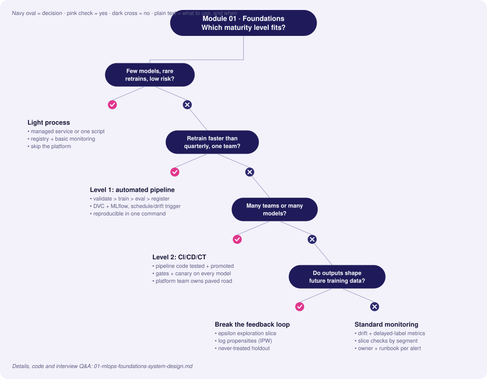
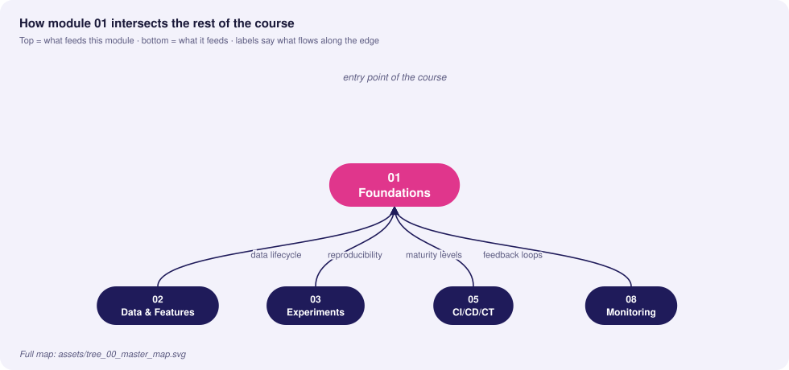
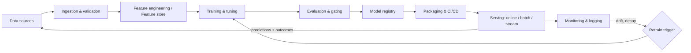

# 01 · MLOps Foundations & System Design

> **Goal:** understand *why* ML systems fail in production differently from ordinary software, and be able to design the lifecycle, spot technical debt, and place any team on a maturity ladder.

### 🌳 Decision Tree: which component, and when?



### 🔗 How this module intersects the others



> Full course map: [assets/tree_00_master_map.svg](../assets/tree_00_master_map.svg)


**Contents**
1. [First principles: three lifecycles](#1-first-principles-three-lifecycles)
2. [Anatomy of a production ML system](#2-anatomy-of-a-production-ml-system)
3. [Hidden technical debt in ML](#3-hidden-technical-debt-in-ml)
4. [MLOps maturity levels](#4-mlops-maturity-levels)
5. [Hands-on: reproducible pipeline skeleton](#5-hands-on-reproducible-pipeline-skeleton)
6. [Edge cases & production failures](#6-edge-cases--production-failures)
7. [Senior interview questions & answers](#7-senior-interview-questions--answers)
8. [Tips, Tricks & Field Notes](#8-tips-tricks--field-notes)
9. [Worked Scenario: Notebook-to-prod takes 3 months](#9-worked-scenario-notebook-to-prod-takes-3-months)
10. [More Interview Questions](#10-more-interview-questions)
11. [Where This Module Connects](#11-where-this-module-connects)
12. [Interview Playbook: Tips & Tricks](#12-interview-playbook-tips--tricks)
13. [Scenario-Based Evaluation](#13-scenario-based-evaluation)
14. [Rapid-Fire Round](#14-rapid-fire-round)
- [1.15 ML Problem Framing, Baselines and Feasibility](#115-ml-problem-framing-baselines-and-feasibility)
- [1.16 Offline vs Online Metrics and Metric Hierarchies](#116-offline-vs-online-metrics-and-metric-hierarchies)
- [1.17 Ownership, SLOs and the Operating Model for ML Systems](#117-ownership-slos-and-the-operating-model-for-ml-systems)

---

## 1. First principles: three lifecycles

Traditional software has one artifact that changes behaviour: **code**. An ML system has three, and each changes on its own clock.

| Lifecycle | Artifact | Changes because… | Versioned with | Tested with | Typical failure |
|---|---|---|---|---|---|
| **Code** | Training/serving source, configs | Feature work, refactors | Git | Unit/integration tests | Bug, bad merge |
| **Data** | Raw data, labels, features | The world changes, upstream schema change, new sources | DVC / lakeFS / Delta snapshots | Validation (schema, distribution) | Silent drift, null floods |
| **Model** | Weights + preprocessing + signature | Retraining, new hyperparameters | Model registry (MLflow) | Offline eval, slice eval, shadow | Regression on a segment, staleness |

**Key insight:** a deployed model is a *function of (code, data, config, random seed, environment)*. If you cannot pin all five, you cannot reproduce, debug, or audit it.

```
          ┌─────────┐   ┌──────────┐   ┌─────────┐
 Git ───▶ │  Code   │   │   Data   │   │  Model  │
          └────┬────┘   └────┬─────┘   └────┬────┘
               │             │              │
               └──────┬──────┴──────┬───────┘
                      ▼             ▼
                 Training run ──▶ Registered model version
                 (params, env)      (lineage: git SHA + data hash + run id)
```

### Why ML breaks differently
- **Behaviour is learned, not written.** There is no stack trace for "the model got worse on Android users".
- **Failures are silent.** A pipeline can return HTTP 200 with garbage predictions.
- **Data is a dependency you do not control.** Upstream teams change columns without telling you.
- **Training/serving skew.** Two code paths computing "the same" feature drift apart.
- **Feedback loops.** Model outputs change future training data.

## 2. Anatomy of a production ML system

The model code is typically < 5% of the system. Everything else is the platform around it.



| Component | Responsibility | Common tools |
|---|---|---|
| Ingestion/validation | Contract enforcement on inputs | Great Expectations, Pydantic, dbt tests |
| Feature store | Single feature definition, point-in-time correctness | Feast, Tecton, Databricks FS |
| Orchestration | DAGs, retries, backfills | Airflow, Argo, Kubeflow, Dagster |
| Tracking/registry | Runs, versions, stages/aliases | MLflow, W&B |
| Serving | Low-latency inference, batching | FastAPI, Triton, TorchServe, KServe |
| Monitoring | System + model health | Prometheus, Grafana, Evidently |

## 3. Hidden technical debt in ML

ML adds *system-level* debt on top of code debt, because model behaviour depends on data and on other models.

| Debt pattern | What it looks like | Why it hurts | Mitigation |
|---|---|---|---|
| **Entanglement (CACE: Changing Anything Changes Everything)** | Adding/removing one feature shifts weights for all others | Cannot make isolated improvements | Feature ablation tests, regularisation, per-feature monitoring, modular ensembles |
| **Hidden feedback loops** | Recommender trained on clicks it itself caused | Model reinforces its own bias; metric inflation | Exploration traffic (ε-greedy), holdout populations, counterfactual logging (log propensity) |
| **Undeclared consumers** | Another team silently reads your model's output | Retraining changes their behaviour | Access via versioned API only, consumer registry, contracts |
| **Data dependencies (unstable)** | Feature comes from another model that is retrained | Upstream shift becomes your drift | Pin versions, snapshot upstream outputs, alert on upstream changes |
| **Glue code** | 95% of code adapts library A to B | Hard to swap libs | Native interfaces, thin wrappers, own the schema |
| **Pipeline jungles** | Ad-hoc joins/scrapes accumulate | Untestable, unowned | Treat data prep as first-class pipeline with tests |
| **Dead experimental code paths** | `if EXPERIMENT_7:` branches in prod | Combinatorial testing explosion | Delete after decision; config flags with expiry |
| **Configuration debt** | Hundreds of unreviewed knobs | Mistakes ship unnoticed | Typed, versioned, reviewed config; diff in PRs |
| **Training/serving skew** | Different code computing the feature | Offline great, online bad | Shared feature definitions, log serving features and replay |
| **Prediction-as-label leakage** | Feature includes future/derived info | Great offline, useless online | Point-in-time joins, leakage review |

### Hidden feedback loop — worked example
A loan model denies applicants with low income. Denied applicants never have repayment outcomes, so future training data only contains *approved* people (selection bias). The model becomes confident about a shrinking region of feature space.

```python
# Counterfactual logging: record the propensity of every decision so
# future training can re-weight (inverse propensity weighting).
import random, json, time

def decide(score: float, epsilon: float = 0.05) -> dict:
    """Approve if score>0.5, but explore with probability epsilon."""
    greedy = score > 0.5
    explore = random.random() < epsilon
    decision = (not greedy) if explore else greedy
    # probability that THIS decision was chosen under the policy
    p_decision = (1 - epsilon) if decision == greedy else epsilon
    record = {"ts": time.time(), "score": score, "decision": decision,
              "propensity": p_decision, "explored": explore}
    print(json.dumps(record))  # ship to the event log, not stdout, in prod
    return record
```

Training later weights each row by `1 / propensity`, which un-biases the estimate.

## 4. MLOps maturity levels

| | **Level 0 — Manual** | **Level 1 — Automated pipeline (CT)** | **Level 2 — CI/CD/CT automation** |
|---|---|---|---|
| Process | Notebooks, hand-offs | Orchestrated pipeline, modular components | Pipeline itself is built/tested/deployed by CI |
| Training | Ad hoc, data scientist laptop | Triggered by schedule/data/drift | Triggered + pipeline code versioned & promoted across envs |
| Deploy | Manually copy a pickle | Pipeline deploys prediction service | Automated staged rollout with gates |
| Reproducibility | Low | Medium (data+code pinned) | High (everything as code) |
| Monitoring | None / manual | Basic metrics, drift alerts | Closed loop: drift → retrain → eval → canary |
| Release cadence | Months | Weeks / continuous training | Days → hours |
| Team shape | DS ⟂ Eng silos | Shared ownership of pipeline | Platform team + product ML teams |

```
Level 0:  Notebook ──(email model.pkl)──▶ Engineer ──▶ Prod
Level 1:  Trigger ─▶ [Validate ▶ Train ▶ Eval ▶ Register] ─▶ Auto-deploy model
Level 2:  PR ─▶ CI(test pipeline code) ─▶ CD(deploy pipeline) ─▶ CT runs ─▶ Canary ─▶ Prod
```

**Upgrade rules of thumb**
- Moving 0→1 buys *reproducibility and speed of retraining*; do it when models need refreshing more than quarterly.
- Moving 1→2 buys *safe change of the pipeline itself*; do it when several teams or many models share infrastructure.
- Do **not** build Level 2 for a single model retrained annually. Cost of platform > value.

## 5. Hands-on: reproducible pipeline skeleton

A minimal Level-1 pipeline: `dvc.yaml` stages, parameters, and a training script that records lineage.

`params.yaml`
```yaml
data:
  raw_path: data/raw/transactions.csv
  test_size: 0.2
  seed: 42
train:
  n_estimators: 300
  max_depth: 8
```

`dvc.yaml`
```yaml
stages:
  validate:
    cmd: python src/validate.py data/raw/transactions.csv
    deps: [src/validate.py, data/raw/transactions.csv]
  train:
    cmd: python src/train.py
    deps: [src/train.py, data/raw/transactions.csv]
    params: [data, train]
    outs: [artifacts/model.joblib]
    metrics:
      - artifacts/metrics.json:
          cache: false
```

`src/train.py`
```python
"""Train a classifier and record full lineage so the run can be reproduced."""
import json, subprocess, hashlib
from pathlib import Path

import joblib
import pandas as pd
import yaml
from sklearn.ensemble import RandomForestClassifier
from sklearn.metrics import roc_auc_score, average_precision_score
from sklearn.model_selection import train_test_split


def sha256_file(path: str) -> str:
    h = hashlib.sha256()
    with open(path, "rb") as f:
        for chunk in iter(lambda: f.read(1 << 20), b""):
            h.update(chunk)
    return h.hexdigest()


def git_sha() -> str:
    return subprocess.check_output(["git", "rev-parse", "HEAD"], text=True).strip()


def main() -> None:
    params = yaml.safe_load(Path("params.yaml").read_text())
    d, t = params["data"], params["train"]

    df = pd.read_csv(d["raw_path"])
    X, y = df.drop(columns=["label"]), df["label"]
    X_tr, X_te, y_tr, y_te = train_test_split(
        X, y, test_size=d["test_size"], random_state=d["seed"], stratify=y
    )

    model = RandomForestClassifier(
        n_estimators=t["n_estimators"], max_depth=t["max_depth"],
        random_state=d["seed"], n_jobs=-1,
    ).fit(X_tr, y_tr)

    proba = model.predict_proba(X_te)[:, 1]
    metrics = {
        "roc_auc": float(roc_auc_score(y_te, proba)),
        "pr_auc": float(average_precision_score(y_te, proba)),
        "lineage": {
            "git_sha": git_sha(),
            "data_sha256": sha256_file(d["raw_path"]),
            "params": params,
        },
    }
    Path("artifacts").mkdir(exist_ok=True)
    joblib.dump(model, "artifacts/model.joblib")
    Path("artifacts/metrics.json").write_text(json.dumps(metrics, indent=2))


if __name__ == "__main__":
    main()
```

Run: `dvc repro` — only stages with changed deps/params re-execute.

## 6. Edge cases & production failures

| Failure | Root cause | Detection | Mitigation |
|---|---|---|---|
| **Silent accuracy decay** after a holiday | Seasonality; training window excluded the event | Slice metrics by time; PSI on key features | Include seasonal windows; retrain schedule aligned with calendar |
| **"Same" feature differs online** | Pandas in training vs SQL/Java in serving; timezone and rounding | Log served features, compare to offline recompute | Single feature definition (feature store) or shared library |
| **Label leakage discovered post-launch** | Feature computed from post-event data | Suspiciously high AUC (> 0.99); feature importance dominated by one column | Point-in-time joins; leakage review checklist |
| **Retrain makes model worse** | Corrupt upstream batch accepted | Eval gate vs. champion absent | Validation + champion/challenger gate on frozen holdout *and* recent slice |
| **Non-reproducible model** | Unpinned dependency, GPU non-determinism, un-versioned data | Rerun produces ΔAUC > tolerance | Lockfiles, container digest, seeds, data hashes; accept bounded nondeterminism |
| **Feedback loop collapse** | Model trains on its own outputs | Narrowing prediction diversity | Exploration traffic, holdout, human labels |

**Post-mortem template (use in interviews):** Impact → Timeline → Detection gap (why we did not see it) → Root cause (5 whys) → Fix → Preventive control (test/alert/gate) → Owner.

## 7. Senior interview questions & answers

**Q1. Explain the difference between DevOps and MLOps.**
- ❌ *Trap:* "MLOps is DevOps for models; you just containerize the model and deploy."
- ✅ *Staff:* DevOps manages one changing artifact (code). MLOps manages three (code, data, model) with independent change clocks, and the failure mode shifts from loud (exceptions) to silent (degraded predictions with HTTP 200). That adds data validation, experiment lineage, evaluation gating, drift monitoring and continuous training to the CI/CD baseline. Success metrics also change: besides latency/availability we track business and model-quality SLOs with delayed labels.

**Q2. A model's offline AUC is 0.91 but online conversion didn't improve. Walk me through diagnosis.**
- ❌ *Trap:* "Retrain with more data / tune hyperparameters."
- ✅ *Staff:* Split into hypotheses: (1) *skew* — replay logged serving features through offline path and diff; (2) *leakage* — check feature timestamps vs prediction time; (3) *metric mismatch* — AUC ≠ business objective, check calibration and top-k precision at the operating threshold; (4) *population shift* — compare traffic vs training distribution (PSI); (5) *experiment validity* — SRM check, power, novelty effect; (6) *feedback loop / UX* — maybe the action taken on the score is the bottleneck. Instrument first, then change the model.

**Q3. What is a hidden feedback loop? Give a mitigation.**
- ❌ *Trap:* "When the model overfits to training data."
- ✅ *Staff:* When model outputs influence the data it is later trained on (recommendations → clicks → training labels, loan denials → missing outcomes). It causes selection bias and metric inflation. Mitigations: randomised exploration slice with logged propensities for inverse-propensity weighting, a never-treated holdout group, and evaluation against holdout rather than on model-influenced data.

**Q4. Our team has a notebook-to-prod process taking 3 months. What do you do first?**
- ❌ *Trap:* "Adopt Kubeflow."
- ✅ *Staff:* Measure the lead-time breakdown first. Usually the biggest wins are cheap: containerised, pinned training env; a single `train` entrypoint driven by params; DVC/data snapshot; a registry with an eval gate; a serving template. That's Level 1 in weeks. Only then introduce orchestration/CT, and Level 2 once multiple teams require shared pipelines. Tool choice follows pain, not the reverse.

**Q5. How do you decide the retraining cadence?**
- ❌ *Trap:* "Retrain every night, more fresh data is better."
- ✅ *Staff:* Derive it from the *decay curve*: measure performance degradation vs. model age (backtests with time-sliced models). Pick cadence where marginal accuracy regained > cost (compute + risk + review). Add drift/metric triggers as a safety net, not only a cron. Nightly retraining without gates increases the chance of ingesting a bad batch automatically.

**Q6. What does "training/serving skew" mean and how do you prevent it?**
- ❌ *Trap:* "Different data in train and test."
- ✅ *Staff:* The feature value at serve time differs from what training saw for the same entity/time due to different code paths, data freshness, or point-in-time errors. Prevent: one feature definition (feature store, shared transformation library or in-graph preprocessing exported with the model), serve-time feature logging, and a scheduled skew job comparing logged vs. recomputed features with alerts.

**Q7. When would you NOT build a full MLOps platform?**
- ❌ *Trap:* "Always — best practice."
- ✅ *Staff:* One or two models, retrained rarely, low blast radius: managed services or a simple scripted pipeline with a registry and monitoring suffice. A platform has fixed maintenance cost and needs a team. Build it when the number of models/teams × change frequency makes ad hoc processes the bottleneck or the risk.

**Q8. Define the maturity-level jump from 1 to 2 in terms of outcomes.**
- ❌ *Trap:* "Level 2 is when you use GitHub Actions."
- ✅ *Staff:* Level 1 automates *running* the pipeline; Level 2 automates *changing* it. Pipeline code is tested (unit tests on components, data contract tests, integration run on a sample), built into versioned images, promoted dev→staging→prod, and a retrained model goes through automated gates and progressive delivery. Outcome metrics: lead time for pipeline changes, change-failure rate, MTTR for bad models.


<!-- appendix:start -->

## 8. Tips, Tricks & Field Notes

1. Draw the lifecycle (code, data, model) on a whiteboard before touching any tool; interviewers watch for it.
2. Say 'three artifacts, three clocks' early: it signals you understand why ML breaks differently from software.
3. Quote maturity levels as outcomes (lead time, change-failure rate), not tool names.
4. Always name the feedback loop in a recommender or lending design, then name its mitigation.
5. Keep a one-line post-mortem template in memory: impact, timeline, detection gap, root cause, fix, prevention.
6. When asked 'should we build a platform?', answer with cost of platform versus cost of ad-hoc process.

## 9. Worked Scenario: Notebook-to-prod takes 3 months

**Situation.** A churn model lives in one notebook. Retrains need a data scientist's laptop and a hand-off email.

**Steps**

1. Measure the lead-time breakdown (data pull, training, review, deploy).
2. Containerize the env and create a single `train` entrypoint driven by params.yaml.
3. Add DVC for data, MLflow for runs, and an eval gate before registering.
4. Add a serving template and a drift alert; stop there until pain justifies Level 2.

**Outcome.** Lead time drops from months to days; retraining becomes a command, not a project.

## 10. More Interview Questions

**Q9. Why can't a team just 'do DevOps' for ML?**
- ❌ *Trap:* ML is just another service, so CI/CD is enough.
- ✅ *Staff:* The deployable behaviour depends on data and training too. Add data validation, lineage, eval gating and drift monitoring on top of CI/CD.

**Q10. How do you spot entanglement debt?**
- ❌ *Trap:* Look for messy code.
- ✅ *Staff:* Ablate or perturb one feature and watch unrelated predictions shift (CACE); track per-feature importance stability and keep features modular.

**Q11. Give a Level 2 success metric.**
- ❌ *Trap:* Number of pipelines.
- ✅ *Staff:* Lead time for pipeline changes, change-failure rate, MTTR for a bad model, and percent of retrains promoted automatically vs rejected by gates.

## 11. Where This Module Connects

| Direction | Module | What flows |
|---|---|---|
| ⬆ Fed by | none | entry point of the course |
| ⬇ Feeds | [02 Data & Features](02_data_engineering_feature_stores.md) | data lifecycle |
| ⬇ Feeds | [03 Experiments](03_experiment_tracking_model_versioning.md) | reproducibility |
| ⬇ Feeds | [05 CI/CD/CT](05_cicd_ct_automation_pipelines.md) | maturity levels |
| ⬇ Feeds | [08 Monitoring](08_monitoring_observability_alerting.md) | feedback loops |


<!-- appendix:end -->

<!-- deep:start -->

## 12. Interview Playbook: Tips & Tricks

1. Open every design answer with the lifecycle: data, code, model, and which one is changing in this problem.
2. Use the word 'blast radius' when choosing process weight; it shows you scale controls to risk.
3. When asked about debt, name one concrete example from your own work, not a textbook definition.
4. Pair every problem you raise with a detection signal and an owner; interviewers score 'how would you know'.
5. Avoid tool lists in the first two minutes. Principles first, tools as examples.
6. If you don't know a number, estimate it out loud and state your assumption; silence costs more than a rough guess.

## 13. Scenario-Based Evaluation

Each scenario shows what the interviewer is really testing, the answer that loses points, and the answer that earns them.

### Scenario 1: Inherited a Level 0 team

**Situation.** You join a team where a data scientist emails a pickle to an engineer every release. Leadership wants 'MLOps' in a quarter.

**What is being evaluated.** Prioritisation, scoping, pragmatism over platform-building.

- ❌ **Weak answer:** Propose adopting Kubeflow, a feature store and a registry at once.
- ✅ **Strong answer:**
  1. Baseline: time from idea to production, incidents, reproducibility rate.
  2. Month 1: containerised env, single train entrypoint, DVC + MLflow, one eval gate.
  3. Month 2: serving template, health checks, drift alert, rollback runbook.
  4. Month 3: CI for pipeline code, scheduled retrain; revisit platform only if multiple teams hit the same wall.

**Likely follow-up:** *Which of these would you cut if you only had two weeks?*

### Scenario 2: Recommender metric inflation

**Situation.** CTR rose 15% over six months but revenue per user is flat. The model is retrained weekly on clicks.

**What is being evaluated.** Recognising hidden feedback loops and metric gaming.

- ❌ **Weak answer:** Say the model is improving and tune more.
- ✅ **Strong answer:**
  1. Hypothesis: model shows what it already knows users click, narrowing exposure.
  2. Check diversity, catalogue coverage and holdout-group revenue.
  3. Add exploration traffic with logged propensities; train with inverse-propensity weights.
  4. Evaluate on a never-personalised holdout and optimise for long-term value, not clicks.

**Likely follow-up:** *How big should the exploration slice be and who pays for it?*

### Scenario 3: Two teams, one dataset

**Situation.** Team A's model degrades after Team B 'cleans' a shared table. No one was told.

**What is being evaluated.** Data dependencies, contracts, undeclared consumers.

- ❌ **Weak answer:** Ask teams to communicate more.
- ✅ **Strong answer:**
  1. Introduce a data contract with owner, schema and SLA.
  2. Consumer registry via lineage so changes notify downstream owners.
  3. CI on the producer that runs downstream contract tests.
  4. Versioned tables for breaking changes with a deprecation window.

**Likely follow-up:** *How do you enforce this without slowing Team B?*

### Scenario 4: Justify a platform investment

**Situation.** Finance asks why you need three engineers for an ML platform when models already ship.

**What is being evaluated.** Business framing and measurable outcomes.

- ❌ **Weak answer:** Say it is best practice.
- ✅ **Strong answer:**
  1. Quantify current cost: lead time, incidents, duplicated work, idle GPU.
  2. Define target metrics: lead time, change-failure rate, MTTR, percent models with monitoring.
  3. Stage investment; show a paved road for one team first.
  4. Agree on a kill criterion if metrics don't move.

**Likely follow-up:** *What would make you say the platform was not worth it?*

## 14. Rapid-Fire Round

| Question | One-line answer |
|---|---|
| What are the three lifecycles? | Code, data and model, each versioned and changing on its own clock. |
| Define training/serving skew. | Same feature computed differently at train and serve time. |
| What is CACE? | Changing anything changes everything: entanglement of features. |
| Level 1 in one line? | Automated pipeline that retrains and registers without a human running steps. |
| Level 2 in one line? | Automated CI/CD of the pipeline itself plus gated promotion. |
| Silent failure meaning? | HTTP 200 with degraded predictions and no exception. |
| Fix for hidden feedback loops? | Exploration slice, logged propensities, never-treated holdout. |
| One metric for delivery health? | Lead time from change to production model. |
## 1.15 ML Problem Framing, Baselines and Feasibility

### Conceptual Deep Dive
Framing is the cheapest place to fail and the most expensive place to be wrong. Start decision-first: name the **decision**, the **actor** (a person, a service, an automated policy), the **action** taken on a prediction, and the **cost of a false positive versus a false negative**. If no action changes with the prediction, there is no ML product, only a dashboard. The target definition then fixes everything downstream: "churn within 30 days" versus "ever churns" changes the labels, the label delay, the leakage surface and the base rate. Pick the task type (classification, ranking, regression, forecasting, anomaly detection, generation) from the decision, not from the available library.

A **feasibility checklist** keeps the project honest: the signal exists in data *at prediction time*; labels are obtainable and affordable; volume suffices for the chosen model family; latency and freshness targets are reachable; and each feature has a legal basis (see Module 10 (legacy) and 10.15). Then climb the **baseline ladder**: majority class or constant, a business rule, a heuristic, a linear model or GBDT, and only then a deep model. Record each rung's metric *and* ops cost (build effort, serving cost, monitoring burden), so the uplift of the next rung is explicit and defensible.

Define success as one primary business metric, one ML proxy and two guardrails, and write down how the proxy-to-business link will be validated online (see 1.16 and 7.17). Know when **not** to use ML: stable deterministic rules, tiny data, a mandate for simple explainable logic, or no feedback signal to learn from. The test is arithmetic: best-case uplift times volume times value per decision must exceed build plus run cost (rule of thumb: count on-call and retraining, usually the larger half).

| Rung | Cost to build | Cost to run | What it proves |
|---|---|---|---|
| Majority or rule | hours | near zero | whether a model is needed at all |
| GBDT or linear | days | low | whether features carry signal |
| Deep model | weeks | high | whether complexity pays for itself |

Edge cases: a target defined with future information (the label window overlaps the feature window) gives offline numbers that cannot exist in production; **selection bias** when labels exist only for acted-on cases (loans approved, transactions not declined), which needs propensity-style correction or exploration traffic (see Module 01 section 3 (legacy) on feedback loops); and a metric that moves when the product changes but not when the model changes, which makes the model unmeasurable.

### Cross-Connection Scenarios
- Label windows and delayed outcomes continue in 2.16 and the leakage tests in 13.2.
- The proxy-to-business link is validated online in 7.17.
- Baseline metrics become the champion floors used in 13.3.
- The cost matrix returns as the alert-cost trade-off in 8.17.

### Production Anti-Patterns
- Choosing the model before defining the decision: the team ships a high-AUC score nobody can act on, and the build cost is sunk.
- Skipping the rules or heuristic baseline: the uplift of ML is unknowable, so a model adding 0.2% over a three-line rule survives and costs a permanent on-call rotation.
- Defining success only as offline AUC: the model "wins" yet moves no business metric, and nobody can say whether to roll it back.

### Minimal Working Code
A baseline ladder on synthetic data prints precision, recall and cost per 1k decisions for each rung, using an illustrative cost matrix (a false negative costs 10x a false positive).

```python
import numpy as np
rng = np.random.default_rng(0)
n = 4000
X = rng.normal(size=(n, 3))
y = (rng.random(n) < 1 / (1 + np.exp(-(1.2 * X[:, 0] + 0.8 * X[:, 1] - 2.2)))).astype(int)
Xtr, ytr, Xte, yte = X[:3000], y[:3000], X[3000:], y[3000:]
C_FP, C_FN = 5.0, 50.0                      # illustrative costs per wrong decision

def fit(X, y, steps=400, lr=0.3):
    Xb = np.c_[np.ones(len(X)), X]; w = np.zeros(Xb.shape[1])
    for _ in range(steps):
        w -= lr * Xb.T @ (1 / (1 + np.exp(-Xb @ w)) - y) / len(y)
    return w

def proba(w, X):
    return 1 / (1 + np.exp(-(np.c_[np.ones(len(X)), X] @ w)))

def row(name, pred, run_cost):
    tp = int(((pred == 1) & (yte == 1)).sum()); fp = int(((pred == 1) & (yte == 0)).sum())
    fn = int(((pred == 0) & (yte == 1)).sum())
    err = 1000 * (C_FP * fp + C_FN * fn) / len(yte)
    print(f"{name:9s} prec={tp / max(tp + fp, 1):.2f} rec={tp / max(tp + fn, 1):.2f} "
          f"err/1k={err:6.0f} run/1k={run_cost:4.1f} total={err + run_cost:6.0f}")

w = fit(Xtr, ytr)
row("majority", np.zeros(len(yte), int), 0.0)
row("rule", (Xte[:, 0] > 1.0).astype(int), 0.1)                           # run costs are made up
row("logreg", (proba(w, Xte) >= C_FP / (C_FP + C_FN)).astype(int), 2.0)
```

With calibrated probabilities the cost-optimal threshold is the cost ratio, and the scan below confirms it and shows the threshold falling when a false negative gets twice as expensive.

```python
import numpy as np
rng = np.random.default_rng(1)
p = rng.beta(0.6, 4.0, size=20000)        # calibrated by construction: y ~ Bernoulli(p)

def expected_cost(p, t, c_fp, c_fn):
    """Expected cost per 1k decisions when flagging every item with p >= t."""
    return 1000 * np.where(p >= t, (1 - p) * c_fp, p * c_fn).mean()

def best_threshold(p, c_fp, c_fn):
    grid = np.linspace(0.01, 0.99, 197)
    costs = [expected_cost(p, t, c_fp, c_fn) for t in grid]
    return float(grid[int(np.argmin(costs))]), min(costs)

for c_fn in (50.0, 100.0):
    t, c = best_threshold(p, 5.0, c_fn)
    print(f"C_FN={c_fn:5.0f} best t={t:.3f} analytic={5.0 / (5.0 + c_fn):.3f} cost/1k={c:.0f}")
assert best_threshold(p, 5.0, 100.0)[0] < best_threshold(p, 5.0, 50.0)[0]
```

### Interview Angle
**Q:** A PM asks for "a churn model". What do you ask before writing code?
**A:** Which decision and action follow a score (discount, call, nothing), who acts, and what a wasted action versus a missed churner costs. Then the label definition (churn within 30 days of what event), the label delay, the current non-ML baseline and the success metric with guardrails. Trade-off: five days of framing delays a prototype but prevents building a score no team can use. Measurable check: the decision table has a cost matrix and a baseline number before any training run.

**Q:** How do you decide a model is not worth building?
**A:** Compute best-case uplift over the strongest cheap baseline, times decision volume, times value per decision, and compare it with build plus yearly run cost including on-call and retraining. If the ratio is below roughly 2-3 (rule of thumb, because uplift estimates are optimistic), stay with the rule. Trade-off: ML's option value versus certain maintenance cost. Check it by running the rule baseline on real data first; if it captures most of the gain, stop.

## 1.16 Offline vs Online Metrics and Metric Hierarchies

### Conceptual Deep Dive
A **metric hierarchy** has four levels: the business KPI (revenue, loss rate), the product metric (conversion, time to resolution), the model metric (NDCG, PR-AUC) and the system metric (latency, freshness). Each level needs an owner, a review cadence and a known **lag**; a KPI that matures in 90 days cannot gate a daily deploy, so a faster proxy must stand in for it, and the proxy-to-KPI link must be re-validated, not assumed.

Offline wins fail to transfer for predictable reasons: logged data came from the old policy, so the distribution differs from live traffic; the model's own outputs change user behaviour (feedback effects, see Module 01 section 3 (legacy)); **position bias** inflates the clicks on whatever was shown first; the offline metric simply is not the product metric; and **exposure dilution** shrinks a real effect when only part of the traffic can see the change.

Choose offline metrics by task. Ranking: NDCG for graded relevance, MAP, recall@k when a later stage reranks. Classification: PR-AUC and precision at a fixed recall or FPR rather than accuracy on rare events. Regression: MAE targets the median and is robust, RMSE punishes large errors, quantile (pinball) loss serves interval or inventory problems. Calibration: Brier score and expected calibration error (ECE), because downstream thresholds and cost calculations assume probabilities mean something. Counterfactual evaluation (inverse propensity scoring, IPS) estimates a new policy from logged data given the logging propensities; it is high-variance when propensities are small. This chapter only previews it; the full treatment is in 7.17 and 7.18.

Pair a **north star with tripwires**: one primary metric and guardrails (latency, complaint rate, a protected-slice metric) that block a launch regardless of the north star. Goodhart's law applies: once a proxy is the target it decouples from the KPI, so rotate or audit proxies. For delayed outcomes, report **matured cohorts** (only users old enough that the label is final) and evaluate time-forward, never on a random split of the same period.

Edge cases: averaging per-user metrics gives a different answer from per-event metrics when heavy users dominate events; computing on deduplicated versus raw logs changes both numerator and denominator; and Simpson's paradox appears when a mix shift across traffic segments reverses the aggregate trend, so always slice.

### Cross-Connection Scenarios
- Offline-to-online gaps are diagnosed with the experiment design in 7.17 and 7.18.
- Metric lag determines which monitors can exist, see 8.16 for estimating performance without labels.
- Slice-level floors for these metrics are tested in 13.5.
- Calibration tests are in 13.3.

### Production Anti-Patterns
- Reporting one aggregate metric with no slices or intervals: a cohort collapses behind a flat average and the regression is found by customers.
- Optimising a proxy until it decouples from the KPI: clicks rise while retention falls, and the team celebrates for two quarters.
- Comparing offline numbers computed on different splits or dedup rules: a "3% improvement" is only a different test set.

### Minimal Working Code
Two rankers swap order depending on whether the metric is NDCG@3 or recall@3, which is why the metric must follow the decision.

```python
import numpy as np
rel = np.array([3, 0, 0, 2, 1, 0, 1, 0, 0, 2])          # graded relevance per item id

def dcg(r):
    r = np.asarray(r)
    return float(((2.0 ** r - 1) / np.log2(np.arange(2, len(r) + 2))).sum())

def ndcg_at_k(ranking, k):
    return dcg(rel[ranking[:k]]) / dcg(np.sort(rel)[::-1][:k])

def recall_at_k(ranking, k):
    return float((rel[ranking[:k]] > 0).sum() / (rel > 0).sum())

models = {"A": [0, 1, 2, 3, 4, 5, 6, 7, 8, 9], "B": [3, 9, 4, 0, 1, 2, 5, 6, 7, 8]}
k = 3
for name, ranking in models.items():
    print(name, f"NDCG@{k}={ndcg_at_k(ranking, k):.3f}", f"recall@{k}={recall_at_k(ranking, k):.3f}")
assert ndcg_at_k(models["A"], k) > ndcg_at_k(models["B"], k)
assert recall_at_k(models["B"], k) > recall_at_k(models["A"], k)
```

A metric tree records owner, lag and alert threshold per metric, and answers which metrics cannot yet judge a fresh deploy.

```python
from dataclasses import dataclass
from typing import Optional

@dataclass(frozen=True)
class Metric:
    name: str
    level: str                      # kpi | product | model | system
    owner: str
    lag_days: int
    alert_below: Optional[float] = None
    parent: Optional[str] = None

TREE = {m.name: m for m in [
    Metric("loss_rate", "kpi", "risk-lead", 90, 0.0),
    Metric("approval_precision_30d", "product", "pm-credit", 30, 0.85, "loss_rate"),
    Metric("pr_auc", "model", "ml-owner", 0, 0.40, "approval_precision_30d"),
    Metric("feature_freshness", "system", "platform", 0, 0.99, "pr_auc"),
]}

def chain(name):
    out = []
    while name:
        out.append(name); name = TREE[name].parent
    return out

def unobservable_after_deploy(days):
    return sorted(m.name for m in TREE.values() if m.lag_days > days)

print(chain("feature_freshness"))
print("blind for 7 days:", unobservable_after_deploy(7))
assert unobservable_after_deploy(7) == ["approval_precision_30d", "loss_rate"]
```

### Interview Angle
**Q:** Offline AUC went up 0.01 but the A/B shows no change. What do you test first?
**A:** (1) The gain is within noise: bootstrap the offline delta. (2) Offline data came from the old policy, so replay or weight it. (3) The metric mismatch: AUC versus the product metric. (4) Exposure dilution or an experiment that was underpowered. (5) The change is concentrated in a slice that is too small to move the aggregate. Each needs a specific artefact: a CI, propensities, the metric definitions, the exposure rate and a per-slice table. Trade-off: an hour of triage versus shipping a null change.

**Q:** Which metric for a rare-event detector, and why not accuracy?
**A:** PR-AUC for ranking quality, plus precision at the recall the business needs (or recall at the analyst-capacity alert budget). At 0.5% prevalence an always-negative model scores 99.5% accuracy. Trade-off: PR-AUC depends on the base rate, so compare only on equal-prevalence data. Measurable check: report the metric on a time-forward matured cohort with a bootstrap interval, and the alert volume per day at the chosen threshold.

## 1.17 Ownership, SLOs and the Operating Model for ML Systems

### Conceptual Deep Dive
A model in production is a service with an unusual failure mode: it keeps answering while quality decays. The operating model exists to make that failure someone's problem. Define who owns what: **data producers** own source schema and freshness, **feature owners** own definitions and backfills, **model owners** own quality and retraining, the **platform** owns runtime and tooling, and **product** owns the decision and the metric. Write a RACI for incidents, retraining, deprecation and feature changes, and put the owner in the model registry record (see Module 04 (legacy)) so reorgs cannot orphan a model.

Quality needs SLOs like everything else, each with a measurable SLI. Service: availability and p99 latency. Data: freshness (share of hourly partitions on time) and completeness. Model: quality on matured cohorts, calibration error, and share of requests answered by a fallback. Process: time-to-rollback and time-to-detect. Compute an error budget per SLO and alert on burn rate (see 8.17), not on a raw threshold. On-call needs a runbook per failure class (data late, drift alarm, serving error, label pipeline broken), escalation paths to data owners, and a severity matrix that includes **silent quality incidents**; a model that is 5 points worse for six weeks is a Sev-2 even though no pager fired.

Model **lifecycle states**: experimental, candidate, production, deprecated, retired. Moving to deprecated requires consumer notification from a consumer registry (lineage, see 3.16) and a fixed window; retirement criteria include no traffic for N days and no consumer. Dead models still cost compute, credentials and risk surface.

The operating cadence makes this routine: a weekly model health review (SLO status, open alerts), a monthly alert-precision review (which alerts were actionable; delete the rest) and a quarterly rollback drill. Team shapes trade autonomy for consistency: embedded DS plus MLE pairs move fast but duplicate tooling; a central platform team standardises but becomes a queue; hub-and-spoke gives a platform with embedded owners. Rule of thumb: embedded below roughly 3-4 model teams, platform plus spokes beyond that, but adopt it on pain, not on headcount.

Edge cases: a model with no owner after a reorg; a shared feature changed by its producer with no consumer registry; and two teams who each believe the other monitors quality.

### Cross-Connection Scenarios
- SLO burn-rate alerting is in 8.17; incident structure is in 11.17 and 11.18.
- Registry ownership fields and lifecycle states connect to 4.15.
- Platform team shapes and golden paths continue in chapter 16.
- Feature ownership and consumer registries are detailed in 2.15.

### Production Anti-Patterns
- Owner means whoever trained it last: after a departure nobody answers the page, and the model degrades until a customer complains.
- SLOs on infrastructure only: dashboards stay green while predictions are wrong for weeks.
- No retirement process: dead models keep consuming GPUs, credentials and audit scope, and nobody dares delete them.

### Minimal Working Code
A model-inventory checker flags missing owners and runbooks and evaluations older than 90 days, using an injected date for determinism.

```python
from datetime import date

TODAY = date(2026, 1, 15)

def check_inventory(models, today=TODAY, max_eval_age_days=90):
    issues = []
    for m in models:
        if not m.get("owner"):
            issues.append((m["name"], "missing owner"))
        if not m.get("runbook_url"):
            issues.append((m["name"], f"missing runbook (tier {m['tier']})"))
        age = (today - date.fromisoformat(m["last_eval_date"])).days
        if age > max_eval_age_days:
            issues.append((m["name"], f"stale eval ({age} days)"))
    return issues

models = [
    {"name": "churn_v3", "owner": "team-growth", "runbook_url": "wiki/churn", "last_eval_date": "2025-12-20", "tier": 2},
    {"name": "fraud_v7", "owner": "", "runbook_url": "wiki/fraud", "last_eval_date": "2025-08-01", "tier": 1},
    {"name": "rank_v2", "owner": "team-search", "runbook_url": None, "last_eval_date": "2025-12-01", "tier": 1},
]
for issue in check_inventory(models):
    print(issue)
assert len(check_inventory(models)) == 3
```

An error-budget calculator turns a data-freshness SLI into budget consumed and burn rate, where a burn rate of 1.0 means the budget is spent exactly at the end of the 28-day window.

```python
def error_budget(on_time, slo=0.99, window_hours=28 * 24):
    """on_time: list of booleans, one per elapsed hourly partition in the window."""
    elapsed, bad = len(on_time), len(on_time) - sum(on_time)
    budget_bad = (1 - slo) * window_hours             # bad partitions allowed in the full window
    return {
        "sli": round(1 - bad / elapsed, 4),
        "budget_consumed": round(bad / budget_bad, 3),
        "burn_rate": round((bad / elapsed) / (1 - slo), 2),
    }

week = [True] * 168
for i in (10, 11, 90, 150):                            # 4 late partitions in the first 7 days
    week[i] = False
r = error_budget(week)
print(r)
assert r["burn_rate"] > 2 and r["budget_consumed"] < 1
```

### Interview Angle
**Q:** A model silently degraded for six weeks. Which organisational controls would have caught it earlier?
**A:** A quality SLO on matured cohorts with burn-rate alerting, a named owner on the registry record, a weekly health review that reads the SLO table, and slice monitors. Also a label pipeline owned by someone, since without labels the SLO is blind (see 8.16 for label-free estimation). Trade-off: more alerts versus fatigue, controlled by the monthly alert-precision review. Measurable check: time-to-detect in a quarterly drill that injects a known degradation, with a target in days, not weeks.

**Q:** Define SLOs for a nightly batch-scoring model and justify each threshold.
**A:** Freshness: scores for 99% of entities available by 06:00 on 28-day windows, set by when consumers read them. Completeness: at least 99.5% of expected entities scored. Quality: AUC on the matured cohort no more than a set margin below the validated value, margin derived from bootstrap noise. Process: rollback within one business day. Trade-off: tighter thresholds raise on-call cost, so derive them from consumer needs, not aspiration. Check each with an SLI query and a historical backtest of how often it would have fired.

<!-- deep:end -->

---
**Next:** [02 · Data Engineering & Feature Stores →](02_data_engineering_feature_stores.md)
