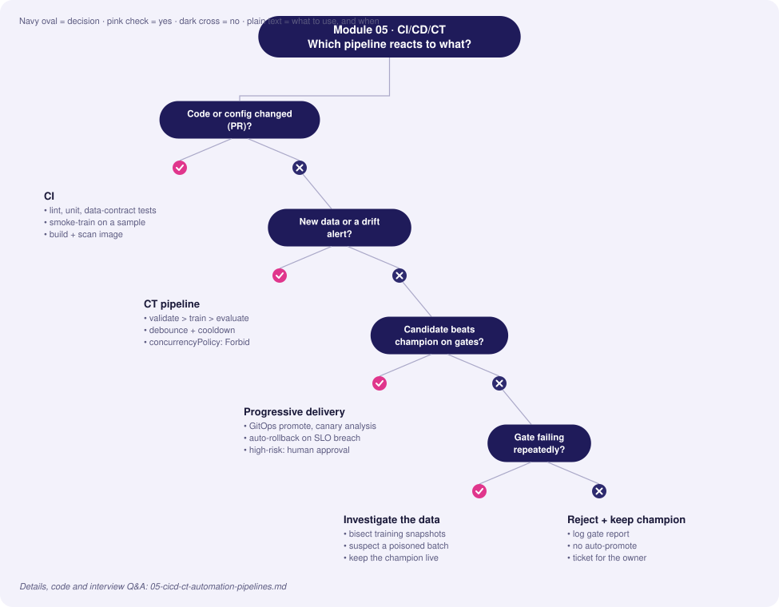
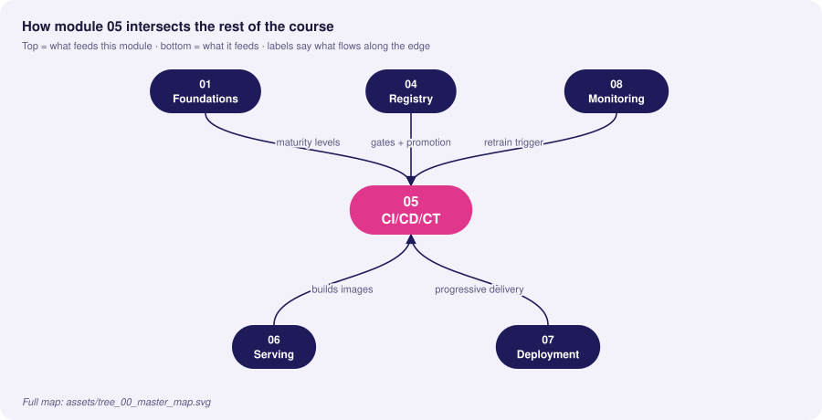
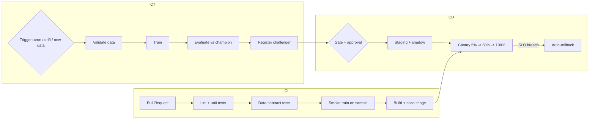

# 05 · CI/CD/CT Automation Pipelines

> **Goal:** automate testing, delivery and *continuous training* so a code change, a data change or a drift signal all lead to a safe, gated, auditable release.

### 🌳 Decision Tree: which component, and when?



### 🔗 How this module intersects the others



> Full course map: [assets/tree_00_master_map.svg](../assets/tree_00_master_map.svg)


**Contents**
1. [CI vs CD vs CT](#1-ci-vs-cd-vs-ct)
2. [What to test in ML](#2-what-to-test-in-ml)
3. [GitHub Actions: CI + build + deploy](#3-github-actions-ci--build--deploy)
4. [Continuous Training with Argo Workflows](#4-continuous-training-with-argo-workflows)
5. [Kubeflow Pipelines (KFP v2)](#5-kubeflow-pipelines-kfp-v2)
6. [Edge cases & production failures](#6-edge-cases--production-failures)
7. [Senior interview questions & answers](#7-senior-interview-questions--answers)
8. [Tips, Tricks & Field Notes](#8-tips-tricks--field-notes)
9. [Worked Scenario: Retrain storm](#9-worked-scenario-retrain-storm)
10. [More Interview Questions](#10-more-interview-questions)
11. [Where This Module Connects](#11-where-this-module-connects)
12. [Interview Playbook: Tips & Tricks](#12-interview-playbook-tips--tricks)
13. [Scenario-Based Evaluation](#13-scenario-based-evaluation)
14. [Rapid-Fire Round](#14-rapid-fire-round)
- [5.15 Orchestrators Compared: Airflow, Dagster, Prefect, Argo and Kubeflow](#515-orchestrators-compared-airflow-dagster-prefect-argo-and-kubeflow)
- [5.16 Idempotent, Backfill-Safe and Cacheable Pipelines](#516-idempotent-backfill-safe-and-cacheable-pipelines)
- [5.17 GitOps, Environments and Supply Chain for ML Delivery](#517-gitops-environments-and-supply-chain-for-ml-delivery)

---

## 1. CI vs CD vs CT

| | Continuous Integration | Continuous Delivery/Deployment | Continuous Training |
|---|---|---|---|
| Trigger | Pull request / push | Merge to main, approved model | Schedule, new data, drift alert, metric decay |
| Verifies | Code, data contracts, pipeline components | Image, deployment, smoke, SLOs | Data validity, new model quality vs champion |
| Output | Test report, built artifact | Running service (progressive rollout) | New registered model version (candidate) |
| Owner | Dev/ML eng | Platform/ML eng | ML eng + data owner |



## 2. What to test in ML

| Layer | Test | Example |
|---|---|---|
| **Code** | Unit tests of transforms | `normalize()` returns expected values on edge input |
| **Data** | Schema, ranges, null rate, leakage | GX suite on new batch |
| **Model** | Invariance & directional tests | Changing name shouldn't change credit score; more income ↑ score |
| **Model** | Min performance, slice floors | AUC ≥ 0.9; no slice below 0.8 |
| **Pipeline** | End-to-end on 1% sample | Runs in < 5 min on every PR |
| **Serving** | Contract test of API; load test | p95 < 50 ms at 200 RPS |
| **Infra** | Manifest lint, policy | `kubeconform`, `conftest`, image scan |

```python
# tests/test_model_behavior.py
import numpy as np, pytest, joblib, pandas as pd

@pytest.fixture(scope="session")
def model():
    return joblib.load("artifacts/model.joblib")

@pytest.fixture(scope="session")
def sample():
    return pd.read_parquet("tests/data/sample.parquet")

def test_no_nan_predictions(model, sample):
    p = model.predict_proba(sample.drop(columns="label"))[:, 1]
    assert np.isfinite(p).all() and ((0 <= p) & (p <= 1)).all()

def test_monotonic_in_income(model, sample):
    """Directional test: higher income must not lower approval probability."""
    base = sample.drop(columns="label").head(200).copy()
    hi = base.copy(); hi["income"] *= 1.5
    assert (model.predict_proba(hi)[:, 1] >= model.predict_proba(base)[:, 1] - 1e-6).mean() > 0.98

def test_invariance_to_user_id(model, sample):
    # Smell check: a raw identifier should not be a model feature at all. This test only guards a legacy
    # pipeline that still passes it; prefer dropping the column from the feature set.
    base = sample.drop(columns="label").head(200).copy()
    alt = base.copy(); alt["user_id"] = alt["user_id"].sample(frac=1, random_state=0).values
    np.testing.assert_allclose(model.predict_proba(base), model.predict_proba(alt), atol=1e-6)

def test_min_performance(model, sample):
    from sklearn.metrics import roc_auc_score
    auc = roc_auc_score(sample["label"], model.predict_proba(sample.drop(columns="label"))[:, 1])
    assert auc >= 0.85   # illustrative floor; in practice derive it from the current champion's AUC minus a tolerance
```

## 3. GitHub Actions: CI + build + deploy

`.github/workflows/ci.yml`
```yaml
name: ci
on:
  pull_request:
    paths: ["src/**", "tests/**", "params.yaml", "dvc.yaml", "Dockerfile", "deploy/**"]
concurrency: { group: "ci-${{ github.ref }}", cancel-in-progress: true }
permissions: { contents: read }

jobs:
  test:
    runs-on: ubuntu-latest
    steps:
      - uses: actions/checkout@v4
      - uses: actions/setup-python@v5
        with: { python-version: "3.11", cache: pip }
      - run: pip install -r requirements.txt -r requirements-dev.txt
      - run: ruff check . && ruff format --check .
      - run: pytest -q --maxfail=1 --cov=src --cov-fail-under=80
      - name: Smoke-train pipeline on sample
        run: python src/train.py --config configs/smoke.yaml
      - name: Validate K8s manifests
        run: |
          curl -sLO https://github.com/yannh/kubeconform/releases/download/v0.6.7/kubeconform-linux-amd64.tar.gz
          echo "REPLACE_WITH_SHA256  kubeconform-linux-amd64.tar.gz" | sha256sum -c -   # verify against the release's published checksums
          tar xzf kubeconform-linux-amd64.tar.gz
          ./kubeconform -strict -summary deploy/k8s/
```

`.github/workflows/cd.yml`
```yaml
name: cd
on:
  push: { branches: [main] }
  workflow_dispatch:           # manual re-run of the same pipeline (no inputs)
permissions: { contents: read, packages: write, id-token: write }

jobs:
  build:
    runs-on: ubuntu-latest
    outputs: { digest: "${{ steps.push.outputs.digest }}" }
    steps:
      - uses: actions/checkout@v4
      - uses: docker/setup-buildx-action@v3
      - uses: docker/login-action@v3
        with: { registry: ghcr.io, username: "${{ github.actor }}", password: "${{ secrets.GITHUB_TOKEN }}" }
      - id: push
        uses: docker/build-push-action@v6
        with:
          context: .
          push: true
          tags: ghcr.io/${{ github.repository }}/fraud-api:${{ github.sha }}
          cache-from: type=gha
          cache-to: type=gha,mode=max
      - name: Scan image
        uses: aquasecurity/trivy-action@REPLACE_WITH_COMMIT_SHA   # pin third-party actions by commit SHA (comment the tag)
        with:
          image-ref: ghcr.io/${{ github.repository }}/fraud-api:${{ github.sha }}
          severity: CRITICAL,HIGH
          exit-code: "1"

  deploy-staging:
    needs: build
    runs-on: ubuntu-latest
    environment: staging
    steps:
      - uses: actions/checkout@v4
      - name: Bump image digest in GitOps repo
        run: |
          curl -sL "https://raw.githubusercontent.com/kubernetes-sigs/kustomize/master/hack/install_kustomize.sh" | bash   # sketch only: pin a release and verify its checksum in real use
          sudo mv kustomize /usr/local/bin/
          git config --global user.name "ci-bot" && git config --global user.email "ci-bot@example.com"
          git clone https://x-access-token:${{ secrets.GITOPS_TOKEN }}@github.com/${{ github.repository_owner }}/gitops.git
          cd gitops/apps/fraud-api/overlays/staging
          kustomize edit set image fraud-api=ghcr.io/${{ github.repository }}/fraud-api@${{ needs.build.outputs.digest }}
          git commit -am "staging: fraud-api ${{ github.sha }}" && git push
      - name: Smoke + shadow gate
        run: python scripts/staging_gate.py --url https://staging.example.com --min-requests 500

  deploy-prod:
    needs: deploy-staging
    runs-on: ubuntu-latest
    environment: production         # required reviewers configured on this environment
    steps:
      - run: echo "Promote via GitOps PR; Argo Rollouts performs the canary"   # placeholder job: a real one opens/merges the prod GitOps PR
```

## 4. Continuous Training with Argo Workflows

A `CronWorkflow` runs the CT DAG nightly; an event (drift alert webhook) can also submit it.

```yaml
apiVersion: argoproj.io/v1alpha1
kind: CronWorkflow
metadata: { name: fraud-ct, namespace: mlops }
spec:
  schedule: "0 2 * * *"
  concurrencyPolicy: Forbid
  workflowSpec:
    entrypoint: ct
    serviceAccountName: ml-pipeline
    arguments:
      parameters:
        - { name: git-ref,  value: main }
        - { name: min-auc-gain, value: "-0.002" }
    templates:
      - name: ct
        dag:
          tasks:
            - { name: validate, template: step, arguments: { parameters: [{ name: cmd, value: "python src/validate.py" }] } }
            - { name: train, dependencies: [validate], template: gpu-step,
                arguments: { parameters: [{ name: cmd, value: "python src/train.py" }] } }
            - { name: evaluate, dependencies: [train], template: eval-step,
                arguments: { parameters: [{ name: cmd, value: "python src/evaluate.py --min-gain {{workflow.parameters.min-auc-gain}}" }] } }
            - { name: register, dependencies: [evaluate], template: step,
                when: "{{tasks.evaluate.outputs.parameters.passed}} == true",
                arguments: { parameters: [{ name: cmd, value: "python scripts/promote.py" }] } }
      - name: step
        inputs: { parameters: [{ name: cmd }] }
        container:
          image: ghcr.io/acme/fraud-train:latest   # pin by digest in real use
          command: [sh, -c]
          args: ["{{inputs.parameters.cmd}}"]
          envFrom: [{ secretRef: { name: mlflow-credentials } }]
        retryStrategy: { limit: 2, retryPolicy: OnError, backoff: { duration: 30s, factor: 2 } }
      - name: eval-step                 # like `step`, but exposes the gate result for the `register` task's `when`
        inputs: { parameters: [{ name: cmd }] }
        container:
          image: ghcr.io/acme/fraud-train:latest   # pin by digest in real use
          command: [sh, -c]
          args: ["{{inputs.parameters.cmd}}"]       # evaluate.py must write `true` or `false` to /tmp/passed.txt
          envFrom: [{ secretRef: { name: mlflow-credentials } }]
        outputs:
          parameters:
            - { name: passed, valueFrom: { path: /tmp/passed.txt } }
      - name: gpu-step
        inputs: { parameters: [{ name: cmd }] }
        nodeSelector: { accelerator: nvidia-a10 }
        tolerations: [{ key: nvidia.com/gpu, operator: Exists, effect: NoSchedule }]
        container:
          image: ghcr.io/acme/fraud-train:latest
          command: [sh, -c]
          args: ["{{inputs.parameters.cmd}}"]
          resources: { limits: { nvidia.com/gpu: 1, memory: 32Gi }, requests: { cpu: "4", memory: 16Gi } }
          envFrom: [{ secretRef: { name: mlflow-credentials } }]
```

Drift-triggered CT: Alertmanager webhook → Argo Events `Sensor` → submit workflow from `WorkflowTemplate`.
```yaml
apiVersion: argoproj.io/v1alpha1
kind: Sensor
metadata: { name: drift-retrain, namespace: mlops }
spec:
  dependencies:
    - { name: drift, eventSourceName: alertmanager, eventName: model-drift }
  triggers:
    - template:
        name: submit-ct
        argoWorkflow:
          operation: submit
          source: { resource: { apiVersion: argoproj.io/v1alpha1, kind: Workflow,
                    metadata: { generateName: fraud-ct-drift- },
                    spec: { workflowTemplateRef: { name: fraud-ct } } } }
```

## 5. Kubeflow Pipelines (KFP v2)

```python
from kfp import dsl, compiler

@dsl.component(base_image="python:3.11", packages_to_install=["pandas", "scikit-learn", "mlflow"])
def train(data_uri: str, n_estimators: int, model_uri: dsl.Output[dsl.Model], auc: dsl.Output[dsl.Metrics]):
    import pandas as pd, joblib
    from sklearn.ensemble import RandomForestClassifier
    from sklearn.metrics import roc_auc_score
    from sklearn.model_selection import train_test_split
    df = pd.read_csv(data_uri); X, y = df.drop(columns="label"), df["label"]
    Xtr, Xte, ytr, yte = train_test_split(X, y, test_size=.2, random_state=1, stratify=y)
    m = RandomForestClassifier(n_estimators=n_estimators, random_state=1).fit(Xtr, ytr)
    auc.log_metric("auc", float(roc_auc_score(yte, m.predict_proba(Xte)[:, 1])))
    joblib.dump(m, model_uri.path)

@dsl.component(base_image="python:3.11")
def gate(auc: dsl.Input[dsl.Metrics], threshold: float) -> bool:
    return auc.metadata["auc"] >= threshold

@dsl.pipeline(name="fraud-ct")
def pipeline(data_uri: str = "s3://data/train.csv", n_estimators: int = 300, threshold: float = 0.9):
    t = train(data_uri=data_uri, n_estimators=n_estimators)
    ok = gate(auc=t.outputs["auc"], threshold=threshold)
    with dsl.If(ok.output == True):   # noqa: E712
        pass  # add register/deploy component here

compiler.Compiler().compile(pipeline, "fraud_ct.yaml")
```

| Orchestrator | Strength | Weakness | Pick when |
|---|---|---|---|
| **GitHub Actions** | Zero infra, great for CI/CD | Not built for long GPU jobs/DAG caching | CI, build, deploy, small CT |
| **Argo Workflows** | K8s native, scalable DAGs, GitOps-friendly | YAML verbosity, learning curve | Existing K8s platform |
| **Kubeflow Pipelines** | Python DSL, ML artifacts/metadata, caching | Heavy install | ML platform team on K8s |
| **Airflow/Dagster** | Rich scheduling/backfills, data ecosystem | Not K8s-native by default | Data-engineering-centric orgs |

## 6. Edge cases & production failures

| Failure | Root cause | Fix |
|---|---|---|
| **CT loop ships worse model** | Auto-promote without champion comparison; poisoned batch | Evaluate vs champion on frozen + recent slices; validation gate before training; manual approval above risk tier |
| **Flaky ML tests block CI** | Non-determinism, tiny datasets | Seed, use tolerances, statistical assertions; quarantine flaky tests with tickets |
| **CI takes 45 min** | Full training on each PR | Smoke-train on sample, cache deps/data, run full train nightly |
| **Retrain storms** | Drift alert flaps → dozens of workflows | `concurrencyPolicy: Forbid`, debounce window, cooldown after each retrain |
| **`latest` tag drift** | Same tag, different image | Pin by digest; sign (cosign) and verify admission |
| **Secrets in logs** | `set -x` echoing tokens | Masked secrets, OIDC to cloud instead of long-lived keys |
| **Pipeline code and model out of sync** | Model trained by old pipeline version | Record pipeline git SHA & image digest in model version tags |
| **Backfill overwrote prod features** | CT job writes into shared online store | Isolated namespaces for training; write-protected prod store |

## 7. Senior interview questions & answers

**Q1. What's different about CI for ML compared to CI for normal software?**
- ❌ *Trap:* "Add pytest to the pipeline."
- ✅ *Staff:* Test three artifacts: code (unit), data (contract/distribution tests), model (behavioural, performance floor, slice checks). Run a fast smoke training on a sample per PR and the full training out-of-band. Cache data and dependencies and handle non-determinism with seeds and tolerance-based assertions.

**Q2. When should retraining be automatic vs human-approved?**
- ❌ *Trap:* "Always automatic—that's the point of MLOps."
- ✅ *Staff:* Tier by blast radius. Low-risk (ranking widgets) can auto-promote after gates and canary. High-risk (credit, safety) trains automatically but stops at a registered challenger awaiting review. Auto-promotion requires: validated data, beating champion by margin on frozen+recent data, slice floors, stable canary, and a cooldown period.

**Q3. Design the trigger logic for CT.**
- ❌ *Trap:* "Retrain daily."
- ✅ *Staff:* Combine (a) schedule as a safety net, (b) data triggers — enough new labelled rows, (c) drift triggers — PSI/prediction drift sustained over N windows, (d) performance triggers — delayed-label metric below SLO. Add debounce/cooldown and a budget cap so a flapping alert can't launch a retrain storm.

**Q4. How do you safely deploy the training pipeline code itself (Level 2)?**
- ❌ *Trap:* "Push to main and the cron picks it up."
- ✅ *Staff:* Pipeline code is versioned, unit-tested per component, integration-tested on a sample, built into an immutable image, and promoted by environment. The CT cron references a pinned pipeline version; a new version runs in staging against shadow data first, comparing outputs with the previous pipeline version.

**Q5. GitHub Actions vs Argo vs Kubeflow — how do you split responsibilities?**
- ❌ *Trap:* "Use one tool for everything."
- ✅ *Staff:* Actions for CI/build/scan/sign and promotion PRs (event-driven, repo-centric). Argo/KFP for long-running, GPU, DAG-heavy CT with retries and artifact passing. The two meet at the registry and GitOps repo: CT registers a challenger; Actions/Argo CD handle delivery.

**Q6. A retrained model passes offline gates but fails in canary. Why, and what do you do?**
- ❌ *Trap:* "The canary was wrong; ship anyway."
- ✅ *Staff:* Offline sets don't capture serving skew, latency, feedback effects, feature freshness or traffic mix. Auto-rollback on SLO breach, then analyse shadow logs: replay features, compare to offline. Add the failing scenario to the offline suite (regression test), and fix the root cause (skew or missing slice).

**Q7. How do you stop a bad batch from poisoning continuous training?**
- ❌ *Trap:* "Trust the data team."
- ✅ *Staff:* Data validation as the first CT task (schema, volume, null rate, label distribution, drift vs previous snapshot) with hard fail + quarantine; train on versioned snapshots; compare challenger vs champion on a frozen golden set so poisoned data shows up as regression; keep the last N snapshots to bisect.

**Q8. What metrics do you track for the delivery process itself?**
- ❌ *Trap:* "Number of deployments."
- ✅ *Staff:* DORA-style metrics adapted to ML: lead time from data/code change to production model, deployment frequency, change-failure rate (rollbacks/incidents), MTTR (time to rollback), plus CT-specific: pipeline success rate, time-to-retrain after drift alert, % retrains auto-promoted vs rejected by gates.


<!-- appendix:start -->

## 8. Tips, Tricks & Field Notes

1. Run the full retrain on a schedule, not on every PR; smoke-train on a sample in CI.
2. Debounce drift alerts and add a cooldown to avoid retrain storms.
3. Pin images by digest, sign them, and verify at admission.
4. Test behaviour: invariance and directional tests catch bugs unit tests cannot.
5. Record pipeline git sha and image digest in model version tags.
6. Gate retrain promotion against champion on a frozen set AND a recent slice.

## 9. Worked Scenario: Retrain storm

**Situation.** A flapping drift alert launches 40 retraining workflows overnight.

**Steps**

1. Set concurrencyPolicy: Forbid on the CronWorkflow.
2. Add a debounce window in Alertmanager and a cooldown after each retrain.
3. Cap budget per day.
4. Alert on retrain frequency itself.

**Outcome.** One retrain per cooldown window; the cluster bill and registry noise disappear.

## 10. More Interview Questions

**Q9. When should retraining be automatic?**
- ❌ *Trap:* Always.
- ✅ *Staff:* Tier by blast radius: low risk auto-promotes after gates and canary; high risk stops at a registered challenger for review.

**Q10. CI passes, canary fails. Why?**
- ❌ *Trap:* Canary is flaky.
- ✅ *Staff:* Offline sets miss skew, freshness and traffic mix. Roll back, replay shadow logs, add the case to the offline suite.

**Q11. How do you stop poisoned data entering CT?**
- ❌ *Trap:* Trust the data team.
- ✅ *Staff:* Validate first, train on snapshots, compare to champion on a golden set, keep N snapshots to bisect.

## 11. Where This Module Connects

| Direction | Module | What flows |
|---|---|---|
| ⬆ Fed by | [01 Foundations](01_mlops_foundations_system_design.md) | maturity levels |
| ⬆ Fed by | [04 Registry](04_model_registry_governance.md) | gates + promotion |
| ⬆ Fed by | [08 Monitoring](08_monitoring_observability_alerting.md) | retrain trigger |
| ⬇ Feeds | [06 Serving](06_model_serving_architecture.md) | builds images |
| ⬇ Feeds | [07 Deployment](07_deployment_strategies_traffic_routing.md) | progressive delivery |


<!-- appendix:end -->

<!-- deep:start -->

## 12. Interview Playbook: Tips & Tricks

1. Describe CI, CD, CT as three different triggers and three different questions.
2. Mention smoke-train on a sample for PRs and full training out-of-band.
3. State a cooldown and debounce whenever you describe automatic retraining.
4. Talk about gates in terms of champion comparison on frozen and recent data.
5. Mention digest pinning and image signing when asked about supply chain.
6. Quote DORA-style metrics adapted to ML.

## 13. Scenario-Based Evaluation

Each scenario shows what the interviewer is really testing, the answer that loses points, and the answer that earns them.

### Scenario 1: Flaky model tests block CI

**Situation.** Behavioural tests fail randomly 1 in 8 runs.

**What is being evaluated.** Test design under non-determinism.

- ❌ **Weak answer:** Retry until green.
- ✅ **Strong answer:**
  1. Seed, fix tolerance-based assertions.
  2. Statistical assertions (rate over many samples) instead of exact equality.
  3. Quarantine with a ticket and owner, not deletion.
  4. Separate fast deterministic tests from slow statistical ones.

**Likely follow-up:** *How do you decide what to quarantine?*

### Scenario 2: Nightly retrain shipped a worse model

**Situation.** Auto-promotion pushed a model that lowered conversion 3%.

**What is being evaluated.** Gate design and post-incident learning.

- ❌ **Weak answer:** Turn off retraining.
- ✅ **Strong answer:**
  1. Roll back via alias/manifest.
  2. Postmortem: which gate was missing (recent-slice eval, canary KPI)?
  3. Add champion comparison on frozen and recent slices; cooldown; canary analysis.
  4. Tier risk: require approval for high-impact models.

**Likely follow-up:** *What would you automate versus keep manual?*

### Scenario 3: Slow pipeline

**Situation.** CI takes 50 minutes and developers bypass it.

**What is being evaluated.** Developer-experience thinking.

- ❌ **Weak answer:** Add more runners.
- ✅ **Strong answer:**
  1. Profile stages; cache deps and data.
  2. Smoke-train on 1% sample on PRs.
  3. Run full training nightly.
  4. Path filters so docs changes skip training.

**Likely follow-up:** *What is an acceptable CI time?*

### Scenario 4: Drift alert flapping

**Situation.** Alert triggers retrain 12 times in a day.

**What is being evaluated.** Control-loop design.

- ❌ **Weak answer:** Raise threshold.
- ✅ **Strong answer:**
  1. Debounce window and sustained-drift requirement.
  2. Cooldown after each retrain.
  3. Concurrency Forbid and daily budget.
  4. Alert on retrain frequency.

**Likely follow-up:** *How do you know the retrain helped?*

## 14. Rapid-Fire Round

| Question | One-line answer |
|---|---|
| CI vs CT? | Code change verification vs data/drift-triggered training. |
| What is a gate? | Automated policy check blocking promotion. |
| Why GitOps for deploy? | Git history is the change record. |
| Argo vs Actions? | Long DAG/GPU jobs vs repo-centric CI/CD. |
| Directional test? | More income should not lower approval probability. |
| Invariance test? | Irrelevant feature changes must not change output. |
| Retrain storm? | Many triggered retrains from a flapping alert. |
| Pin image by? | Digest, not tag. |
## 5.15 Orchestrators Compared: Airflow, Dagster, Prefect, Argo and Kubeflow

### Conceptual Deep Dive
Orchestrators differ first in their **mental model**. Airflow and Argo Workflows are **task-centric**: you declare tasks and edges, and the unit of state is a task instance. Dagster is **asset-centric**: you declare the data objects (tables, models) and their upstream dependencies, and runs are derived from "which assets are stale". Prefect treats a pipeline as an ordinary **dynamic Python flow**, so loops and branching are plain code. Kubeflow Pipelines compiles components into containerised steps with typed **artifact passing** and ML metadata. The model you choose decides how naturally you can express "rebuild only what changed".

**Scheduling** splits into cron (time-driven), data-aware or asset-triggered (run when upstream data lands), sensors that poll, and event-driven triggers. **Backfills** and catch-up behaviour are where tools diverge most: some replay every missed interval by default, which can flood a cluster after an outage.

**Execution** is either workers on long-lived VMs (fast start, shared dependencies) or **pod-per-task** (isolation, per-step resource and GPU requests, slower start). Artifacts passed through the orchestrator's metadata store are fine for pointers and small values; bulk data belongs in object storage.

**Observability by default**: all give run history, retries and alerts; lineage and asset freshness are first-class mainly in asset-centric tools. Features and versions change quickly, so verify against current docs before deciding.

| Team shape | Questions to ask | Lean |
|---|---|---|
| Data-eng heavy, SQL/Spark | Need data-aware scheduling and a rich operator ecosystem? | Airflow or Dagster |
| Platform team on Kubernetes | Need per-step images, GPUs, isolation? | Argo or Kubeflow |
| Small team, Python only | Can we avoid running a scheduler cluster? | Prefect or a managed service |

**Lock-in** is controlled by keeping step logic in plain Python packages or containers and making the DSL a thin wrapper; Module 05 sections 3-5 (legacy) hold the concrete YAML.

Edge cases: with thousands of queued tasks the **scheduler loop lags** and latency becomes scheduler-bound, so shard DAGs and cap parallelism. **Dynamic fan-out** over a list can create millions of tasks, so chunk the list first. A daily job on a **DST boundary** can run twice or never in local time, so schedule and key partitions in UTC.

### Cross-Connection Scenarios
- Continuous-training triggers and retrain storms: Module 05 section 9 (legacy).
- Idempotency and backfills decide whether reruns are safe: 5.16.
- Release unit and promotion after the pipeline succeeds: 5.17.
- Pod-per-task GPU scheduling and queues: Module 09 section 2 (legacy).

### Production Anti-Patterns
- Business logic inside orchestrator DSL files: it cannot be unit-tested without the scheduler and welds you to one vendor.
- One giant DAG for everything: one failure blocks unrelated work, parse time grows and ownership is unclear.
- Using the orchestrator as a data bus with large XCom-style payloads: the metadata database bloats and the scheduler slows for everyone.

### Minimal Working Code
A minimal executor showing the primitives every orchestrator shares: topological order, retries with exponential backoff, and skip-if-cached keyed by input hash.

```python
import hashlib, json
from graphlib import TopologicalSorter

def run_dag(tasks, deps, cache, max_retries=3, sleep=lambda s: None):
    results, log = {}, []
    for name in TopologicalSorter(deps).static_order():
        inputs = {d: results[d] for d in deps.get(name, ())}
        key = hashlib.sha256(json.dumps([name, inputs], sort_keys=True).encode()).hexdigest()
        if key in cache:
            results[name] = cache[key]
            log.append((name, "cached"))
            continue
        for attempt in range(max_retries + 1):
            try:
                results[name] = cache[key] = tasks[name](inputs)
                log.append((name, f"ok@attempt{attempt}"))
                break
            except RuntimeError:
                if attempt == max_retries:
                    raise
                sleep(0.1 * 2 ** attempt)
    return results, log

calls = {"load": 0}
def load(_):
    calls["load"] += 1
    if calls["load"] < 3:
        raise RuntimeError("transient")
    return [1, 2, 3]

tasks = {"load": load, "total": lambda i: sum(i["load"])}
deps = {"load": set(), "total": {"load"}}
cache, delays = {}, []
print(run_dag(tasks, deps, cache, sleep=delays.append)[1], delays)
print(run_dag(tasks, deps, cache)[1])   # second run: everything cached
```

The business logic is a pure function; the orchestrator wrapper is a few lines, so the framework can be swapped.

```python
def build_features(rows, as_of):
    """Pure step: no clock, no I/O, deterministic for the same inputs."""
    return [{"id": r["id"], "amount_k": r["amount"] / 1000} for r in rows if r["ts"] <= as_of]

def run_step(read, write, ds):
    """Thin wrapper: I/O at the edges, logic in build_features."""
    out = build_features(read(ds), as_of=ds)
    write(ds, out)
    return len(out)

# Wrappers differ only in syntax (check current docs for each tool's decorator/API):
#   Airflow TaskFlow : a @task function that calls run_step(...)
#   Dagster          : an @asset function whose return value is the output table
#   Prefect          : a @flow function that calls run_step(...) in a loop over dates
store = {"2026-01-02": [{"id": 1, "amount": 5000, "ts": "2026-01-01"},
                        {"id": 2, "amount": 900, "ts": "2026-01-03"}]}
out = {}
n1 = run_step(store.get, out.__setitem__, "2026-01-02")
n2 = run_step(store.get, out.__setitem__, "2026-01-02")   # rerun is harmless
assert n1 == n2 == 1 and out["2026-01-02"] == [{"id": 1, "amount_k": 5.0}]
print(out)
```

### Interview Angle
**Q:** How do you choose between Airflow and Argo for a new ML platform? **A:** I ask: is the team Kubernetes-native, do steps need different images or GPUs, is data-aware scheduling needed, and who operates the scheduler? Airflow wins on ecosystem and data-eng familiarity; Argo wins on pod-per-step isolation and a CRD-based GitOps fit. Trade-off: Airflow's shared workers versus Argo's pod start latency. Measure scheduler lag, task start latency and time-to-add-a-pipeline in a one-week spike.

**Q:** Your nightly DAG missed a day. How do you backfill safely? **A:** First confirm tasks are idempotent and partitioned by logical date. Run the backfill with a rate limit and low parallelism, writing to a versioned or staging location, then compare row counts and key aggregates against neighbouring days before publishing. Trade-off: speed versus load on shared sources. Check: no duplicates, no change to other partitions, and downstream freshness recovers.

## 5.16 Idempotent, Backfill-Safe and Cacheable Pipelines

### Conceptual Deep Dive
The **idempotency contract**: the same inputs and parameters give the same outputs and the same side effects, however many times the task runs. Retries, reruns and backfills are only safe if this holds. It requires that a task read only its declared inputs (including a **logical date**, never the wall clock) and write only to a location determined by those inputs.

**Partitioned outputs** are keyed by (logical date, version). Write to a temporary location, then publish atomically. Local filesystems offer rename; **object stores lack atomic directory rename**, so use a manifest or commit-file written last (a single-object PUT is atomic), or a table format with transactions such as Delta, Iceberg or Hudi. Readers resolve the partition through the commit marker and never see half-written data.

**Content-addressed caching** keys a step by hash(code version, parameters, input hashes). Invalidation is automatic when any component changes; the risk is a key that omits something the step depends on, such as a config file, a reference table or the code itself.

**Backfills** are parameterised by date range, rate-limited, write to isolated (versioned or shadow) outputs, and are verified against prior outputs before being promoted, so history is not silently rewritten.

**Exactly-once effects** come from at-least-once execution plus idempotent sinks: dedup keys, upserts or MERGE instead of appends, and transactional publish. **Failure handling** distinguishes transient errors (retry with backoff) from **poison inputs** (retry never helps); route the latter to a dead-letter partition and define partial-success semantics (publish the good partitions, flag the bad ones) explicitly.

| Pattern | Retry-safe? | Fix |
|---|---|---|
| append rows | no | upsert on key or overwrite the partition |
| overwrite one partition | yes | still publish atomically |
| `now()` in a transform | no | pass logical date as a parameter |

Edge cases: a **retried task that appends** duplicates rows; **clock-dependent logic** inside a task makes a backfill compute today's features for last year; a **cache hit on stale input** happens when the hash ignored a config file.

### Cross-Connection Scenarios
- Orchestrator retry and backfill semantics: 5.15.
- Point-in-time correctness for training sets and backfills: Module 02 section 2 (legacy).
- Registered datasets and lineage for reproducibility: Module 03 (legacy).
- Backfilling streaming features without corrupting the online store: 14.3.

### Production Anti-Patterns
- Wall-clock time inside transforms: reruns and backfills produce different numbers than the original run, and nobody can reproduce a training set.
- Overwriting production tables during a backfill: a bug in the backfill corrupts live data with no way back.
- Cache keys that omit code version: a bug fix does not invalidate stale outputs, so the fix appears to have no effect.

### Minimal Working Code
Atomic partition publish on a local filesystem: data goes to an immutable versioned directory, and a manifest swapped in with `os.replace` is the commit point.

```python
import hashlib, json, os, tempfile
from pathlib import Path

def publish(root, ds, version, rows, crash_before_commit=False):
    part = Path(root) / f"ds={ds}"
    vdir = part / f"v={version}"
    vdir.mkdir(parents=True, exist_ok=True)
    data = json.dumps(rows, sort_keys=True).encode()
    (vdir / "part-0.json").write_bytes(data)
    if crash_before_commit:
        raise RuntimeError("crashed before commit")
    manifest = {"version": version, "sha256": hashlib.sha256(data).hexdigest()}
    (part / "_COMMIT.tmp").write_text(json.dumps(manifest))
    os.replace(part / "_COMMIT.tmp", part / "_COMMIT")   # atomic on one filesystem
    # Object stores: PUT the manifest object last, or use a transactional table format.

def read(root, ds):
    part = Path(root) / f"ds={ds}"
    if not (part / "_COMMIT").exists():
        return None
    m = json.loads((part / "_COMMIT").read_text())
    data = (part / f"v={m['version']}" / "part-0.json").read_bytes()
    assert hashlib.sha256(data).hexdigest() == m["sha256"], "corrupt partition"
    return json.loads(data)

with tempfile.TemporaryDirectory() as d:
    publish(d, "2026-01-01", "v1", [{"id": 1}])
    try:
        publish(d, "2026-01-01", "v2", [{"id": 1}, {"id": 2}], crash_before_commit=True)
    except RuntimeError:
        pass
    print(read(d, "2026-01-01"))            # still v1: readers never see the crashed write
    publish(d, "2026-01-01", "v2", [{"id": 1}, {"id": 2}])
    print(read(d, "2026-01-01"))
```

A content-addressed cache whose key covers code, parameters and input-file hashes; the test shows it invalidates when any one changes.

```python
import functools, hashlib, json, tempfile
from pathlib import Path

def cached(store, input_files=()):
    def deco(fn):
        # Demo: hash bytecode and constants. In real systems also pin a git SHA or package version.
        code_id = hashlib.sha256(fn.__code__.co_code + repr(fn.__code__.co_consts).encode()).hexdigest()
        @functools.wraps(fn)
        def wrapper(**kw):
            files = [hashlib.sha256(Path(p).read_bytes()).hexdigest() for p in input_files]
            key = hashlib.sha256(json.dumps([code_id, kw, files], sort_keys=True).encode()).hexdigest()
            if key not in store:
                wrapper.misses += 1
                store[key] = fn(**kw)
            return store[key]
        wrapper.misses = 0
        return wrapper
    return deco

with tempfile.TemporaryDirectory() as d:
    cfg = Path(d) / "cfg.txt"
    cfg.write_text("threshold=1")
    store = {}
    @cached(store, [cfg])
    def f(x):
        return x * 2
    f(x=1); f(x=1)
    assert f.misses == 1                    # second call hit the cache
    f(x=2)
    assert f.misses == 2                    # parameter change invalidates
    cfg.write_text("threshold=2")
    f(x=1)
    assert f.misses == 3                    # config-file change invalidates
    @cached(store, [cfg])
    def f(x):
        return x * 3                        # new code under the same name
    f(x=1)
    assert f.misses == 1                    # fresh wrapper counter: new code is a miss
    print("cache invalidation ok")
```

### Interview Angle
**Q:** Why is `INSERT INTO` in a retried task dangerous and what do you do instead? **A:** If the task fails after inserting but before reporting success, the retry inserts the same rows again and aggregates double. Prefer overwrite of a whole partition keyed by logical date, or upsert/MERGE on a natural key, ideally with an atomic publish. Trade-off: upserts need a stable key and cost more compute. Check: row count per partition equals distinct key count, and a deliberate double-run leaves outputs unchanged.

**Q:** How do you verify a backfill didn't change history incorrectly? **A:** Write backfill output to a separate versioned location and diff it against the existing partitions before promotion: row counts, key-set equality, per-column aggregates and a sampled row-level comparison, with explicit tolerances. Expected differences (a bug fix) must be explained and approved; unexpected ones block promotion. Trade-off: extra storage and compute. Check: zero unexplained diffs outside the intended date range.

## 5.17 GitOps, Environments and Supply Chain for ML Delivery

### Conceptual Deep Dive
In the **GitOps** model the desired state of every environment lives in Git, and a controller (the Argo CD or Flux idea) continuously reconciles the cluster toward it. For ML this means the **model version is pinned in a manifest** (by explicit version or digest), never resolved at runtime from a floating alias; the registry says what is approved, Git says what is deployed, and a promotion step copies one into the other via a pull request.

**Environment promotion** moves dev, staging and production through config overlays (Kustomize or Helm values); only parameters differ, and the **same artifact digest** is promoted, never rebuilt. A promotion is a reviewable PR, which gives you approvals and history for free.

The **release bundle** is the traceable unit: image digest, model version, feature-service version and config hash, serialised canonically and hashed. Recording it per deployment makes "what was running at 14:03?" a lookup.

**Supply chain** controls: an SBOM listing image contents, provenance attestations (the SLSA idea: signed statements of how and from what source an artifact was built), image signing with admission-time verification, and third-party CI actions pinned by commit SHA. **Secrets and identity**: CI authenticates to clouds through OIDC federation with short-lived tokens, no long-lived keys, with least privilege per environment.

**Rollback** is reverting a commit; the controller applies it. **Drift detection** compares observed with desired state and flags manual changes.

| Control | Prevents |
|---|---|
| digest pinning | mutable-tag surprises |
| signed images plus admission check | unverified artifacts running |
| OIDC, scoped roles | leaked long-lived keys |
| SHA-pinned actions | compromised third-party action |

Edge cases: **auto-sync reverts a hotfix** applied by hand, which is correct behaviour but surprising during an incident, so define a documented break-glass path. A **model alias moves** but pods keep the old model (or the reverse), so Git and reality differ unless the model is part of the pinned manifest. **Mutable tags in base images** change behaviour between builds with no diff.

### Cross-Connection Scenarios
- Registry aliases and promotion gates: Module 04 section 3 (legacy).
- CI pipelines that produce the artifacts: Module 05 section 3 (legacy).
- Image signing, secrets and threat model: Module 10 (legacy).
- Environment-as-code and drift in infrastructure: 9.18.

### Production Anti-Patterns
- Serving that follows a registry alias live with no Git record: a registry edit silently changes production and the audit trail has no entry.
- Third-party CI actions pinned to mutable tags: a compromised upstream tag runs with your CI credentials.
- Different images built per environment: what passed staging is not what runs in production, so staging evidence is void.

### Minimal Working Code
A release-bundle builder that emits canonical JSON with its own sha256, plus a verifier that also rejects mutable image references.

```python
import hashlib, json

def canonical(obj):
    return json.dumps(obj, sort_keys=True, separators=(",", ":")).encode()

def build_bundle(image_digest, model_version, feature_service, config):
    body = {"image": image_digest, "model": model_version,
            "feature_service": feature_service,
            "config_sha256": hashlib.sha256(canonical(config)).hexdigest()}
    return {**body, "bundle_sha256": hashlib.sha256(canonical(body)).hexdigest()}

def verify_bundle(bundle, config):
    problems = []
    body = {k: v for k, v in bundle.items() if k != "bundle_sha256"}
    if hashlib.sha256(canonical(body)).hexdigest() != bundle["bundle_sha256"]:
        problems.append("bundle hash mismatch")
    if hashlib.sha256(canonical(config)).hexdigest() != bundle["config_sha256"]:
        problems.append("config changed since bundle was built")
    if not bundle["image"].startswith("sha256:"):
        problems.append("image is not pinned by digest")
    return problems

cfg = {"threshold": 0.5}
b = build_bundle("sha256:" + "ab" * 32, "fraud-model:17", "fs:v4", cfg)
print(verify_bundle(b, cfg))                       # []
print(verify_bundle(b, {"threshold": 0.6}))        # config drift detected
print(verify_bundle({**b, "image": "app:latest"}, cfg))
```

A drift checker that compares the desired state from Git with the observed cluster state and reports differences by field path.

```python
def flatten(d, prefix=""):
    out = {}
    for k, v in d.items():
        path = f"{prefix}{k}"
        if isinstance(v, dict):
            out.update(flatten(v, path + "."))
        else:
            out[path] = v
    return out

def drift(desired, observed):
    d, o = flatten(desired), flatten(observed)
    report = []
    for path in sorted(set(d) | set(o)):
        if path not in o:
            report.append((path, "missing in cluster", d[path], None))
        elif path not in d:
            report.append((path, "not in Git", None, o[path]))
        elif d[path] != o[path]:
            report.append((path, "differs", d[path], o[path]))
    return report

desired = {"serving": {"image": "sha256:aaa", "model": "m:17", "replicas": 3}}
observed = {"serving": {"image": "sha256:aaa", "model": "m:18", "replicas": 3, "debug": True}}
for row in drift(desired, observed):
    print(row)
assert [r[0] for r in drift(desired, observed)] == ["serving.debug", "serving.model"]
```

### Interview Angle
**Q:** Argue for pinning model versions in manifests rather than serving `@champion`. **A:** A floating alias makes production change without a deploy, so rollbacks, audits and incident timelines lose their anchor, and pods can disagree about the model during a rollout. A pinned version makes promotion a reviewable PR and rollback a revert. Trade-off: one extra PR step per promotion, which automation can open. Check: every serving pod's reported model version equals the manifest, and alias moves create no production change by themselves.

**Q:** How do you make an ML release auditable end to end? **A:** Produce one release bundle per deployment: image digest, model version, feature-service version and config hash, signed and stored with the CI run, the evaluation report and the approving PR. Verify it at admission time and log the bundle id on every prediction. Trade-off: pipeline friction versus traceability. Check: from a single prediction you can recover the commit, data snapshot and approver in minutes.

<!-- deep:end -->

---
**Prev:** [← 04](04_model_registry_governance.md) · **Next:** [06 · Model Serving Architecture →](06_model_serving_architecture.md)
