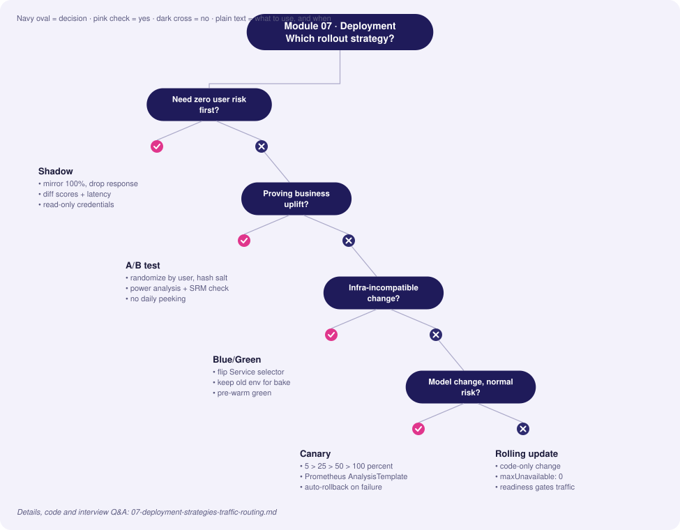
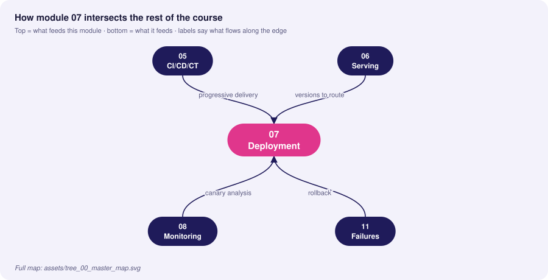
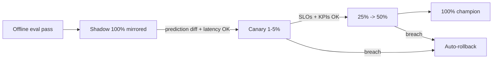

# 07 · Deployment Strategies & Traffic Routing

> **Goal:** release new models with bounded risk: measure before exposing, expose gradually, and roll back in seconds.

### 🌳 Decision Tree: which component, and when?



### 🔗 How this module intersects the others



> Full course map: [assets/tree_00_master_map.svg](../assets/tree_00_master_map.svg)


**Contents**
1. [Strategy comparison](#1-strategy-comparison)
2. [Blue/Green](#2-bluegreen)
3. [Canary with Istio](#3-canary-with-istio)
4. [Shadow (dark) deployment](#4-shadow-dark-deployment)
5. [A/B testing for models](#5-ab-testing-for-models)
6. [Progressive delivery automation (Argo Rollouts)](#6-progressive-delivery-automation-argo-rollouts)
7. [Rollback strategies](#7-rollback-strategies)
8. [Edge cases & production failures](#8-edge-cases--production-failures)
9. [Senior interview questions & answers](#9-senior-interview-questions--answers)
10. [Tips, Tricks & Field Notes](#10-tips-tricks--field-notes)
11. [Worked Scenario: Shadow shows 8% decision flips](#11-worked-scenario-shadow-shows-8-decision-flips)
12. [More Interview Questions](#12-more-interview-questions)
13. [Where This Module Connects](#13-where-this-module-connects)
14. [Interview Playbook: Tips & Tricks](#14-interview-playbook-tips--tricks)
15. [Scenario-Based Evaluation](#15-scenario-based-evaluation)
16. [Rapid-Fire Round](#16-rapid-fire-round)
- [7.17 Experimentation Platforms: Variance Reduction, Sequential Tests and Interference](#717-experimentation-platforms-variance-reduction-sequential-tests-and-interference)
- [7.18 Bandits and Off-Policy Evaluation for Deployed Models](#718-bandits-and-off-policy-evaluation-for-deployed-models)

---

## 1. Strategy comparison

| Strategy | User impact of bad model | Infra cost | Detects | Rollback speed | Best for |
|---|---|---|---|---|---|
| **Recreate** | Full downtime/impact | 1× | — | Slow | Dev only |
| **Rolling** | Gradual, uncontrolled by metric | 1×+ | Crashes | Minutes | Stateless, code-only changes |
| **Blue/Green** | Instant 100% flip | 2× during switch | Pre-flip smoke | Instant (flip back) | Schema-incompatible or big changes |
| **Canary** | Limited to X% | ~1.1× | Errors, latency, model KPIs | Seconds | Default for models |
| **Shadow** | **None** (responses discarded) | 2× compute | Skew, latency, prediction diff | n/a | Validate before any exposure |
| **A/B test** | Limited to arm | 1× + | **Business causal effect** | Seconds | Measuring value, not safety |
| **Interleaving** | Mixed | 1× | Ranking preference with less traffic | Seconds | Search/recs |



**Canonical progression for a risky model:** offline → shadow → canary → A/B (if business impact must be proven) → full.

## 2. Blue/Green

Two identical environments; the Service selector flips atomically.

```yaml
# blue and green Deployments differ only by label `track` and image
apiVersion: v1
kind: Service
metadata: { name: fraud-api }
spec:
  selector: { app: fraud-api, track: blue }    # flip to green after validation
  ports: [{ port: 80, targetPort: 8080 }]
```
```bash
# validate green out-of-band (port-forward or internal preview Service) then flip
kubectl patch svc fraud-api -p '{"spec":{"selector":{"app":"fraud-api","track":"green"}}}'
# rollback = patch back to blue; keep blue running for the bake period
```
**Caveats:** stateful sessions, DB schema migrations (use expand/contract), warm caches (green starts cold → pre-warm), doubled GPU cost.

## 3. Canary with Istio

Weighted routing between subsets defined by a `DestinationRule`.

```yaml
apiVersion: networking.istio.io/v1
kind: DestinationRule
metadata: { name: fraud-api }
spec:
  host: fraud-api
  trafficPolicy:
    connectionPool: { http: { http1MaxPendingRequests: 100, maxRequestsPerConnection: 50 } }
    outlierDetection: { consecutive5xxErrors: 5, interval: 10s, baseEjectionTime: 30s }
  subsets:
    - { name: stable, labels: { version: v17 } }
    - { name: canary, labels: { version: v18 } }
---
apiVersion: networking.istio.io/v1
kind: VirtualService
metadata: { name: fraud-api }
spec:
  hosts: [fraud-api]
  http:
    - match: [{ headers: { x-canary: { exact: "force" } } }]   # internal testers pin to canary
      route: [{ destination: { host: fraud-api, subset: canary } }]
    - name: primary                      # named route: the Argo Rollout in section 6 references it
      route:
        - { destination: { host: fraud-api, subset: stable }, weight: 95 }
        - { destination: { host: fraud-api, subset: canary }, weight: 5 }
      timeout: 300ms
      retries: { attempts: 1, perTryTimeout: 150ms, retryOn: "5xx,connect-failure" }
```

**Sticky canary by user** (avoid a user flipping between model versions): hash a header.
```yaml
trafficPolicy:
  loadBalancer:
    consistentHash: { httpHeaderName: x-user-id }
```
(For percentage-by-user, do assignment in a gateway/experimentation service: `hash(user_id, experiment_salt) % 100 < p`.)

Envoy-only (without Istio) uses `weighted_clusters` in route config:
```yaml
route:
  weighted_clusters:
    clusters:
      - { name: fraud_stable, weight: 95 }
      - { name: fraud_canary, weight: 5 }
```

## 4. Shadow (dark) deployment

Mirror a copy of live traffic to the candidate; discard its response; compare offline.

```yaml
apiVersion: networking.istio.io/v1
kind: VirtualService
metadata: { name: fraud-api-shadow }
spec:
  hosts: [fraud-api]
  http:
    - route: [{ destination: { host: fraud-api, subset: stable } }]
      mirror: { host: fraud-api, subset: canary }
      mirrorPercentage: { value: 100.0 }
```
Mirrored requests get `-shadow` appended to Host/Authority, so side-effecting endpoints must be suppressed. The candidate must **not** write to production stores or trigger actions.

Compare shadow vs stable predictions:
```python
import pandas as pd, numpy as np
df = pd.read_parquet("logs/shadow_pairs.parquet")        # request_id, score_stable, score_shadow
diff = (df.score_shadow - df.score_stable)
print({
  "mean_abs_diff": float(diff.abs().mean()),
  "p99_abs_diff": float(diff.abs().quantile(.99)),
  "decision_flip_rate": float(((df.score_stable > .5) != (df.score_shadow > .5)).mean()),
  "corr": float(np.corrcoef(df.score_stable, df.score_shadow)[0, 1]),
})
```
Gate: flip rate within expected band (explainable), no NaNs, latency p99 within budget.

## 5. A/B testing for models

Canary answers "is it **safe**?" A/B answers "is it **better**?" — a causal question on a business metric.

**Design checklist**
1. **Unit of randomisation:** user (not request) to avoid contamination.
2. **Deterministic assignment:** `hash(salt + user_id)`; log arm on every event.
3. **Primary metric + guardrails** pre-registered (conversion; latency, complaint rate).
4. **Power analysis** before launch → sample size and duration (≥ 1–2 business cycles).
5. **Sample Ratio Mismatch (SRM)** check: chi-square on arm counts; SRM → invalid test.
6. **No peeking** (or use sequential testing/alpha spending).
7. **Network effects/interference:** marketplaces need cluster or switchback designs.

```python
import hashlib
def assign(user_id: str, experiment: str, split: float = 0.5) -> str:
    h = int(hashlib.sha256(f"{experiment}:{user_id}".encode()).hexdigest(), 16) % 10_000
    return "treatment" if h < split * 10_000 else "control"

# Sample size per arm for a conversion lift (two-sided z-test)
from scipy.stats import norm
def sample_size(p0, mde_abs, alpha=.05, power=.8):
    p1 = p0 + mde_abs
    z = norm.ppf(1 - alpha/2) + norm.ppf(power)
    return int(((p0*(1-p0) + p1*(1-p1)) * z**2) / mde_abs**2) + 1

# SRM check
from scipy.stats import chisquare
def srm(n_control, n_treat, expected=.5):
    total = n_control + n_treat
    return chisquare([n_control, n_treat], [total*(1-expected), total*expected]).pvalue  # p<0.001 => invalid
```

| | Canary | A/B |
|---|---|---|
| Question | Is it broken? | Is it better? |
| Metrics | Errors, latency, proxy KPIs | Business outcome with significance |
| Duration | Minutes–hours | Days–weeks |
| Traffic | 1–10% ramp | Fixed split |
| Decision | Auto-rollback | Statistical |

**Bandits** (Thompson sampling) shift traffic to winners adaptively—good for short-lived optimisation (banners), poor for rigorous inference or delayed outcomes.

## 6. Progressive delivery automation (Argo Rollouts)

```yaml
apiVersion: argoproj.io/v1alpha1
kind: Rollout
metadata: { name: fraud-api }
spec:
  replicas: 6
  selector: { matchLabels: { app: fraud-api } }
  template:
    metadata: { labels: { app: fraud-api } }
    spec:
      containers:
        - name: api
          image: ghcr.io/acme/fraud-api@sha256:REPLACE_WITH_DIGEST
          ports: [{ containerPort: 8080 }]
          readinessProbe: { httpGet: { path: /readyz, port: 8080 }, periodSeconds: 5 }
  strategy:
    canary:
      canaryService: fraud-api-canary
      stableService: fraud-api-stable
      trafficRouting: { istio: { virtualService: { name: fraud-api, routes: [primary] } } }
      steps:
        - setWeight: 5
        - pause: { duration: 10m }
        - analysis:
            templates: [{ templateName: model-slo }]
            args:                       # scope the queries to the canary ReplicaSet only
              - name: canary-hash
                valueFrom: { podTemplateHashValue: Latest }
        - setWeight: 25
        - pause: { duration: 15m }
        - setWeight: 50
        - pause: { duration: 15m }
---
apiVersion: argoproj.io/v1alpha1
kind: AnalysisTemplate
metadata: { name: model-slo }
spec:
  args:
    - name: canary-hash
  metrics:
    - name: error-rate
      interval: 1m
      failureLimit: 2
      successCondition: result[0] < 0.01
      provider:
        prometheus:
          address: http://prometheus.monitoring:9090
          query: |
            sum(rate(predict_requests_total{status!="ok",pod=~"fraud-api-{{args.canary-hash}}-.*"}[2m]))
            / sum(rate(predict_requests_total{pod=~"fraud-api-{{args.canary-hash}}-.*"}[2m]))
    - name: p95-latency
      interval: 1m
      failureLimit: 2
      successCondition: result[0] < 0.05
      provider:
        prometheus:
          address: http://prometheus.monitoring:9090
          query: histogram_quantile(0.95, sum(rate(predict_latency_seconds_bucket{pod=~"fraud-api-{{args.canary-hash}}-.*"}[2m])) by (le))
```
Failure of any analysis → automatic abort and rollback to stable.

Notes: Rollout pods are named `<rollout>-<pod-template-hash>-<suffix>`, so filtering on the canary hash isolates the canary; a bare `fraud-api-.*` regex would also match stable pods and pass whenever stable is healthy. With `trafficRouting`, the Rollouts controller edits the weights of the named `primary` route (its destinations should point at the `fraud-api-stable` / `fraud-api-canary` services or subsets); the section 3 manifest is the hand-managed equivalent. Resource shapes and the pod label names depend on your scrape config and controller version; verify against current documentation.

**Model-specific canary metrics** beyond HTTP: prediction-score distribution vs stable (PSI), fallback rate, null-feature rate, approval/decline rate, business proxy KPI (when available quickly).

## 7. Rollback strategies

| Method | Speed | Notes |
|---|---|---|
| Traffic shift (set canary weight 0) | Seconds | Best first response |
| Alias/manifest revert (GitOps) | 1–5 min | Leaves audit trail |
| Blue/green flip back | Seconds | Requires keeping old env alive during bake |
| Fallback model / rule engine | Immediate (in-process) | Handles *both* bad model & dependency failures |
| Feature flag kill switch | Seconds | Disable model usage, revert to heuristic |
| Re-deploy previous image | Minutes | Last resort |

**Rollback readiness checklist:** previous version still deployable; DB/feature schema backward compatible (expand/contract); previous model compatible with *current* features; runbook with explicit triggers (e.g., error rate > 2% for 3 min or KPI proxy −5%); drill quarterly.

## 8. Edge cases & production failures

| Failure | Root cause | Mitigation |
|---|---|---|
| **Canary looks fine, damage appears days later** | Delayed labels; bad outcomes unobservable in canary window | Proxy metrics, holdback group retained, longer bake for risky models, guardrail alerts post-100% |
| **Shadow double-writes** | Candidate triggers side-effects (emails, DB writes) | Read-only mode flag; separate credentials with no write permission |
| **User sees inconsistent decisions** | Non-sticky routing | Consistent hashing / user-level assignment |
| **Low traffic canary meaningless** | 5% of 100 RPS = 5 RPS | Time-based bake, synthetic traffic, replay logs |
| **Retry amplification** | Mesh retries + client retries on canary failures | Retry budgets, idempotent endpoints |
| **Rollback incompatibility** | New model required new feature; old model fails with it | Backward-compatible feature schema; keep both versions' inputs available |
| **SRM in A/B** | Bot filtering applied after assignment, cache serving one arm | Check logging pipeline & assignment, discard test, fix |
| **Config/model skew in rollout** | New pods read old ConfigMap | Version config with image; rollout restart on change (checksum annotation) |

## 9. Senior interview questions & answers

**Q1. Canary vs shadow vs A/B: when do you use each?**
- ❌ *Trap:* "They're all ways to test a new model."
- ✅ *Staff:* Shadow validates technical behaviour (skew, latency, prediction differences) with zero user risk. Canary limits blast radius while verifying SLOs and proxy KPIs under real responses. A/B establishes causal business impact with pre-registered metrics. Risky models traverse all three; low-risk refreshes might go straight to automated canary.

**Q2. How do you implement automated rollback for a model, not just a container?**
- ❌ *Trap:* "Kubernetes rolls back if the pod crashes."
- ✅ *Staff:* Pods don't crash on bad predictions. Add model-level analysis to the rollout: Prometheus queries for score-distribution drift vs stable, fallback/null rate, decision-rate change, and available business proxies, with failure limits aborting the rollout. Also alert post-rollout for delayed-label metrics and keep a kill switch to fallback logic.

**Q3. How do you choose the canary step sizes and durations?**
- ❌ *Trap:* "5%, 25%, 50%, 100% always."
- ✅ *Staff:* Choose from traffic volume and the metric noise: need enough samples at each step to detect a regression of size δ with adequate power. Low-traffic services need longer bakes or replayed traffic. Longer steps if outcomes are delayed or if daily seasonality matters (cover peak). Make steps config, derive from a minimum-detectable-effect calculation.

**Q4. Your A/B shows +2% conversion but a p-value of 0.07 after peeking daily. Ship?**
- ❌ *Trap:* "It's close enough, ship."
- ✅ *Staff:* Daily peeking inflates false positives; with a fixed-horizon design the p-value is only valid at the planned end. Either continue to planned duration/power, or use a sequential method (alpha spending, mSPRT). Also check SRM, novelty effects, guardrails, and practical significance versus cost. Decide per pre-registered rules.

**Q5. What's the downside of blue/green for ML?**
- ❌ *Trap:* "None, it's the safest."
- ✅ *Staff:* All-at-once flip exposes 100% of traffic to a model that was only smoke-tested; doubles expensive GPU capacity; cold caches/feature lookups; and the real quality signal needs real traffic. I'd combine with shadow pre-flip, or prefer canary for model changes and use blue/green for infrastructure-incompatible changes.

**Q6. How do you keep a user's experience consistent during a canary?**
- ❌ *Trap:* "Random routing per request is fine."
- ✅ *Staff:* Use sticky assignment by user/session via consistent hashing or a deterministic bucket function at the gateway, otherwise a user can flip between models, creating confusing behaviour and contaminating metrics. Log arm and version on every prediction.

**Q7. Shadow traffic shows 8% of decisions differ from production. Is that a failure?**
- ❌ *Trap:* "Yes, they should match."
- ✅ *Staff:* Not necessarily—a better model should differ. Judge direction and cause: segment the flips, review samples with domain experts, check whether flips concentrate in a slice or a feature path (skew), and compare against labels where available. Define expected flip band beforehand; unexplained flips in a single segment are the red flag.

**Q8. Design rollback for a model whose new version needs a new feature.**
- ❌ *Trap:* "Just redeploy the old image."
- ✅ *Staff:* Make feature changes additive (expand/contract). Publish the new feature while v-old ignores it. Roll out the new model; during rollback the old model still works because its inputs are untouched. Remove old features only after the bake period and when no version depends on them. Feature versioning in the store (`user_stats_v2`) enforces this.


<!-- appendix:start -->

## 10. Tips, Tricks & Field Notes

1. Canary answers 'is it safe', A/B answers 'is it better'; do not mix the two.
2. Use sticky assignment so a user never flips between model versions.
3. Run shadow with credentials that cannot write; mirrored traffic must be side-effect free.
4. Add model-level metrics to the canary analysis (score PSI, fallback rate, decision rate).
5. Keep the old environment alive through the bake period.
6. Make feature changes additive (expand/contract) so rollback always works.

## 11. Worked Scenario: Shadow shows 8% decision flips

**Situation.** The challenger disagrees with the champion on 8% of traffic.

**Steps**

1. Segment flips by feature and slice.
2. Review samples with a domain expert.
3. Compare to labels where available.
4. Decide using a pre-agreed expected flip band.

**Outcome.** Flips concentrated in one region due to a skewed feature path; fixed before canary.

## 12. More Interview Questions

**Q9. Peeking at A/B results daily?**
- ❌ *Trap:* Stop when p<0.05.
- ✅ *Staff:* Peeking inflates false positives; use the fixed horizon or sequential methods and check SRM first.

**Q10. Rollback with a new feature?**
- ❌ *Trap:* Redeploy old image.
- ✅ *Staff:* Additive feature schema; the old model ignores the new feature; remove only after bake.

**Q11. Blue/green downside?**
- ❌ *Trap:* None.
- ✅ *Staff:* 100% exposure after only a smoke test, double GPU cost, cold caches; combine with shadow first.

## 13. Where This Module Connects

| Direction | Module | What flows |
|---|---|---|
| ⬆ Fed by | [05 CI/CD/CT](05_cicd_ct_automation_pipelines.md) | progressive delivery |
| ⬆ Fed by | [06 Serving](06_model_serving_architecture.md) | versions to route |
| ⬇ Feeds | [08 Monitoring](08_monitoring_observability_alerting.md) | canary analysis |
| ⬇ Feeds | [11 Failures](11_production_failures_troubleshooting.md) | rollback |


<!-- appendix:end -->

<!-- deep:start -->

## 14. Interview Playbook: Tips & Tricks

1. Clarify which question you're answering: safe, or better.
2. Mention sticky assignment and SRM checks whenever A/B is discussed.
3. State rollback readiness before describing rollout.
4. Quantify canary steps with traffic and MDE.
5. Mention guardrail metrics along with the primary metric.
6. Always describe what you will do if the canary passes but business metrics later fall.

## 15. Scenario-Based Evaluation

Each scenario shows what the interviewer is really testing, the answer that loses points, and the answer that earns them.

### Scenario 1: Low-traffic service canary

**Situation.** Only 50 RPS; a 5% canary yields 2.5 RPS.

**What is being evaluated.** Adapting strategy to low volume.

- ❌ **Weak answer:** Use 5% anyway.
- ✅ **Strong answer:**
  1. Use longer bake time and replay production logs.
  2. Synthetic probes plus shadow for technical checks.
  3. Larger canary percent during low-risk hours.
  4. Use proxy metrics with higher event rate.

**Likely follow-up:** *How do you compute needed duration?*

### Scenario 2: A/B with novelty effect

**Situation.** New ranking model shows +4% in week one, +0.5% in week three.

**What is being evaluated.** Experiment validity.

- ❌ **Weak answer:** Ship based on week one.
- ✅ **Strong answer:**
  1. Recognise novelty/learning effect.
  2. Run to planned horizon; use cohort analysis by exposure time.
  3. Check long-term metrics and retention guardrails.
  4. Decide on steady-state effect.

**Likely follow-up:** *How long should the test run?*

### Scenario 3: Canary passes, harm later

**Situation.** Fraud model canary passed; chargebacks rise 40 days later.

**What is being evaluated.** Delayed outcome handling.

- ❌ **Weak answer:** Blame labels.
- ✅ **Strong answer:**
  1. Keep a holdback group on old model beyond full rollout.
  2. Use proxy leading indicators during canary.
  3. Alert on delayed metrics post-100%.
  4. Rollback criteria include delayed metric thresholds.

**Likely follow-up:** *How large should the holdback be?*

### Scenario 4: Shadow writes to prod

**Situation.** Shadow candidate sent real emails.

**What is being evaluated.** Safety design.

- ❌ **Weak answer:** Fix the bug.
- ✅ **Strong answer:**
  1. Make shadow read-only by design: no write credentials, flag-based side-effect suppression.
  2. Mirror at mesh level with separate identity.
  3. Contract test that shadow mode has zero writes.
  4. Post-incident review.

**Likely follow-up:** *How do you test side-effect suppression?*

## 16. Rapid-Fire Round

| Question | One-line answer |
|---|---|
| Canary vs shadow? | Limited live exposure vs zero exposure mirror. |
| SRM? | Arm counts deviate from design; test invalid. |
| Blue/green rollback? | Flip the selector back. |
| Sticky canary? | Consistent hash on user id. |
| Why AnalysisTemplate? | Automates rollback decisions on metrics. |
| Expand/contract? | Additive schema changes for safe rollback. |
| Interleaving? | Mix rankings to compare with less traffic. |
| Bandit downside? | Weak inference, delayed outcomes issues. |
## 7.17 Experimentation Platforms: Variance Reduction, Sequential Tests and Interference

### Conceptual Deep Dive
An **experimentation platform** has six parts: an **assignment service** (deterministic hashing of a randomisation unit plus experiment salt), **exposure logging** (record who actually saw which variant, not just who was assigned), a **metric pipeline**, an **analysis** layer, **guardrail checks** (SRM, latency, error rate, revenue) and an **experiment registry** recording hypothesis, owner, metrics and decision. Module 07 section 5 (legacy) covers sample sizing and SRM basics; this section covers what makes tests cheaper and more trustworthy.

**Variance reduction** shortens experiments. **CUPED** (Deng et al., 2013) subtracts a pre-experiment covariate's contribution: Y_adj = Y - theta (X - mean X) with theta = Cov(Y,X)/Var(X); variance shrinks by roughly a factor (1 - rho^2) where rho is the correlation of X and Y, and the expected treatment effect is unchanged because X is pre-treatment. **Stratification** and post-stratification remove between-group variance, and ratio metrics (clicks per session) need the **delta method** for correct standard errors. Required sample size scales with variance, so halving variance halves the sample.

**Sequential testing** and always-valid inference let you look repeatedly while controlling error, using alpha-spending or mixture sequential tests. Fixed-horizon tests permit one look; naive daily peeking inflates false positives. **Interleaving** compares rankers by mixing results (team-draft idea) and typically needs far fewer users, but measures preference rather than absolute business metrics and cannot test non-ranking changes.

**Interference** breaks the independent-units assumption: network effects, marketplaces where treated units take inventory from controls. Remedies are **switchback** designs (alternate treatment over time blocks) and **cluster randomisation**, both at the price of fewer effective units. **Long-term effects** need a long-running **holdout**, checks for novelty and primacy, and **surrogate metrics** used cautiously, since a short-term proxy may not predict the long-term outcome.

Edge cases: **triggered analysis** (only users who reached the feature) is valid only if triggering is logged symmetrically in both arms; **SRM** can come from bot filtering or redirect losses, and an SRM invalidates the result until explained; **heavy-tailed metrics** need winsorisation, with the cap documented before looking at results.

### Cross-Connection Scenarios
- Online/offline metric alignment: Module 01 section 3 (legacy).
- Shadow and canary as pre-experiment safety stages: Module 07 sections 3-4 (legacy).
- Bandits as an adaptive alternative: 7.18.
- Metric definitions and guardrail dashboards: Module 08 (legacy).

### Production Anti-Patterns
- Stopping at first significance: the false-positive rate climbs far above the nominal level, and shipped "wins" regress.
- Multiple primary metrics without correction: with 10 independent metrics at alpha 0.05, a spurious "win" appears about 40% of the time.
- Randomising by request in a user-centric product: one user sees both variants, effects leak, and metrics are not per-user independent.

### Minimal Working Code
CUPED on synthetic pre/post metrics: variance drops while the estimated treatment effect stays unbiased.

```python
import numpy as np

rng = np.random.default_rng(0)
n, tau = 20000, 0.5
x = rng.normal(10, 3, n)                      # pre-experiment metric
t = rng.integers(0, 2, n)                     # random assignment
y = 0.8 * x + rng.normal(0, 2, n) + tau * t   # post metric with true effect tau

theta = np.cov(y, x)[0, 1] / np.var(x, ddof=1)
y_adj = y - theta * (x - x.mean())

def effect_and_se(v):
    a, b = v[t == 1], v[t == 0]
    return a.mean() - b.mean(), np.sqrt(a.var(ddof=1) / len(a) + b.var(ddof=1) / len(b))

for name, v in [("raw", y), ("CUPED", y_adj)]:
    eff, se = effect_and_se(v)
    print(f"{name:5s}: effect {eff:.3f}  se {se:.4f}")
print("variance ratio:", round(y_adj.var() / y.var(), 3))
```

Simulating the null: daily peeking inflates the false-positive rate relative to a single fixed-horizon test.

```python
import numpy as np

rng = np.random.default_rng(1)
sims, days, per_day = 4000, 14, 200
a = rng.normal(0, 1, (sims, days, per_day))      # null: both arms identical
b = rng.normal(0, 1, (sims, days, per_day))
n = per_day * np.arange(1, days + 1)             # per-arm sample size at each look
diff = (a.sum(axis=2).cumsum(axis=1) - b.sum(axis=2).cumsum(axis=1)) / n
z = diff / np.sqrt(2 / n)                        # known sd = 1
sig = np.abs(z) > 1.96
print("peek every day, stop at first hit:", sig.any(axis=1).mean().round(3))
print("single look at the end           :", sig[:, -1].mean().round(3))
```

### Interview Angle
**Q:** Your A/B tests are underpowered for months. List levers in order. **A:** First fix the metric: choose a more sensitive primary metric and apply CUPED or stratification. Then reduce noise via winsorisation, a tighter triggered population (logged symmetrically), and raising the minimum detectable effect to what matters. Then increase traffic share or duration, and consider interleaving or sequential designs. Trade-off: sensitivity versus relevance of the metric. Check: variance reduction ratio and the resulting required sample size.

**Q:** Explain why peeking inflates false positives and two legitimate alternatives. **A:** Each look is another chance for noise to cross the threshold, so the overall error exceeds alpha; the simulation above shows the gap. Alternatives: a sequential test with alpha spending or always-valid p-values, or a pre-registered fixed horizon. Trade-off: sequential tests lose a little power per look. Check: simulate the null with your stopping rule and confirm the false-positive rate stays near alpha.

## 7.18 Bandits and Off-Policy Evaluation for Deployed Models

### Conceptual Deep Dive
**Bandits** automate the exploration-exploitation trade-off: epsilon-greedy explores at random with fixed probability, **UCB** adds an optimism bonus for uncertain arms, and **Thompson sampling** draws from each arm's posterior and plays the best draw. They beat classic A/B tests when horizons are short, there are many arms, and the cost of showing a poor arm is high. They mislead when **rewards are delayed** (the bandit over-exploits early signals), when the world is **non-stationary** (a stale posterior), and when you need an unbiased estimate of effect size for a decision rather than just a good allocation.

**Logging for counterfactuals** is the enabling discipline: for every decision log the context, the action, the **propensity** (probability the logging policy chose that action), the reward and the model version (see the feedback-loop discussion in Module 01 section 3 (legacy)). Without propensities you cannot reweight, and deterministic logging policies leave no support for alternatives.

**Off-policy estimators** value a new policy from logs. **Inverse propensity scoring (IPS)** reweights logged rewards by pi(a|x)/mu(a|x): unbiased with full support but high variance when propensities are small. **Self-normalised IPS** divides by the sum of weights, trading slight bias for lower variance. **Doubly robust (DR)** combines a reward model with an IPS correction, and is consistent if either the model or the propensities are right. **Clipping** weights caps variance at the cost of bias. Offline policy evaluation serves as a **pre-A/B filter** for ranking and recommendation models: discard candidates that look clearly worse before spending traffic.

**Safe exploration**: limit exploration to a small traffic slice, set guardrail metrics and minimum support, keep a **holdout** of the incumbent policy to measure drift in the world, and log reward joins that arrive late. **Contextual bandits in production** require feature-logging parity (the features logged are those the policy actually used) and a delayed-reward join with a defined attribution window.

Edge cases: **propensities near zero** blow up variance; the **logged policy has no support** for the new policy's actions, so no estimator can recover the value; **reward arrives days later**, so early allocation is based on incomplete data.

### Cross-Connection Scenarios
- Classic A/B design and variance reduction: 7.17 and Module 07 section 5 (legacy).
- Prediction logging with model version for joins: Module 08 (legacy).
- Safe rollouts and rollback of new policies: Module 07 sections 3 and 6 (legacy).
- Feedback loops created by acting on the model's own outputs: Module 01 section 3 (legacy).

### Production Anti-Patterns
- Using IPS without logging propensities: weights are guessed and the estimate is meaningless.
- Running bandits without a holdout: you cannot tell whether overall performance is drifting or whether the bandit is learning from its own feedback.
- Treating offline replay on greedily-logged data as unbiased: the log only contains the incumbent's choices, so replay estimates are biased toward the incumbent.

### Minimal Working Code
Thompson sampling for Bernoulli arms with cumulative regret against the best arm.

```python
import numpy as np

rng = np.random.default_rng(0)
p = np.array([0.10, 0.12, 0.15])             # true click rates (unknown to the bandit)
alpha, beta = np.ones(3), np.ones(3)          # Beta(1, 1) priors
T, regret = 5000, 0.0
pulls = np.zeros(3, dtype=int)
for _ in range(T):
    arm = int(np.argmax(rng.beta(alpha, beta)))     # sample posteriors, play the best draw
    reward = rng.random() < p[arm]
    alpha[arm] += reward
    beta[arm] += 1 - reward
    pulls[arm] += 1
    regret += p.max() - p[arm]
print("pulls per arm:", pulls, "| cumulative regret:", round(regret, 1),
      "| uniform-random regret would be:", round(T * (p.max() - p.mean()), 1))
```

IPS, self-normalised IPS and doubly robust estimates of a new policy from epsilon-greedy logs, compared with ground truth and with a clipped variant.

```python
import numpy as np

rng = np.random.default_rng(0)
n, A = 50000, 3
q = np.array([[0.30, 0.10, 0.20], [0.10, 0.40, 0.25]])    # true reward prob per (context, action)
x = rng.integers(0, 2, n)
eps, log_fav = 0.3, np.array([0, 2])                      # logging policy: epsilon-greedy
probs = np.full((2, A), eps / A)
probs[np.arange(2), log_fav] += 1 - eps
a = np.minimum((rng.random(n)[:, None] > probs[x].cumsum(1)).sum(1), A - 1)
r = (rng.random(n) < q[x, a]).astype(float)
pi = np.array([0, 1])                                      # new deterministic policy to evaluate
true_value = q[np.arange(2), pi].mean()

w = (a == pi[x]) / probs[x, a]                             # importance weights
q_hat = np.array([[r[(x == c) & (a == k)].mean() for k in range(A)] for c in range(2)])
dr = (q_hat[x, pi[x]] + w * (r - q_hat[x, a])).mean()
print("true value      :", round(true_value, 4))
print("IPS             :", round((w * r).mean(), 4))
print("IPS, clipped w<=5:", round((np.minimum(w, 5) * r).mean(), 4), "(biased down)")
print("self-normalised :", round((w * r).sum() / w.sum(), 4))
print("doubly robust   :", round(dr, 4))
```

### Interview Angle
**Q:** When do you pick a bandit over an A/B test and what are the risks? **A:** Pick a bandit for many arms or short-lived content where regret during the test is costly and an effect-size estimate is secondary. Prefer an A/B test when you need a clean causal estimate, rewards are delayed, or the environment is non-stationary. Risks: over-exploiting early noise, feedback loops, biased estimates. Trade-off: regret versus inferential clarity. Check: regret against a holdout and stability of allocation under delayed rewards.

**Q:** How can you estimate a new ranking policy's value before exposing users? **A:** Use off-policy evaluation on logged data that includes propensities: IPS or doubly robust estimates with clipped weights and confidence intervals from bootstrapping. Verify support overlap between old and new policies and use the estimate only to filter candidates before an online test. Trade-off: variance versus bias from clipping. Check: effective sample size of the weights and agreement between offline estimates and past online results.

<!-- deep:end -->

---
**Prev:** [← 06](06_model_serving_architecture.md) · **Next:** [08 · Monitoring & Observability →](08_monitoring_observability_alerting.md)
