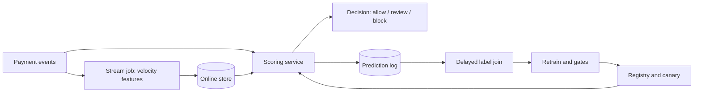
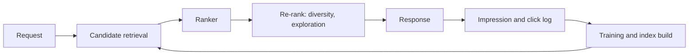

# 22 · Mock Interview and System-Design Question Bank

> **Goal:** practise under realistic conditions with worked system designs, debugging scenarios, depth questions and behavioural frames, each with a weak answer, a strong-answer outline, follow-ups and a scoring checklist.

## Table of Contents

- 22.1 How to Use the Bank and Score Yourself
- 22.2 Worked System Designs I: Real-Time Fraud and Personalised Feed
- 22.3 Worked System Designs II: ML Platform, Feature Platform and Batch Scoring Migration
- 22.4 Debugging and Incident Scenarios with Worked Answers
- 22.5 Concept Deep-Dive Questions by Topic with Model Answers
- 22.6 Behavioural, Leadership and Curveball Questions

The legacy rapid-fire tables (Module 12 section 6 and the final section of each module) hold the one-line facts; this chapter does not repeat them. It holds the longer items that test reasoning. Every model answer is one defensible path, not the only correct architecture, and numbers are illustrative assumptions you should replace with your own.

## 22.1 How to Use the Bank and Score Yourself

### Conceptual Deep Dive
Every item has the same anatomy: a **prompt**, what it **tests**, a **weak answer** (the plausible reply that loses points), a **strong-answer outline** with numbers, **follow-ups**, and a **scoring checklist**. Difficulty tags: **L1** (junior to mid: correct concepts and basic trade-offs, 20-30 minutes), **L2** (senior: end-to-end design or diagnosis with numbers and day-2 operations, 45 minutes) and **L3** (staff: organisational constraints, migration, build-versus-buy, multi-team impact, 45-60 minutes).

Score each attempt 0-4 on five dimensions: scoping, quantification, trade-offs, operations (monitoring, rollback, cost, ownership) and communication. Anchors: 0 absent; 1 named without explanation; 2 correct but generic; 3 specific, with numbers and a rejected alternative; 4 specific, adapts when a constraint changes and anticipates the next question. Passing bars used by the aggregator below: L1 average 2.0; L2 average 2.5 with no dimension under 2; L3 average 3.0 with no dimension under 2, each over at least three attempts.

Practice modes: **solo** (record yourself and score against the checklist), **paired** (the interviewer reveals data only for good questions), **timed** (strict R-A-D-I-O-M boxes from Module 12 section 1 (legacy)) and **interrupted** (the partner injects a curveball every ten minutes). Always attempt before reading the outline; reading first trains recognition, not recall.

| Item | Level | Prerequisite sections |
|---|---|---|
| 22.2 Fraud, feed | L2-L3 | 12.16, 14.1-14.5, 18.1, 18.2 |
| 22.3 Platform, feature platform, batch migration | L3, L3, L2 | 2.15, 5.16, 16.1-16.5 |
| 22.4 Twelve scenarios | L2 | 8.16-8.18, 11.17, 11.18 |
| 22.5 Depth questions | L1-L3 | the chapter named per row |
| 22.6 Behavioural and curveballs | L2-L3 | 12.17, 21.4 |

Edge cases: memorising answer shapes (change one constraint and redo the item) and skipping weak-area items (use the gap list from 21.1 to choose).

### Cross-Connection Scenarios
- Dimensions and mock cadence connect to the loop in 21.4; the plan to fit them is 21.2.
- Numbers for every design come from the toolkit in 12.16.
- Behavioural items use the story bank from 12.17.
- Projects in chapter 20 supply the examples that make answers specific.

### Production Anti-Patterns
- Reading answers before attempting: the practice becomes recognition and the score is meaningless.
- Ignoring numbers: designs without arithmetic cannot reach a 3 in quantification.
- Only practising favourite domains: the average hides a low dimension that a real loop will find.

### Minimal Working Code
A bank validator that reports coverage gaps.

```python
from collections import Counter

REQUIRED = ["prompt", "level", "tags", "followups"]
LEVELS = {"L1", "L2", "L3"}

def validate(bank):
    errors, by_level, by_tag = [], Counter(), Counter()
    for i, item in enumerate(bank):
        missing = [k for k in REQUIRED if not item.get(k)]
        if missing:
            errors.append(f"item {i}: missing {missing}")
        if item.get("level") not in LEVELS:
            errors.append(f"item {i}: bad level {item.get('level')!r}")
        by_level[item.get("level")] += 1
        by_tag.update(item.get("tags", []))
    return errors, by_level, by_tag

def coverage_gaps(by_tag, wanted, min_count=2):
    return [t for t in wanted if by_tag[t] < min_count]

if __name__ == "__main__":
    bank = [{"prompt": "Design fraud", "level": "L2", "tags": ["serving", "monitoring"], "followups": ["10x?"]},
            {"prompt": "Cut cost", "level": "L3", "tags": ["cost"], "followups": []}]
    errors, lv, tags = validate(bank)
    print(errors, dict(lv), coverage_gaps(tags, ["serving", "cost", "data"]))
    assert errors == ["item 1: missing ['followups']"]
```

A scoring aggregator with a readiness estimate per level.

```python
DIMS = ["scoping", "quantification", "tradeoffs", "operations", "communication"]
BARS = {"L1": 2.0, "L2": 2.5, "L3": 3.0}

def readiness(attempts, min_attempts=3):
    out = {}
    for level, bar in BARS.items():
        rows = [a["scores"] for a in attempts if a["level"] == level]
        if len(rows) < min_attempts:
            out[level] = "need more attempts"
            continue
        avg = {d: sum(r[d] for r in rows) / len(rows) for d in DIMS}
        overall = sum(avg.values()) / len(DIMS)
        ok = overall >= bar and (level == "L1" or min(avg.values()) >= 2)
        out[level] = ("ready" if ok else "not yet", round(overall, 2), min(avg, key=avg.get))
    return out

if __name__ == "__main__":
    s = {"scoping": 3, "quantification": 2, "tradeoffs": 3, "operations": 2, "communication": 3}
    attempts = [{"level": "L2", "scores": s}] * 3
    print(readiness(attempts))
    assert readiness(attempts)["L2"][0] == "ready" and readiness(attempts)["L3"] == "need more attempts"
```

### Interview Angle
**Q:** How will you know you're ready for a staff-level loop?
**A:** Three or more L3 attempts scored by someone else averaging at least 3 with no dimension under 2, plus a reproducible project result and a story bank with numbers. Trade-off: waiting for perfect scores delays the loop; a bar with a margin is enough. Check: the aggregator shows ready for L3, and the weakest dimension has improved across the last three recordings.

**Q:** What would you do differently after a failed mock?
**A:** Write the three points where the score dropped, classify each as knowledge, structure or time, and change one practice habit per class. Redo the same prompt with one constraint changed to test transfer rather than memory. Trade-off: repeating one item narrows coverage. Check: the same dimension scores higher on the repeated item and on a fresh item within a week.

## 22.2 Worked System Designs I: Real-Time Fraud and Personalised Feed

### Conceptual Deep Dive
**Design 1: real-time card fraud (L2-L3).** Walk R-A-D-I-O-M. *Requirements:* score each transaction before authorisation, p99 under 100 ms, decisions allow, review or block, success measured as fraud loss avoided minus review cost and customer friction. *Assumptions:* 5M daily users, 8 transactions each, peak factor 10, labels (chargebacks) arriving weeks later, 50M tracked cards. *Data and features:* velocity features per card and merchant over short and long windows (14.2), device and geography features, an online store with fallback tiers (20.2). *Infra:* stream job to online store and offline log, scoring service, registry with gated retraining (20.3). *Operate:* freshness SLO, fallback rate, score drift, a small random-approve holdout to measure what blocked traffic would have done (counterfactual logging, Module 01 section 3 (legacy)). *Milestones:* rules baseline, batch model, online features, streaming features, canary.



| Quantity | Estimate (see 12.16) |
|---|---|
| Average / peak QPS | about 460 / 4.6k |
| Replicas (15 ms, 0.6 utilisation, 4 workers) | about 29, plus headroom |
| Online store | about 77 GB with overhead and two replicas |
| Stream ingest (1 KB events) | about 14 MB/s with 3x replication |

Top risks: delayed and censored labels (blocked traffic has none) mitigated by a holdout; adversaries adapting, mitigated by fast rules and monitoring (18.2); hot merchants, mitigated by key splitting; stale features, mitigated by freshness SLO and fallback; miscalibrated thresholds across segments, mitigated by per-segment calibration (17.5).

**Design 2: personalised feed (L3).** Candidate generation retrieves about 10^3 items from several sources, ranking scores a few hundred, re-ranking applies diversity and exploration. Feature freshness matters for recency signals; evaluation uses offline ranking metrics then online tests (1.16, 7.17); cold start uses content features and exploration; index rollout versions embeddings so retrieval and ranker match. Monitoring covers impression logging, position bias and feedback-loop effects (18.1).



**Curveballs.** 10x traffic: re-run the arithmetic, find the binding resource. Label delay doubles: lengthen the maturity window and lean on proxy metrics (8.16). Regulator asks for reasons: reason codes with stability checks (17.3). GPU shortage: distil or move to CPU (6.16). **Weak answer:** names Kafka, Redis and Kubernetes without requirements, labels or rollback.

### Cross-Connection Scenarios
- Capacity numbers: 12.16; streaming windows and late data: 14.2; parity: 14.3.
- Fraud domain specifics: 18.2; recommender specifics: 18.1; delayed labels in monitoring: 8.18.
- The capstone in 20.5 implements the fraud design on a laptop.
- Threshold choice links to calibration in 17.5.

### Production Anti-Patterns
- Drawing before requirements: the diagram answers an unstated problem and cannot be defended.
- Naming tools without reasons: each box needs the requirement that forced it and the alternative rejected.
- No rollback or day-2 story: a design that cannot be operated is incomplete.

### Minimal Working Code
A capacity calculator for the fraud design, reusing the formulas from 12.16.

```python
import math

def qps(dau, actions, peak):
    avg = dau * actions / 86400
    return avg, avg * peak

def replicas(peak_qps, service_s, util=0.6, workers=4):
    return math.ceil(peak_qps * service_s / util / workers)

def online_gb(entities, per_entity=384, overhead=2.0, repl=2):
    return entities * per_entity * overhead * repl / 1e9

def kafka_mb_s(events_s, bytes_ev=1000, repl=3):
    return events_s * bytes_ev * repl / 1e6

if __name__ == "__main__":
    avg, peak = qps(5_000_000, 8, 10)
    rows = {"avg QPS": avg, "peak QPS": peak, "replicas": replicas(peak, 0.015),
            "online GB": online_gb(50_000_000), "kafka MB/s": kafka_mb_s(peak)}
    for k, v in rows.items():
        print(f"{k:12s}{v:12.1f}")
    assert rows["replicas"] == 29 and round(rows["online GB"]) == 77
```

An expected-cost threshold sweep for the fraud operating point and a candidate-quota calculator for the feed.

```python
import random

def make(n=20000, prev=0.01, seed=5):
    r = random.Random(seed)
    out = []
    for _ in range(n):
        fraud = r.random() < prev
        s = r.gauss(0.6, 0.2) if fraud else r.gauss(0.1, 0.1)
        out.append((min(max(s, 0), 1), fraud))
    return out

def cost(data, thr, c_fp=5.0, c_fn=200.0):          # illustrative cost units
    fp = sum(1 for s, f in data if s >= thr and not f)
    fn = sum(1 for s, f in data if s < thr and f)
    return c_fp * fp + c_fn * fn

def quota(budget_ms, per_item_ms, parallel=1):
    return int(budget_ms * parallel / per_item_ms)

if __name__ == "__main__":
    d = make()
    best = min([i / 20 for i in range(1, 20)], key=lambda t: cost(d, t))
    print("best threshold", best, cost(d, best), "vs 0.5:", cost(d, 0.5))
    assert cost(d, best) <= cost(d, 0.5)
    print("ranker candidates:", quota(40, 0.1, 2))
    assert quota(40, 0.1, 2) == 800
```

### Interview Angle
**Q:** Design real-time fraud detection end to end (run the full framework).
**A:** Clarify the decision, latency, loss and review costs; assume 5k peak QPS and weeks-late labels; use streaming velocity features into an online store with fallback tiers; gate retraining and canary releases; monitor freshness, fallback rate and drift; keep a random-approve holdout. Trade-off: streaming freshness against operational complexity. Check: parity mismatch rate, p99 under 100 ms at 1.5x peak, and a failure drill with the store down.

**Q:** Design a feed recommender; what do you do about cold-start and feedback loops?
**A:** Retrieval, ranking, then re-ranking with exploration. Cold start: content features, popularity priors and a share of traffic for exploration. Feedback loops: log propensities, keep a randomised holdout, and evaluate against it. Trade-off: exploration costs short-term engagement. Check: new-item time to first impressions, diversity metrics and holdout-based lift (7.18).

## 22.3 Worked System Designs II: ML Platform, Feature Platform and Batch Scoring Migration

### Conceptual Deep Dive
**Design 3: multi-tenant ML platform for 50 data scientists (L3).** Start with users and their top three pains, not components. The **golden path** is a template repository, a standard pipeline, a registry with promotion gates and a serving template (16.1). *Isolation* uses namespaces, quotas and policy-as-code (16.2); *GPU quotas* use queues with fair share (15.3); *cost attribution* uses tags and per-team dashboards (16.3). *Adoption metrics:* time to first model, share of models on the path, and support tickets per model. *First 90 days:* weeks 1-3 interviews and a baseline; weeks 4-8 a thin path for one team; weeks 9-13 onboard two more, measure, and decide what to build next. *Migration:* run old and new side by side, deprecate with a date (16.5). Common failure: a platform built before users.

**Design 4: shared feature platform (L3).** Ownership by domain with a registry and consumer list; versioning with deprecation windows; online/offline sync through one definition (2.15, 14.3); backfills that are idempotent and checked; SLOs for freshness and availability; a consumer registry so a change can be traced to its dependents.

**Design 5: nightly batch to hourly (L2).** What breaks: runs overlap, partial publishes become visible, late data changes earlier hours, cost multiplies 24x unless incremental. Design: idempotent partitioned jobs, an atomic publish through a commit marker or pointer switch (5.16), validation before publish, a backfill path, and a staged rollout comparing old and new outputs per partition before cutover.

| Decision | Option A | Option B | Criteria |
|---|---|---|---|
| Platform | Managed service | OSS on Kubernetes | team size, compliance, time to value, lock-in |
| Processing | Batch hourly | Stream | freshness need, state complexity, cost |
| Features | Central platform | Per-team | reuse, parity needs, ownership capacity |

**Curveballs.** Team of three: managed services and one golden path, no custom control plane. Multi-region: replicate registry and artifacts, accept eventual consistency for features. Compliance requirement: lineage, approvals, evidence (10.16). Five-times cost cut: sequence levers by measured share (16.4). Ambiguous scope and organisational politics are handled by naming the decision owner and the reversible first step.

**Weak answer:** a long tool list with no users, no adoption plan and no deprecation story.

### Cross-Connection Scenarios
- Product framing and golden paths: 16.1; self-service and policy: 16.2; migrations and deprecation: 16.5.
- Feature ownership and backfills: 2.15; streaming parity: 14.3.
- Idempotency and atomic publish for the batch migration: 5.16.
- Staff-level storytelling to accompany these designs: 12.17.

### Production Anti-Patterns
- Platform-first thinking: components are built for imagined users and none is adopted.
- No adoption plan: without metrics and champions the golden path stays optional and unused.
- No deprecation story: the old and new paths coexist indefinitely and double the support cost.

### Minimal Working Code
A weighted option scorer (scores 1-4, higher is a better fit; the scores are illustrative judgements to replace with your own).

```python
OPTIONS = {"managed": {"team": 4, "compliance": 3, "ttv": 4, "lockin": 1, "cost": 2},
           "oss":     {"team": 2, "compliance": 4, "ttv": 2, "lockin": 4, "cost": 3},
           "custom":  {"team": 1, "compliance": 4, "ttv": 1, "lockin": 4, "cost": 2}}

def rank(weights, options=OPTIONS):
    total = sum(weights.values())
    scored = {n: sum(weights[k] * v for k, v in s.items()) / total for n, s in options.items()}
    return sorted(scored.items(), key=lambda kv: -kv[1])

if __name__ == "__main__":
    small_team = {"team": 5, "compliance": 1, "ttv": 5, "lockin": 1, "cost": 2}
    regulated = {"team": 1, "compliance": 5, "ttv": 1, "lockin": 4, "cost": 2}
    for name, w in [("small team", small_team), ("regulated", regulated)]:
        print(name, [(n, round(s, 2)) for n, s in rank(w)])
    assert rank(small_team)[0][0] == "managed" and rank(regulated)[0][0] == "oss"
```

A batch-migration cutover checker that compares partitions and returns go or no-go.

```python
import random

def ks(a, b):
    a, b = sorted(a), sorted(b)
    i = j = 0
    d = 0.0
    for x in sorted(set(a + b)):
        while i < len(a) and a[i] <= x:
            i += 1
        while j < len(b) and b[j] <= x:
            j += 1
        d = max(d, abs(i / len(a) - j / len(b)))
    return d

def cutover(old, new, max_rows=0.001, max_null=0.005, max_ks=0.05):
    report = {}
    for part, o in old.items():
        n = new[part]
        rows = abs(len(o) - len(n)) / len(o)
        null = abs(sum(x is None for x in o) / len(o) - sum(x is None for x in n) / len(n))
        dist = ks([x for x in o if x is not None], [x for x in n if x is not None])
        report[part] = rows <= max_rows and null <= max_null and dist <= max_ks
    return all(report.values()), report

if __name__ == "__main__":
    r = random.Random(1)
    old = {"2026-01-01": [r.random() for _ in range(1000)]}
    same = {k: list(v) for k, v in old.items()}
    shifted = {k: [min(1.0, x + 0.1) for x in v] for k, v in old.items()}
    assert cutover(old, same)[0] is True and cutover(old, shifted)[0] is False
    print(cutover(old, shifted))
```

### Interview Angle
**Q:** Design the ML platform for 50 data scientists; what do you build in the first 90 days?
**A:** Interview users, baseline lead time and incidents, then ship one thin golden path (template, pipeline, registry gate, serving template) for one team, and measure adoption before adding anything. Trade-off: standardisation against flexibility for unusual work. Check: time to first production model drops, share of models on the path rises, and support tickets per model fall over the quarter.

**Q:** You must move nightly batch scoring to hourly. What breaks?
**A:** Overlapping runs, visible partial writes, late data rewriting earlier hours and a 24x cost increase unless incremental. Fix with idempotent partitions, atomic publish through a commit marker, validation before publish and incremental computation. Trade-off: freshness against cost and complexity. Check: a per-partition comparison of old and new outputs (rows, nulls, score distribution) before cutover, and cost per 1k predictions after.

## 22.4 Debugging and Incident Scenarios with Worked Answers

### Conceptual Deep Dive
Use one answer template: **stabilise** (stop the bleeding, roll back or shed load), **scope** (who and what is affected, since when), **hypothesise** (ordered by probability and cost to test), **isolate** (one change per experiment), **fix**, **prevent** (add the control), and communicate on a cadence (an update at fixed intervals, even if the update is "no new information"). Always ask three questions first: the timeline, the change log, and the slices. Never begin with retraining, and never change many things at once.

| # | Scenario | First questions | Ordered hypotheses | Isolation | Preventive control |
|---|---|---|---|---|---|
| 1 | Accuracy dropped, no deploy | When? Which slice? Label delay? | Upstream data change, drift, label maturity, seasonality | Compare feature stats and null rates by day | 13.2, 8.16 |
| 2 | p99 spikes after deploy | What changed? Which hop? | Model size, batching, cold start, dependency | Per-hop trace, canary vs stable | 6.17, 13.6 |
| 3 | Online/offline mismatch | Which features? Since when? | Defaults, transform version, stale values, PIT | Replay logged requests offline | 14.3, 20.2 |
| 4 | OOM at peak | Which resource? Request size? | Concurrency, batch size, leak, large inputs | Memory per request, load test | 6.17, Module 11 section 3 (legacy) |
| 5 | Canary passes, KPI drops later | Canary length? Which metric? | Novelty, slow-moving metric, small sample, slice | Cohort comparison over time | 7.17, 7.18 |
| 6 | Retrain storm | What triggered each run? | Flapping trigger, no cooldown, bad labels | Trigger timeline | 20.4, Module 05 section 9 (legacy) |
| 7 | Stale model after rollback | What does serving load? | Alias cache, image pin, config mismatch | Compare served version to registry | 4.16, 5.17 |
| 8 | Feature freshness failure | Which job? Upstream? | Dead job, late source, TTL | Freshness per feature | 8.17, 14.2 |
| 9 | Label delay confusion | Which cohort? | Metric computed on immature cohorts | Quality by label maturity | 8.18, 8.16 |
| 10 | GPU idle | Utilisation by phase? | Input pipeline, small batch, fragmentation, queue | Profile data loading | 15.3, 15.5 |
| 11 | Cost doubled | Which line item? | Traffic, retries, stuck replicas, logging volume | Cost by tag and day | 16.3, 16.4 |
| 12 | Shadow writes to prod | What side effects does shadow have? | Shared credentials, non-idempotent writes | Audit shadow path permissions | Module 07 section 4 (legacy), 10.15 |

**Mock-interview mode.** The interviewer holds hidden facts and reveals one only when the candidate asks the right question. A scoring checklist: did the candidate ask for the timeline, the change log, the slices, and the most recent deploys before hypothesising? Did they state a rollback option? Did they propose a prevention? **Common traps:** red herrings (a noisy metric that predates the incident), multiple root causes (fixing one does not end the symptom), mistaking label delay for degradation, and retraining before diagnosis.

**Worked example, scenario 2.** Stabilise: roll the canary or deployment back if latency breaches the SLO. Scope: all routes or one model? Timeline: p99 doubled ten minutes after v12. Hypotheses: larger model, lost batching, an added feature lookup, cold start. Isolate: compare per-hop latency of v11 and v12 under the same load. Fix: capacity or optimise (6.16). Prevent: a latency gate in the canary analysis (20.3).

### Cross-Connection Scenarios
- Archetypes and postmortem structure: 11.17; root-cause playbook for quality regressions: 11.18.
- SLO and burn-rate framing for communication: 8.17.
- Controls in the last column connect back to the sections that teach them.
- The runner below supports the paired mode in 22.1.

### Production Anti-Patterns
- Jumping to retraining: it hides a data or serving bug and adds a new variable.
- Changing many things at once: the cause becomes unknowable and the rollback unclear.
- No communication plan: stakeholders learn about the incident from customers.

### Minimal Working Code
A scenario runner whose hidden facts are revealed by keyword questions, with a transcript and a checklist.

```python
SCENARIOS = {
    "latency": {"facts": {"timeline": (("when", "timeline", "start"), "p99 doubled at 14:05, ten minutes after v12"),
                          "change": (("change", "deploy", "diff"), "v12 has 3x more trees and a new feature lookup"),
                          "slice": (("slice", "region", "segment"), "all regions equally affected")}},
    "accuracy": {"facts": {"timeline": (("when", "timeline", "start"), "decline began Tuesday, no deploy"),
                           "change": (("change", "upstream", "schema"), "upstream team changed amount to cents"),
                           "slice": (("slice", "segment", "region"), "only the mobile channel is affected")}},
}

def ask(name, question, log):
    for key, (words, text) in SCENARIOS[name]["facts"].items():
        if any(w in question.lower() for w in words):
            log.append((question, key, text))
            return text
    log.append((question, None, "no new information"))
    return "no new information"

def checklist(log):
    asked = {k for _, k, _ in log if k}
    return {k: k in asked for k in ("timeline", "change", "slice")}

if __name__ == "__main__":
    log = []
    ask("latency", "When did it start?", log)
    ask("latency", "What was the last deploy?", log)
    ask("latency", "Should we retrain?", log)
    print(log[-1][2], checklist(log))
    assert checklist(log) == {"timeline": True, "change": True, "slice": False}
```

A synthetic dataset generator with injectable causes for the "accuracy dropped" scenario.

```python
import numpy as np

def window(cause=None, seed=0, n=5000):
    rng = np.random.default_rng(seed)
    amount = rng.lognormal(3.0, 0.5, n)
    tenure = rng.normal(24, 6, n)
    y = rng.random(n) < 1 / (1 + np.exp(-(0.04 * (amount - 20) - 1.5)))
    if cause == "unit_change":
        amount = amount * 100
    elif cause == "null_flood":
        tenure[rng.random(n) < 0.3] = np.nan
    elif cause == "label_shift":
        y = y | (rng.random(n) < 0.1)
    return {"amount_mean": float(amount.mean()), "tenure_null": float(np.isnan(tenure).mean()),
            "positive_rate": float(y.mean())}

if __name__ == "__main__":
    base = window()
    for cause in ["unit_change", "null_flood", "label_shift"]:
        w = window(cause)
        print(cause, {k: round(w[k] / base[k], 2) if base[k] else round(w[k], 2) for k in base})
    assert window("unit_change")["amount_mean"] > 50 * base["amount_mean"]
    assert window("null_flood")["tenure_null"] > 0.25 and window("label_shift")["positive_rate"] > base["positive_rate"]
```

### Interview Angle
**Q:** Latency doubled right after a model update; walk through diagnosis.
**A:** Stabilise first: roll back if the SLO is breached. Then ask what changed, which hop and which slice; compare v11 and v12 per-hop latency under identical load; check model size, batching, new lookups and cold start. Trade-off: rolling back loses the new model's benefits; accept it until the cause is known. Check: after the fix, p99 returns to baseline in the canary, and a latency gate is added to the release pipeline.

**Q:** A canary passed but revenue dropped a week later; what do you check?
**A:** Whether the canary was long and large enough for a slow-moving metric, whether a novelty effect faded, which cohorts or slices diverged, and whether the loop shifts behaviour over time. Compare cohorts over time with a holdout. Trade-off: longer canaries slow releases. Check: a persistent holdout of old-model traffic showing the gap, plus sequential testing rules for future releases (7.17).

## 22.5 Concept Deep-Dive Questions by Topic with Model Answers

### Conceptual Deep Dive
These items probe why and how, not definitions. Each answer follows **crisp answer, trade-off, measurable check**. Levels: L1 definitions with reasons, L2 trade-offs and numbers, L3 constraints and organisation. A **follow-up ladder** escalates the same topic: L1 "what is it?", L2 "when does it fail and how do you detect it?", L3 "how do you run it for ten teams and retire it?". Comparison questions (X versus Y) are answered with decision criteria, not a winner; several rows below are of that form. Numbers-based questions are worked in the second table.

| # | Question (level) | Crisp answer, trade-off and check |
|---|---|---|
| 1 | Why point-in-time joins? (L1) | Join each label to feature values as of its timestamp, or the future leaks and offline metrics inflate. Cost: history storage. Check: a planted-leak test fails a naive join (2.17). |
| 2 | Sources of training/serving skew? (L2) | Separate code paths, defaults, windows, stale values, encodings. Fix with one definition and logged served features. Check: per-feature mismatch rate (14.3). |
| 3 | When use a feature store? (L2) | When features are shared or need parity; skip for one batch model. Trade-off: operations against reuse. Check: consumers per feature (2.15). |
| 4 | Streaming or batch features? (L3) | Decide by the freshness the decision needs; streaming adds state and late data. Check: replay with delayed features and measure the metric loss (14.1). |
| 5 | Handling noisy labels? (L2) | Audit a sample, flag suspects with disagreement or confident-learning methods, fix the process. Trade-off: relabel cost. Check: audit error rate (2.16). |
| 6 | What to track for reproducibility? (L1) | Code SHA, data version, params, environment, seed, metrics. Check: rerun from a tag matches within tolerance (3.16). |
| 7 | Is AUC +0.01 an improvement? (L2) | Compare with intervals on the same test set across seeds; require the business minimum effect. Check: interval excludes zero (3.15). |
| 8 | Aliases versus stages? (L2) | Aliases are atomic named pointers allowing several environments and instant rollback. Check: rollback in seconds without rebuild (4.16). |
| 9 | Risk-tiered approvals? (L3) | Automated gates for low tiers, review and evidence for high. Check: promotion time per tier and audit completeness (4.15). |
| 10 | CI versus CD versus CT? (L1) | CI tests changes, CD ships them, CT retrains on triggers. Check: each has an owner and a rollback. |
| 11 | What do you test beyond unit tests? (L2) | Data, model floors, behavioural and slice tests, serving contracts. Cost: CI time. Check: planted-defect detection (13.1). |
| 12 | Fail-open or fail-closed gates? (L2) | Closed for production promotion; open only where outage cost exceeds risk. Check: audited overrides (20.3). |
| 13 | Make pipelines backfill-safe? (L3) | Deterministic partitions, atomic publish, idempotency keys. Check: rerun gives identical output (5.16). |
| 14 | Batch, online or streaming serving? (L1) | By latency and freshness needs and unit cost. Check: cost per 1k predictions (12.16). |
| 15 | Why p99 far above p50? (L2) | Queueing, GC, cold start, batching delay. Check: latency by hop (6.17). |
| 16 | Quantisation trade-off? (L2) | Smaller and faster, small accuracy risk. Check: slice quality and calibration before and after (6.16). |
| 17 | Load shedding or queueing? (L3) | Bounded queues and shedding keep latency stable at the price of rejected requests. Check: p99 at 1.5x peak (6.17). |
| 18 | Dynamic batching? (L2) | Raises throughput, adds wait up to the max delay. Check: throughput-latency curve (6.18). |
| 19 | Shadow, canary or blue/green? (L1) | Shadow tests without exposure, canary limits exposure, blue/green gives instant switch. Choose by risk and cost. |
| 20 | Why an SRM check? (L2) | A split differing from design signals an assignment bug. Check: chi-square on counts (7.17). |
| 21 | What is CUPED? (L2) | Uses a pre-experiment covariate to cut variance. Needs a correlated covariate. Check: variance reduction at equal estimate (7.17). |
| 22 | Interference in experiments? (L3) | Marketplaces break independence; use clusters or switchbacks. Trade-off: power. Check: compare estimates (7.17). |
| 23 | Bandit or A/B? (L3) | Bandits lower regret, A/B gives cleaner inference. Check: simulated regret (7.18). |
| 24 | Monitoring without labels? (L2) | Input and score drift, estimated performance with stated assumptions. Check: estimate against delayed truth (8.16). |
| 25 | PSI limitations? (L2) | Bin choice, sample size, no effect size. Combine with impact. Check: alert precision (8.18). |
| 26 | Burn-rate alerts? (L2) | Multi-window rates on budget consumption. Trade-off: speed against false pages. Check: page precision (8.17). |
| 27 | Slice monitoring at scale? (L3) | Prioritise by traffic and harm. Check: coverage of high-risk slices (8.18). |
| 28 | Prediction log design? (L2) | Request ID, features, score, version, sampled for volume. Check: label join rate (8.18). |
| 29 | Why containers for models? (L1) | Reproducible environments; cost is image size and start time. Check: image rebuild reproduces behaviour. |
| 30 | GPU sharing options? (L2) | Partitioning isolates, time-slicing shares without isolation. Check: utilisation and p99 (9.16). |
| 31 | Autoscaling signal? (L2) | Queue depth or concurrency beat CPU for ML. Check: scale-out time against a spike (Module 09 section 3 (legacy)). |
| 32 | Preemptible training? (L3) | Checkpoint interval trades overhead against lost work. Check: resume test (15.2). |
| 33 | Model extraction defence? (L2) | Rate limits, query anomaly detection, output minimisation. Trade-off: utility. Check: detection rate (Module 10 section 1 (legacy)). |
| 34 | Erasure and models? (L2) | Delete from stores, lineage to affected models, retraining policy. Check: time to complete (10.15). |
| 35 | Which fairness metric? (L2) | Definitions conflict; choose by harm and context. Check: gap with intervals (17.1). |
| 36 | Fairness without attributes? (L3) | Proxy estimation with stated error. Check: sensitivity to proxy error (17.1). |
| 37 | Explainability in production? (L2) | Reason codes must be stable. Check: stability across retrains (17.3). |
| 38 | Why calibration? (L2) | Decisions use probabilities and thresholds. Check: ECE or Brier before and after (17.5). |
| 39 | Unit cost metric? (L2) | Cost per 1k predictions and per training run, attributed by tags. Check: tagged spend coverage (16.3). |
| 40 | Cut cost 5x? (L3) | Sequence levers by measured share: batching, caching, quantisation, right-sizing. Check: quality unchanged (16.4). |
| 41 | Build or buy the platform? (L3) | Team size, compliance, time to value, lock-in. Check: reversible first step (22.3). |
| 42 | Retire an old path? (L3) | Adoption metrics, migration tooling, dated deprecation. Check: usage of old path hits zero (16.5). |

**Worked arithmetic.**

| Question | Working | Result |
|---|---|---|
| Sample size per arm, 10% to 11% | (z 1.96 + 0.84)^2 x (0.09 + 0.0979) / 0.01^2 | about 14.7k |
| Downtime, 99.9%, 30.4-day month | 0.001 x 43,830 min | about 43.8 min |
| Replicas, 2k QPS, 20 ms, 0.6 | 2000 x 0.02 / 0.6 | about 67 cores |

**Anti-answers** (plausible but wrong): "Drift means retrain" (diagnose first, Module 08 section 2 (legacy)); "Use accuracy" on imbalanced data; "Canary is enough" without analysis; "Higher AUC means ship" without a champion comparison and slices.

### Cross-Connection Scenarios
- Rows map to the chapters in parentheses; use them as a study index.
- Numeric rows use the formulas in 12.16 and the A/B method in Module 07 section 5 (legacy).
- Level-tagged probes pair with the loop structure in 21.4.
- Behavioural counterparts are in 22.6.

### Production Anti-Patterns
- Answering with definitions only: shows vocabulary and not judgement.
- No trade-off: every option has a cost; an answer without one is incomplete.
- No metric to verify: a claim that cannot be checked cannot be trusted.

### Minimal Working Code
A flashcard generator with a seeded draw by topic and level.

```python
import random

BANK = [{"topic": "data", "level": "L1", "q": "Why point-in-time joins?",
         "a": "Avoid future leakage; check with a planted-leak test."},
        {"topic": "data", "level": "L2", "q": "Sources of skew?",
         "a": "Code paths, defaults, windows; check mismatch rate."},
        {"topic": "serving", "level": "L2", "q": "Why p99 above p50?",
         "a": "Queueing, GC, cold start; check latency by hop."},
        {"topic": "serving", "level": "L3", "q": "Shed or queue?",
         "a": "Bounded queues and shedding; check p99 at 1.5x peak."}]

def draw(n, topic=None, level=None, seed=0):
    pool = [c for c in BANK if topic in (None, c["topic"]) and level in (None, c["level"])]
    picks = random.Random(seed).sample(pool, min(n, len(pool)))
    return [(c["q"], c["a"]) for c in picks]

if __name__ == "__main__":
    for q, a in draw(2, topic="serving", seed=3):
        print("Q:", q, "| A:", a)
    assert len(draw(5, topic="data")) == 2 and draw(2, seed=1) == draw(2, seed=1)
```

Arithmetic helpers for the numeric questions, each with an assertion.

```python
import math
from statistics import NormalDist

def sample_size(p1, p2, alpha=0.05, power=0.8):
    z = NormalDist().inv_cdf
    var = p1 * (1 - p1) + p2 * (1 - p2)
    return math.ceil((z(1 - alpha / 2) + z(power)) ** 2 * var / (p2 - p1) ** 2)

def downtime_min(slo, minutes=43830):
    return (1 - slo) * minutes

def busy_cores(qps, service_s, util):
    return qps * service_s / util

if __name__ == "__main__":
    n = sample_size(0.10, 0.11)
    print(n, round(downtime_min(0.999), 1), round(busy_cores(2000, 0.02, 0.6)))
    assert 14500 < n < 15000
    assert round(downtime_min(0.999), 1) == 43.8 and round(busy_cores(2000, 0.02, 0.6)) == 67
```

### Interview Angle
**Q:** Explain the difference between data drift and concept drift and how you'd detect each.
**A:** Data (covariate) drift is a change in input distribution; concept drift is a change in the relation between inputs and labels. Detect the first by comparing feature and score distributions to a reference (PSI or similar) with an effect-size threshold; detect the second only with labels, by tracking quality by label-matured cohort. Trade-off: input drift is fast but may not matter; concept drift matters but arrives late. Check: alert precision against injected incidents.

**Q:** Compute the per-arm sample size for detecting a 1 percentage point lift on a 10 percent baseline.
**A:** n per arm = (z_alpha/2 + z_beta)^2 x [p1(1-p1) + p2(1-p2)] / (p2-p1)^2. With 1.96 and 0.84: 7.85 x 0.1879 / 0.0001, about 14.7k per arm (the 16 x variance / delta^2 shortcut gives about 14.4k). Trade-off: smaller effects need much more traffic. Check: confirm with a power calculation tool and an SRM check after launch.

## 22.6 Behavioural, Leadership and Curveball Questions

### Conceptual Deep Dive
Behavioural answers are **frames**, not scripts. Use situation, task, action, quantified result and lesson, spend roughly a fifth on context, two fifths on your actions, a quarter on results and the rest on what you changed afterwards (the timing helper is in 12.17). Prepare six stories and map them to the prompts so each round uses a different one; overlapping stories across rounds waste signal.

| Theme | Prompts (20 in total) |
|---|---|
| Incidents | Hardest production ML problem you handled; a drift incident; a rollback you led; a failure you caused |
| Conflicts | Disagreed with a data scientist about shipping; pushed back on a deadline; disagreed with your manager |
| Ambiguity | Vague problem with no spec; changing requirements midway; a decision with incomplete data |
| Mentoring | Raised a junior engineer's level; reviewed a risky design; taught a team a new practice |
| Failure | A project you shut down; a wrong call and what you changed |
| Influencing | Moved a team to a standard without authority; convinced stakeholders to fund monitoring; an RFC that was accepted |
| Prioritisation | Cut scope under pressure; chose reliability over a feature; balanced tech debt and delivery |

**Leadership prompts for staff:** platform bets and their exit cost, build versus buy politics, a deprecation you drove, reorg impact on ownership, and hiring bars for ML platform engineers. Frame each as options, criteria, decision, measured result and what you would revisit.

**Curveballs.** *Changing requirements:* restate, update the assumptions out loud, show which numbers change. *Wrong assumption discovered mid-interview:* say so early, correct it, and explain the cost. *"I don't know":* state what you do know, how you would find out, and a provisional answer. *Hostile interviewer:* stay specific, concede valid points, ask what constraint they care about.

**Questions to ask the interviewer:** who is on call for models and how often are they paged; who owns model quality after launch; how do you evaluate changes before release; what is the platform's maturity and the biggest operational pain; how are costs attributed. These signal operational thinking.

**Final-week checklist:** sleep and logistics, two full designs rehearsed, six stories rehearsed with numbers, a numbers sheet, three mocks, questions list, and a retro plan. Edge cases: culture-fit questions are also bar questions (answer with the same evidence), and stories that overlap across rounds (rotate them).

**Anti-patterns to avoid:** blaming others, vague outcomes, listing tools instead of decisions.

### Cross-Connection Scenarios
- Story construction and seniority signals: 12.17; loop structure and retros: 21.4.
- Postmortem-flavoured stories draw on 11.17; platform stories on 16.1 and 16.5.
- Technical design items to pair with these: 22.2 and 22.3.
- The last-week plan fits inside the schedules in 21.2.

### Production Anti-Patterns
- Unprepared stories: improvisation yields vague results and no numbers.
- Defensive tone: pushback on follow-ups reads as low ownership.
- No questions for the interviewer: a missed chance to show operational thinking and to assess the team.

### Minimal Working Code
A STAR completeness checker and a story-overlap detector.

```python
FIELDS = ["situation", "task", "action", "result", "lesson"]

def star_gaps(story):
    gaps = [f for f in FIELDS if not story.get(f, "").strip()]
    if story.get("result") and not any(c.isdigit() for c in story["result"]):
        gaps.append("result not quantified")
    return gaps

def overlaps(rounds):
    seen, dup = {}, set()
    for rnd, ids in rounds.items():
        for sid in ids:
            if sid in seen and seen[sid] != rnd:
                dup.add(sid)
            seen.setdefault(sid, rnd)
    return sorted(dup)

if __name__ == "__main__":
    s = {"situation": "Drift after upstream change", "task": "Restore quality", "action": "Added contract test",
         "result": "Detection from 2 days to 20 minutes", "lesson": ""}
    print(star_gaps(s))
    assert star_gaps(s) == ["lesson"]
    assert overlaps({"design": ["drift"], "behavioural": ["drift", "cost"], "leadership": ["cost"]}) == ["cost", "drift"]
```

A final-week checklist tracker that prints remaining items by priority.

```python
ITEMS = [
    {"item": "Rehearse fraud design", "priority": 1, "status": "done", "date": "2026-11-02"},
    {"item": "Rehearse six stories", "priority": 1, "status": "todo", "date": "2026-11-03"},
    {"item": "Numbers sheet", "priority": 2, "status": "todo", "date": "2026-11-02"},
    {"item": "Questions for interviewers", "priority": 2, "status": "todo", "date": "2026-11-04"},
]

def remaining(items):
    todo = [i for i in items if i["status"] != "done"]
    return sorted(todo, key=lambda i: (i["priority"], i["date"]))

if __name__ == "__main__":
    for i in remaining(ITEMS):
        print(i["priority"], i["date"], i["item"])
    assert [i["item"] for i in remaining(ITEMS)][0] == "Rehearse six stories"
```

### Interview Angle
**Q:** Tell me about the hardest production ML problem you handled.
**A:** Pick one with a measurable outcome: state the symptom, how you scoped it (timeline, change log, slices), the hypothesis you disproved, the fix and the control you added. Trade-off: speed of mitigation against certainty of cause. Give numbers (time to detect, time to restore, impact) and one lesson that changed a practice. Check: could a listener repeat what you did and why?

**Q:** What would you ask us about our ML platform and why?
**A:** Ask who owns model quality after launch, how often models page the on-call and why, how releases are gated and rolled back, how cost is attributed, and which platform pain is largest. Each question reveals operating maturity and tells me whether the role is build, maintain or fix. Trade-off: too many probing questions can feel adversarial, so pick three. Check: the answers let me estimate on-call load and release safety.
