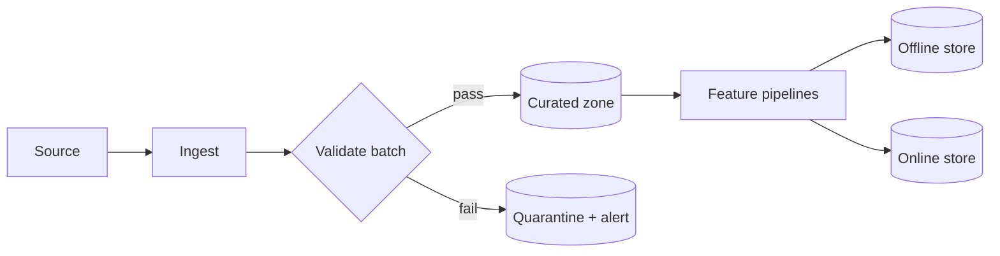

# 02 · Data Engineering & Feature Stores

> **Goal:** guarantee that the data feeding training and serving is valid, consistent, point-in-time correct, and traceable.

### 🌳 Decision Tree: which component, and when?


### 🔗 How this module intersects the others


> Full course map: [assets/tree_00_master_map.svg](assets/tree_00_master_map.svg)


**Contents**
1. [Data contracts & validation](#1-data-contracts--validation)
2. [Feature stores: offline vs online](#2-feature-stores-offline-vs-online)
3. [Feast end-to-end](#3-feast-end-to-end)
4. [Drift detection: data & schema](#4-drift-detection-data--schema)
5. [Lineage tracking](#5-lineage-tracking)
6. [Edge cases & production failures](#6-edge-cases--production-failures)
7. [Senior interview questions & answers](#7-senior-interview-questions--answers)
8. [Tips, Tricks & Field Notes](#8-tips-tricks--field-notes)
9. [Worked Scenario: Nulls jump to 3% after a deploy](#9-worked-scenario-nulls-jump-to-3-after-a-deploy)
10. [More Interview Questions](#10-more-interview-questions)
11. [Where This Module Connects](#11-where-this-module-connects)
12. [Interview Playbook: Tips & Tricks](#12-interview-playbook-tips--tricks)
13. [Scenario-Based Evaluation](#13-scenario-based-evaluation)
14. [Rapid-Fire Round](#14-rapid-fire-round)
- [2.15 Feature Store Design: Ownership, Versioning, Backfills and Build vs Buy](#215-feature-store-design-ownership-versioning-backfills-and-build-vs-buy)
- [2.16 Labels, Label Quality and Data-Centric Workflows](#216-labels-label-quality-and-data-centric-workflows)
- [2.17 Training Data Construction: Splits, Leakage and Sampling](#217-training-data-construction-splits-leakage-and-sampling)

---

## 1. Data contracts & validation

Validation belongs at **every boundary**: ingestion, pre-training, and request time.

| Layer | Question answered | Tool | Cost / latency |
|---|---|---|---|
| Request (online) | Is this single payload well-formed? | Pydantic | µs, in-process |
| Batch ingestion | Does the batch satisfy the contract (schema, nulls, ranges, uniqueness)? | Great Expectations, dbt tests | seconds–minutes |
| Pre-training | Is the distribution similar to previous training data? | Evidently, custom PSI/KS | minutes |
| Post-hoc | Did the feature behave as expected in production? | Logged features + monitors | continuous |



### Request-time validation with Pydantic (v2)

```python
from datetime import datetime
from typing import Annotated
from pydantic import BaseModel, Field, field_validator, ConfigDict

class Transaction(BaseModel):
    model_config = ConfigDict(extra="forbid")   # unknown fields = contract break

    txn_id: str = Field(min_length=8, max_length=64)
    user_id: int = Field(gt=0)
    amount: Annotated[float, Field(ge=0, le=1_000_000)]
    currency: str = Field(pattern=r"^[A-Z]{3}$")
    event_time: datetime

    @field_validator("event_time")
    @classmethod
    def not_future(cls, v: datetime) -> datetime:
        if v > datetime.now(v.tzinfo):
            raise ValueError("event_time in the future")
        return v
```

### Batch validation with Great Expectations (1.x fluent API)

```python
import great_expectations as gx
import pandas as pd

def validate_batch(df: pd.DataFrame) -> bool:
    ctx = gx.get_context(mode="ephemeral")
    src = ctx.data_sources.add_pandas("runtime")
    asset = src.add_dataframe_asset("txns")
    bd = asset.add_batch_definition_whole_dataframe("batch")
    batch = bd.get_batch(batch_parameters={"dataframe": df})

    suite = ctx.suites.add(gx.ExpectationSuite(name="txn_suite"))
    suite.add_expectation(gx.expectations.ExpectColumnValuesToNotBeNull(column="user_id"))
    suite.add_expectation(gx.expectations.ExpectColumnValuesToBeBetween(
        column="amount", min_value=0, max_value=1_000_000))
    suite.add_expectation(gx.expectations.ExpectColumnValuesToBeUnique(column="txn_id"))
    suite.add_expectation(gx.expectations.ExpectColumnValuesToBeInSet(
        column="currency", value_set=["USD", "EUR", "GBP", "INR"]))
    # volume guard: catches half-loaded partitions
    suite.add_expectation(gx.expectations.ExpectTableRowCountToBeBetween(
        min_value=10_000, max_value=5_000_000))

    result = batch.validate(suite)
    return bool(result.success)
```

> Wire the boolean into your orchestrator: **fail the task**, route data to quarantine, page the data owner. Never "log and continue".

## 2. Feature stores: offline vs online

A feature store solves four problems: **reuse**, **training/serving consistency**, **point-in-time correctness**, **low-latency retrieval**.

| Aspect | Offline store | Online store |
|---|---|---|
| Purpose | Build training sets, batch scoring | Real-time inference lookup |
| Storage | Parquet/Delta, BigQuery, Snowflake, Redshift | Redis, DynamoDB, Bigtable, Cassandra |
| Access pattern | Large scans, time-travel joins | Key lookup by entity id |
| Latency | seconds–minutes | 1–10 ms |
| Data kept | Full history | Latest value per entity (TTL) |
| Consistency risk | Late-arriving data | Staleness, missing keys |
| Sync | **Materialization** job (offline → online) | — |

```
                 ┌─────────────── Feature definitions (code, Git) ───────────────┐
 batch sources ─▶│  Transform ─▶ OFFLINE STORE ──(materialize)──▶ ONLINE STORE   │
 stream sources ─▶│  stream transform ───────────────────────────▶ ONLINE STORE   │
                 └────────┬──────────────────────────────────────────┬──────────┘
                          ▼                                          ▼
              get_historical_features()                   get_online_features()
              (point-in-time join → training)             (ms lookup → serving)
```

### Point-in-time (PIT) correctness
For a label at time *t*, you may only join feature values with `event_timestamp ≤ t` (and `> t − TTL`). Joining "latest value" leaks the future.

```
user 7 | feature: avg_spend_30d
  Jan 1 → 100   Jan 8 → 140   Jan 15 → 400 (after fraud event)
label at Jan 10  → must see 140, NOT 400.
```

## 3. Feast end-to-end

Layout:
```
feature_repo/
  feature_store.yaml
  features.py
  data/user_stats.parquet
```

`feature_store.yaml`
```yaml
project: fraud
registry: data/registry.db
provider: local
online_store:
  type: redis
  connection_string: "localhost:6379"
offline_store:
  type: file
entity_key_serialization_version: 3
```

`features.py`
```python
from datetime import timedelta
from feast import Entity, FeatureView, Field, FileSource, FeatureService
from feast.types import Float32, Int64

user = Entity(name="user", join_keys=["user_id"])

user_stats_src = FileSource(
    path="data/user_stats.parquet",
    timestamp_field="event_timestamp",
    created_timestamp_column="created",
)

user_stats = FeatureView(
    name="user_stats",
    entities=[user],
    ttl=timedelta(days=2),          # staleness bound for online serving
    schema=[
        Field(name="avg_spend_30d", dtype=Float32),
        Field(name="txn_count_7d", dtype=Int64),
    ],
    source=user_stats_src,
    online=True,
)

fraud_v1 = FeatureService(name="fraud_v1", features=[user_stats])
```

Operate it:
```bash
feast apply                                        # register definitions
feast materialize-incremental $(date -u +%Y-%m-%dT%H:%M:%S)   # offline → online
```

Training set (point-in-time join) and online retrieval:
```python
import pandas as pd
from feast import FeatureStore

store = FeatureStore(repo_path="feature_repo")

# --- training: entity_df carries labels + the timestamp of each label
entity_df = pd.DataFrame({
    "user_id": [7, 8, 7],
    "event_timestamp": pd.to_datetime(["2026-01-10", "2026-01-10", "2026-01-20"], utc=True),
    "label": [0, 1, 0],
})
train_df = store.get_historical_features(
    entity_df=entity_df, features=store.get_feature_service("fraud_v1")
).to_df()

# --- serving: same feature service, same names
def fetch_features(user_id: int) -> dict:
    resp = store.get_online_features(
        features=store.get_feature_service("fraud_v1"),
        entity_rows=[{"user_id": user_id}],
    ).to_dict()
    return {k: v[0] for k, v in resp.items()}
```

**Serving pattern with explicit missing-feature policy**
```python
DEFAULTS = {"avg_spend_30d": 0.0, "txn_count_7d": 0}

def safe_features(user_id: int) -> tuple[dict, bool]:
    feats = fetch_features(user_id)
    missing = [k for k, v in feats.items() if v is None and k != "user_id"]
    if missing:
        # count it: a rising missing-rate is a pipeline outage signal
        MISSING_FEATURE_COUNTER.labels(feature=",".join(missing)).inc()
        feats = {**feats, **{k: DEFAULTS[k] for k in missing}}
    return feats, bool(missing)
```

## 4. Drift detection: data & schema

| Type | Definition | Example | Detector |
|---|---|---|---|
| **Schema drift** | Structure changes | Column renamed, dtype int→string, new category | Schema diff, contract tests |
| **Covariate (data) drift** | P(X) changes | Avg order value rises after inflation | PSI, KS, JS divergence, Wasserstein |
| **Missingness drift** | Null pattern changes | Upstream sensor offline | Null-rate monitors |
| **Semantic drift** | Meaning changes, same schema | `amount` switches from dollars to cents | Range/unit checks, domain tests |

### Drift metrics

| Metric | Use for | Rule of thumb |
|---|---|---|
| **PSI** (Population Stability Index) | Numeric/binned or categorical | < 0.1 stable · 0.1–0.25 watch · > 0.25 act |
| **KS test** | Continuous, small–mid samples | p-value drops with big N → also look at the statistic |
| **Jensen–Shannon** | Bounded 0–1, symmetric | > 0.1–0.2 notable |
| **Chi-square** | Categorical | Needs adequate counts |

```python
import numpy as np
import pandas as pd
from scipy import stats

def psi(expected: pd.Series, actual: pd.Series, bins: int = 10) -> float:
    """PSI with quantile bins derived from the *reference* sample."""
    edges = np.unique(np.quantile(expected.dropna(), np.linspace(0, 1, bins + 1)))
    edges[0], edges[-1] = -np.inf, np.inf
    e = np.histogram(expected.dropna(), edges)[0] / max(expected.notna().sum(), 1)
    a = np.histogram(actual.dropna(), edges)[0] / max(actual.notna().sum(), 1)
    e, a = np.clip(e, 1e-6, None), np.clip(a, 1e-6, None)   # avoid log(0)
    return float(np.sum((a - e) * np.log(a / e)))

def drift_report(ref: pd.DataFrame, cur: pd.DataFrame) -> pd.DataFrame:
    rows = []
    # schema drift first: it invalidates everything else
    added, removed = set(cur) - set(ref), set(ref) - set(cur)
    dtype_changes = [c for c in ref.columns.intersection(cur.columns) if ref[c].dtype != cur[c].dtype]
    if added or removed or dtype_changes:
        raise ValueError(f"schema drift: +{added} -{removed} dtype:{dtype_changes}")
    for c in ref.select_dtypes("number"):
        rows.append({"feature": c, "psi": psi(ref[c], cur[c]),
                     "ks_stat": stats.ks_2samp(ref[c].dropna(), cur[c].dropna()).statistic,
                     "null_rate_delta": cur[c].isna().mean() - ref[c].isna().mean()})
    return pd.DataFrame(rows).sort_values("psi", ascending=False)
```

Using Evidently for a ready-made report (0.4.x-style API; the import paths and result layout changed in later releases, so pin the version and verify against current documentation):
```python
from evidently.report import Report
from evidently.metric_preset import DataDriftPreset

report = Report(metrics=[DataDriftPreset(stattest_threshold=0.05)])
report.run(reference_data=ref_df, current_data=cur_df)
report.save_html("drift.html")
share_drifted = report.as_dict()["metrics"][0]["result"]["share_of_drifted_columns"]
```

## 5. Lineage tracking

Lineage answers: *"Which raw data, code and transformations produced this prediction/model?"* — essential for audit, debugging and GDPR deletion.

| Level | Captures | Tooling |
|---|---|---|
| Dataset | Table A → job → Table B | OpenLineage / Marquez, DataHub, dbt docs |
| Feature | Feature → source columns → transform commit | Feast registry + Git SHA |
| Model | Model version → run → data hash → code SHA | MLflow tags, DVC `.lock` |
| Prediction | Request id → model version + feature values | Structured prediction log |

Emit OpenLineage-style events from a job:
```python
import uuid, datetime as dt, requests

def emit_lineage(job: str, inputs: list[str], outputs: list[str], state: str = "COMPLETE"):
    event = {
        "eventType": state,
        "eventTime": dt.datetime.now(dt.timezone.utc).isoformat(),
        "run": {"runId": str(uuid.uuid4())},
        "job": {"namespace": "mlops", "name": job},
        "inputs":  [{"namespace": "s3", "name": n} for n in inputs],
        "outputs": [{"namespace": "s3", "name": n} for n in outputs],
        "producer": "https://example.org/mlops/pipelines",
    }
    requests.post("http://marquez:5000/api/v1/lineage", json=event, timeout=5)
```

Always stamp the **prediction log** so any prediction is traceable:
```json
{"request_id":"9f2...","model":"fraud@champion","model_version":17,
 "feature_service":"fraud_v1","features":{"avg_spend_30d":142.5},"score":0.07,"ts":"2026-02-01T10:00:00Z"}
```

## 6. Edge cases & production failures

| Failure | Root cause | Symptom | Fix |
|---|---|---|---|
| **Online/offline inconsistency** | Materialization lagging or failed; offline recomputed with backfill | Model sees stale/default values | Alert on `now - last_materialized`; freshness SLO; skew job |
| **Feature leakage via "latest" join** | Using `merge` on entity id instead of PIT join | Train AUC 0.99, prod 0.7 | Always use `get_historical_features`/`merge_asof` |
| **TTL too short** | Feature older than TTL returns null | Spike in default-filled requests | Align TTL with refresh cadence + buffer; monitor null rate |
| **Hot key in Redis** | One entity (e.g., a bot) hit constantly | p99 latency spike | Local LRU cache, rate limiting, key sharding |
| **Late-arriving events** | Mobile app uploads after offline | Backfilled rows change history; retrain differs | Event-time processing with watermarks, versioned snapshots |
| **Upstream schema change** | Column became nullable / renamed | Nulls flood; model degrades silently | Contract tests in CI of producer, schema registry |
| **Unit change** | Cents vs dollars | PSI explodes on one feature | Range expectations, semantic tests |
| **Cardinality explosion** | New high-cardinality categorical | Embedding OOV rate rises | Track OOV rate; hash/unknown bucket |
| **Backfill poisoning** | Reprocessing with new logic overwrites training history | Past models irreproducible | Immutable snapshots; write new versioned tables |

## 7. Senior interview questions & answers

**Q1. Why use a feature store instead of computing features in the serving code?**
- ❌ *Trap:* "It's faster / it's what everyone uses."
- ✅ *Staff:* It removes training/serving skew by sharing one definition, gives point-in-time-correct training sets, enables reuse across teams, and provides a managed low-latency lookup with freshness and TTL semantics. Cost: another system to operate, so for one model with trivial features I'd skip it and share a tested transformation library instead.

**Q2. Explain point-in-time joins and what happens without them.**
- ❌ *Trap:* "Joins data on timestamps."
- ✅ *Staff:* For each labelled row at time *t* we fetch feature values as they were known at *t* (latest value ≤ t within TTL). Without it, future information leaks into training; offline metrics are inflated and online performance collapses. I validate with a leakage test: shift label timestamps backwards and verify features change accordingly, and compare logged serving features to the offline reconstruction.

**Q3. Online store returns nulls for 3% of requests after a deploy. Diagnose.**
- ❌ *Trap:* "Restart Redis."
- ✅ *Staff:* Check (1) materialization job success/freshness vs TTL; (2) entity key serialization or join-key change in the new release; (3) new entities (cold-start users) never materialized; (4) Redis eviction due to memory policy; (5) a feature view rename that changed key prefixes. Add a missing-rate metric per feature, a defined default/fallback policy, and a freshness alert so the next incident pages us before users notice.

**Q4. How do you detect data drift, and does drift always mean retrain?**
- ❌ *Trap:* "Run a KS test; if p < 0.05, retrain."
- ✅ *Staff:* With large N, KS flags trivial shifts, so I use effect-size metrics (PSI, Wasserstein) with thresholds per feature, weighted by feature importance. Drift is a *signal to investigate*: could be a pipeline bug (fix upstream), a real but benign shift, or concept change. Retrain only when drift correlates with quality loss (proxy metrics or delayed labels) or crosses a policy limit; otherwise retraining on corrupted data makes things worse.

**Q5. Great Expectations vs Pydantic — when do you use which?**
- ❌ *Trap:* "They're the same; pick one."
- ✅ *Staff:* Pydantic validates a single record at request time with microsecond cost and types for application code. GX validates *datasets* — distributions, uniqueness, row counts, cross-column rules — in pipelines and produces reports/data docs. Use both: Pydantic at the API edge, GX at ingestion and before training.

**Q6. How do you handle streaming features (e.g., "transactions in the last 5 minutes")?**
- ❌ *Trap:* "Compute at request time with a SQL query."
- ✅ *Staff:* Maintain windowed aggregates via a stream processor (Flink/Spark Structured Streaming) writing to the online store, with the identical logic replayed in batch for training (or backfill from the event log). Handle late events with watermarks, define feature freshness SLO, and test parity by replaying a day of events through both paths and diffing.

**Q7. A data scientist wants to add a feature from a table owned by another team. What's your checklist?**
- ❌ *Trap:* "Just join it in the training notebook."
- ✅ *Staff:* Ownership/SLA and a data contract; availability at prediction time (latency, no future info); PIT history for training; PII/privacy review; cost; stability (does the upstream get retrained/rewritten?); monitors (null rate, drift); fallback if missing; and registration in the feature store with lineage and an owner.

**Q8. How do you make deletion requests (GDPR) work with lineage?**
- ❌ *Trap:* "Delete the row in the database."
- ✅ *Staff:* Use lineage to find every dataset, feature table, cache and training snapshot containing the subject's key; delete or tokenize there; record the deletion; and decide per policy whether affected models need retraining (usually by schedule, with proof the subject is excluded from the next training snapshot). Pseudonymous keys with a separate mapping table make erasure a single-table operation.


<!-- appendix:start -->

## 8. Tips, Tricks & Field Notes

1. Validate at every boundary: edge (Pydantic), batch (GX), pre-train (drift), post-hoc (served-feature logs).
2. Always log the exact feature vector you served; it is the only way to prove or disprove skew later.
3. Set Feast TTL from refresh cadence plus a buffer; a TTL shorter than the refresh gives silent nulls.
4. Use PSI plus effect-size, not only KS p-values; large N makes p-values meaningless.
5. Version features like APIs: breaking change means a new feature view side by side.
6. Put a row-count guard in every batch suite; half-loaded partitions pass most schema checks.

## 9. Worked Scenario: Nulls jump to 3% after a deploy

**Situation.** Fraud scoring shows 3% of requests with default-filled features right after a release.

**Steps**

1. Check last-materialized timestamp versus TTL.
2. Diff entity key serialization / join keys between old and new release.
3. Check Redis eviction and cold-start entities.
4. Add a per-feature missing-rate metric and a freshness alert.

**Outcome.** Root cause: a join key rename. Fixed in the registry plus alert so the next one pages before users notice.

## 10. More Interview Questions

**Q9. How do you test for point-in-time leakage?**
- ❌ *Trap:* Look at AUC.
- ✅ *Staff:* Shift label timestamps backwards and assert features change accordingly; compare logged serving features to the offline PIT reconstruction.

**Q10. Great Expectations says pass but model quality fell. Why?**
- ❌ *Trap:* GX is broken.
- ✅ *Staff:* Schema checks do not cover semantic drift (cents vs dollars) or joint distributions. Add range/unit expectations and distribution monitors.

**Q11. Backfill vs streaming parity?**
- ❌ *Trap:* Just run the same SQL.
- ✅ *Staff:* Replay a day of events through both paths and diff; handle late events with watermarks; define a freshness SLO.

## 11. Where This Module Connects

| Direction | Module | What flows |
|---|---|---|
| ⬆ Fed by | [01 Foundations](01_mlops_foundations_system_design.md) | data lifecycle |
| ⬇ Feeds | [03 Experiments](03_experiment_tracking_model_versioning.md) | versioned data |
| ⬇ Feeds | [08 Monitoring](08_monitoring_observability_alerting.md) | drift baselines |
| ⬇ Feeds | [11 Failures](11_production_failures_troubleshooting.md) | skew incidents |


<!-- appendix:end -->

<!-- deep:start -->

## 12. Interview Playbook: Tips & Tricks

1. When asked about feature stores, start with the problem (skew, reuse, PIT) before naming Feast.
2. Say 'point-in-time' within your first minute; it separates people who have built training sets from those who haven't.
3. Mention a freshness SLO whenever you mention an online store.
4. Give the cost of validation (latency, ops) alongside its benefit.
5. Offer a fallback for every missing-feature scenario; it signals production maturity.
6. Know when NOT to use a feature store: one model, simple features, shared library may be enough.

## 13. Scenario-Based Evaluation

Each scenario shows what the interviewer is really testing, the answer that loses points, and the answer that earns them.

### Scenario 1: Skew suspected after migration

**Situation.** Online accuracy is 6 points below offline after moving to a feature store.

**What is being evaluated.** Systematic diagnosis of skew versus drift versus leakage.

- ❌ **Weak answer:** Retrain with more data.
- ✅ **Strong answer:**
  1. Log served features; recompute offline for the same entity and time; diff per feature.
  2. Check TTL, materialization lag and default fill rates.
  3. Check join keys and timezone handling.
  4. Check for leakage in the offline set via shifted-label test.

**Likely follow-up:** *How do you automate this check?*

### Scenario 2: Late-arriving events

**Situation.** A mobile app uploads events hours late; features and labels change after the fact.

**What is being evaluated.** Event time, watermarks, reproducibility.

- ❌ **Weak answer:** Ignore late data.
- ✅ **Strong answer:**
  1. Use event time with watermarks; define allowed lateness.
  2. Version snapshots for training so reruns are stable.
  3. Backfill online features with idempotent writes.
  4. Monitor late-event ratio per source.

**Likely follow-up:** *What do you do about labels that arrive late?*

### Scenario 3: PII in feature tables

**Situation.** Security finds raw emails in a feature table used by 6 models.

**What is being evaluated.** Privacy design and blast-radius control.

- ❌ **Weak answer:** Delete the column and move on.
- ✅ **Strong answer:**
  1. Inventory consumers via lineage.
  2. Replace with tokenised keys; keep the mapping table restricted.
  3. Purge snapshots and caches; log deletion evidence.
  4. Add a CI check blocking PII-tagged columns in feature views.

**Likely follow-up:** *How do you handle models already trained on it?*

### Scenario 4: Drift alerts everywhere

**Situation.** Evidently flags 30 of 40 features every day.

**What is being evaluated.** Signal versus noise judgement.

- ❌ **Weak answer:** Raise the threshold until quiet.
- ✅ **Strong answer:**
  1. Check reference window and sample sizes; KS on huge N flags everything.
  2. Switch to effect-size metrics (PSI, Wasserstein) with per-feature thresholds.
  3. Weight by feature importance; require sustained windows.
  4. Compare to a seasonal reference.

**Likely follow-up:** *How do you tune thresholds safely?*

## 14. Rapid-Fire Round

| Question | One-line answer |
|---|---|
| Offline vs online store? | History for training vs latest values for ms lookups. |
| What is materialization? | Copying feature values from offline to online store. |
| PSI thresholds? | <0.1 ok, 0.1-0.25 watch, >0.25 act. |
| Why Pydantic at the edge? | Cheap per-request contract enforcement. |
| Why GX in pipelines? | Dataset-level checks: distributions, uniqueness, row counts. |
| What does TTL do? | Bounds staleness; older values return null. |
| Lineage levels? | Dataset, feature, model, prediction. |
| Fix for hot key in Redis? | Local cache, rate limit, key sharding. |
## 2.15 Feature Store Design: Ownership, Versioning, Backfills and Build vs Buy

### Conceptual Deep Dive
Module 02 sections 2-3 (legacy) explain the offline/online split and a Feast walkthrough; this section covers what makes a feature store survive its second year. A **feature view** is a contract: entity (key and dtype), source, transformation, **TTL**, owner, SLA and version. The registry that stores these contracts is the control surface; consumers read the contract, not the code, and lineage (see 3.16) turns it into a **consumer registry** so a producer knows who a change will hit.

**Versioning rules.** An additive change (a new field, a longer TTL) is safe in place and bumps the minor version. A breaking change (removed or retyped field, changed entity key, changed semantics, shorter TTL) creates a new major version served *side by side* with the old one for a deprecation window, with consumers notified from the registry. Semantic changes with an identical schema (a rolling 7-day window becomes 14 days) are the dangerous case because no schema check fires; hash the transformation code into the contract.

**Backfills.** Recompute from raw data with the *same* transformation code, write to a new versioned table, verify against production values (see the verifier below), then cut over; never overwrite history in place. A backfill with newer logic rewrites training history and makes older models irreproducible, so keep the old materialization until no registered model references it.

**Online/offline sync.** Materialization batches (scheduled offline-to-online copies) are simple but bound freshness by cadence; streaming ingestion lowers staleness at the cost of two code paths (streaming features belong to chapter 14); write-through from the serving path gives the freshest values but couples serving to the store. State the consistency model and acceptable staleness per feature.

| Criterion | DIY tables + Redis | OSS (e.g. Feast) | Managed store |
|---|---|---|---|
| Time to first feature | fast | medium | medium |
| Registry, PIT joins, lineage | you build and own | provided, you operate | provided and operated |
| Operational burden | high over time | medium | low |
| Lock-in and cost control | low lock-in | medium | high; check pricing |

Decide with a weighted score on your own constraints; no vendor ranking is implied. You do **not** need a feature store with one model, one team and batch-only scoring; a versioned table and a shared transformation library are enough.

Edge cases: an entity key changing type (int to string) silently breaks joins and cache keys; a TTL shorter than the materialization cadence returns nulls between runs; and a backfill with newer logic changes training history.

### Cross-Connection Scenarios
- Point-in-time correctness of backfills reuses Module 02 section 2 (legacy) and 2.17.
- Consumer registries are built from lineage, see 3.16.
- Streaming materialization is covered in chapter 14.
- Backfill verification doubles as a data test, see 13.2.

### Production Anti-Patterns
- Treating the store as a shared dumping ground: ownerless features accumulate, nobody can change or delete them, and cost and risk grow unchecked.
- Re-implementing features in the serving service: training/serving skew returns and the store becomes decoration.
- Backfilling in place over production tables: a mistake corrupts live predictions and there is no previous version to restore.

### Minimal Working Code
A feature-view registry classifies a change as additive or breaking and enforces a matching semantic-version bump, returning the consumers to notify.

```python
from dataclasses import dataclass, field

@dataclass
class FeatureView:
    name: str
    version: str
    entity_dtype: str
    fields: dict
    ttl_hours: int
    consumers: list = field(default_factory=list)

def classify_change(old, new):
    if old.entity_dtype != new.entity_dtype or new.ttl_hours < old.ttl_hours:
        return "breaking"                        # a shorter TTL can return nulls between materializations
    if any(new.fields.get(f) != dt for f, dt in old.fields.items()):
        return "breaking"                        # removed or retyped field
    return "additive" if (new.fields.keys() > old.fields.keys() or new.ttl_hours > old.ttl_hours) else "none"

class Registry:
    def __init__(self):
        self.views = {}

    def register(self, fv):
        prev, notify = self.views.get(fv.name), []
        if prev:
            kind = classify_change(prev, fv)
            old, new = [tuple(map(int, v.version.split("."))) for v in (prev, fv)]
            if kind == "breaking" and new[0] <= old[0]:
                raise ValueError("breaking change requires a major bump")
            if kind == "additive" and new <= old:
                raise ValueError("additive change requires a version bump")
            notify = prev.consumers if kind == "breaking" else []
        self.views[fv.name] = fv                 # a real store keeps old majors side by side
        return notify

reg = Registry()
reg.register(FeatureView("user_stats", "1.0.0", "int", {"n_orders": "int"}, 24, ["churn_v3"]))
reg.register(FeatureView("user_stats", "1.1.0", "int", {"n_orders": "int", "avg": "float"}, 24))
try:
    reg.register(FeatureView("user_stats", "1.2.0", "str", {"n_orders": "int", "avg": "float"}, 24))
except ValueError as e:
    print("rejected:", e)
```

A backfill verifier compares recomputed values with stored production values per feature and gates the cutover on match rate and maximum difference.

```python
import numpy as np

def verify_backfill(stored, recomputed, tol=1e-6, min_match=0.999):
    """stored/recomputed: {feature: {entity_id: value}}. Returns a per-feature report."""
    report = {}
    for feat, old in stored.items():
        new = recomputed.get(feat, {})
        common = old.keys() & new.keys()
        diffs = np.array([abs(old[k] - new[k]) for k in common]) if common else np.array([np.inf])
        match = float((diffs <= tol).mean())
        report[feat] = {
            "match_rate": round(match, 4),
            "max_abs_diff": float(diffs.max()),
            "missing": len(old.keys() - new.keys()),
            "pass": match >= min_match and len(old.keys() - new.keys()) == 0,
        }
    return report

rng = np.random.default_rng(0)
ids = range(1000)
stored = {"avg_spend": {i: float(rng.normal()) for i in ids}, "n_orders": {i: float(rng.integers(0, 20)) for i in ids}}
recomputed = {
    "avg_spend": {i: v + 1e-9 for i, v in stored["avg_spend"].items()},       # float noise only
    "n_orders": {i: v + (1.0 if i % 33 == 0 else 0.0) for i, v in stored["n_orders"].items()},  # logic drift
}
rep = verify_backfill(stored, recomputed)
print(rep)
assert rep["avg_spend"]["pass"] and not rep["n_orders"]["pass"]
```

### Interview Angle
**Q:** Two teams depend on a shared feature and one wants to change its definition. Walk through the process.
**A:** Classify the change in the registry; a semantic change is breaking even when the schema is unchanged. Publish a new major version, backfill it from raw with the same code into a new table, and verify against the old values to quantify the shift. Notify consumers from the lineage-based registry, retrain and shadow-compare each model, then deprecate the old version after a window. Trade-off: two versions double storage and compute for the window. Check: backfill match report plus per-consumer offline metric delta before cutover.

**Q:** Argue for or against a feature store for a team with three batch models.
**A:** Against, initially: batch-only, one team and no online serving means versioned tables plus a shared transformation library give point-in-time correctness at far lower operational cost. Revisit when a second team reuses features, online serving appears, or skew incidents recur. Trade-off: delaying adoption risks duplicated feature code; adopting early adds an operated system. Measurable trigger: number of features shared across teams and the count of skew incidents per quarter.

## 2.16 Labels, Label Quality and Data-Centric Workflows

### Conceptual Deep Dive
Models inherit the ceiling of their labels, and in most mature systems the labels, not the architecture, are the cheapest lever. The **data-centric** loop treats the dataset as the product under iteration: error analysis, slice discovery, targeted collection, relabelling, and versioning of both labels and guidelines.

**Label sources** differ in bias and noise. Human annotation is accurate for the guideline but slow and costly. Implicit feedback (clicks, purchases) is plentiful but biased by what was shown. Programmatic or weak supervision (labelling functions combined by a label model) is cheap and noisy. Delayed outcomes (chargebacks, churn) are the truth but arrive late and often only for cases that were acted on.

**Annotation operations.** Write guidelines with worked examples, seed **gold questions** to track annotator accuracy, measure **inter-annotator agreement** (Cohen's kappa for two annotators, Fleiss' kappa for more), and adjudicate disagreements. Kappa corrects raw agreement for chance, so it drops when the class prior is skewed even if raw agreement is high. Rule of thumb: kappa around 0.4 or lower signals ambiguous guidelines, not lazy annotators, so fix the guideline before training.

**Noisy labels** are not irreducible. Audit by the disagreement between model and label: high-loss, high-confidence disagreements are disproportionately label errors. The confident-learning idea (Northcutt et al., 2021) estimates the joint distribution of noisy and true labels from out-of-sample predicted probabilities; the practical version is to relabel the highest-loss slice and measure the metric change.

**Active learning** spends a labelling budget where it helps: uncertainty sampling (entropy or margin) plus diversity so a batch is not ten near-duplicates, in budgeted loops. It breaks through sampling bias (the labelled set no longer represents production, so keep a random holdout for evaluation) and under drift (uncertainty is measured on a stale model). **Delayed and censored labels** need label windows and a maturity rule: a transaction younger than the chargeback window has an unknown, not a negative, label; survival framing handles it explicitly.

Edge cases: annotators who see model predictions anchor on them; labels that change definition mid-project make older data incomparable unless versioned; and the class prior in the labelled sample differs from production, which shifts calibration (see 2.17).

### Cross-Connection Scenarios
- Label windows and censoring connect to leakage control in 2.17 and 13.2.
- Label-flip rate between snapshots is a data test in 13.2.
- Label-free performance estimation when labels are late is in 8.16.
- Annotator bias and guideline effects relate to fairness work in chapter 17.

### Production Anti-Patterns
- Treating label noise as irreducible: the team tunes architectures for months against a ceiling a one-week relabel would lift.
- A single annotator with no agreement measurement: errors and bias are invisible, and the evaluation set inherits them.
- Labelling randomly instead of by uncertainty or error clusters: the budget goes to easy examples and the model's hard cases stay unlabelled.

### Minimal Working Code
Cohen's kappa on two annotators shows how a skewed class prior lowers kappa even though raw agreement is identical.

```python
import numpy as np

def kappa(a, b):
    po = float((a == b).mean())
    pa, pb = a.mean(), b.mean()
    pe = pa * pb + (1 - pa) * (1 - pb)
    return po, (po - pe) / (1 - pe)

def annotators(n11, n10, n01, n00):
    a = np.r_[np.ones(n11), np.ones(n10), np.zeros(n01), np.zeros(n00)]
    b = np.r_[np.ones(n11), np.zeros(n10), np.ones(n01), np.zeros(n00)]
    return a, b

for name, counts in {"balanced": (465, 35, 35, 465), "skewed": (20, 30, 40, 910)}.items():
    po, k = kappa(*annotators(*counts))
    print(f"{name:9s} raw agreement={po:.2f} kappa={k:.2f}")
assert kappa(*annotators(20, 30, 40, 910))[1] < 0.4 < kappa(*annotators(465, 35, 35, 465))[1]
```

An uncertainty-sampling selector ranks by predictive entropy, then applies greedy farthest-point selection inside the uncertain pool so the batch is diverse.

```python
import numpy as np

def entropy(p):
    p = np.clip(p, 1e-9, 1 - 1e-9)
    return -(p * np.log(p) + (1 - p) * np.log(1 - p))

def select(probs, feats, k, pool=60):
    cand = np.argsort(-entropy(probs))[:pool]
    chosen = [int(cand[0])]
    while len(chosen) < k:
        d = np.linalg.norm(feats[cand][:, None, :] - feats[chosen][None, :, :], axis=2).min(axis=1)
        d[np.isin(cand, chosen)] = -1
        chosen.append(int(cand[int(np.argmax(d))]))
    return chosen

def mean_pairwise(feats, idx):
    f = feats[idx]
    d = np.linalg.norm(f[:, None] - f[None], axis=2)
    return d.sum() / (len(idx) * (len(idx) - 1))

rng = np.random.default_rng(0)
feats = rng.normal(size=(400, 4))
probs = 1 / (1 + np.exp(-3 * feats[:, 0]))          # uncertain where feature 0 is near 0
plain = [int(i) for i in np.argsort(-entropy(probs))[:10]]
diverse = select(probs, feats, 10)
print(f"plain top-10 spread={mean_pairwise(feats, plain):.2f} diverse spread={mean_pairwise(feats, diverse):.2f}")
assert mean_pairwise(feats, diverse) > mean_pairwise(feats, plain)
```

### Interview Angle
**Q:** Your fraud labels arrive 45 days late and only for investigated cases. How do you build an unbiased training and evaluation set?
**A:** Train only on matured cohorts (older than the label window), treat younger rows as unlabelled. Correct selection bias by logging the investigation propensity and weighting by its inverse, and reserve a small random-investigation slice as an unbiased evaluation set. Trade-off: the random slice costs analyst time and some missed fraud. Measurable check: compare the metric on the random slice with the weighted metric on the biased set; a large gap means the weights are wrong.

**Q:** Annotator agreement is kappa 0.4. What do you do before training?
**A:** Do not train yet. Inspect disagreements to find ambiguous guidelines or class definitions, revise with examples, adjudicate, and re-measure on a fresh gold set. Check whether skewed priors depress kappa by also reporting per-class agreement. Trade-off: a week of guideline work versus a model that learns noise. Target: kappa above an agreed bar (often 0.6-0.8, a rule of thumb that depends on task difficulty) before bulk labelling.

## 2.17 Training Data Construction: Splits, Leakage and Sampling

### Conceptual Deep Dive
How data is split must mirror how the model will be used. **Random** splits fit i.i.d. problems; **stratified** splits preserve rare-class ratios; **group** splits (by user, device, patient) prevent one entity appearing on both sides; **time-based** splits fit anything that predicts the future, which is most production ML. When unsure, the time-forward split is the honest default, with a group constraint on top.

**Leakage taxonomy.** Target leakage: a feature that encodes the label or is created after it. Temporal leakage: using information from after the prediction time (point-in-time rules, see Module 02 section 2 (legacy)). Group or duplicate leakage: the same user or near-identical rows on both sides. Preprocessing leakage: fitting scalers, imputers or target encoders on the full dataset before splitting. Feature built from the label: aggregates that include the row's own outcome. A suspiciously high single-feature AUC and a train/production gap are the usual symptoms.

**Class imbalance.** Options are reweighting, resampling and threshold moving. Resampling or reweighting shifts the model's predicted base rate, so probabilities are no longer calibrated; correct afterwards with a prior-shift adjustment or recalibrate on an untouched validation set. If you down-sample negatives by a factor of r, odds scale by r, and the corrected probability is p/(p + (1-p)·r) applied to the raw output, which is the standard correction (check it numerically on your data).

**Sampling from logs.** Negative sampling for large candidate spaces and down-sampling frequent classes need importance weights or correction factors, and logs reflect the old policy's exposure, so naive sampling bakes in that bias (see 7.18 for counterfactual treatment). **Golden or frozen evaluation sets** are built once from representative, deduplicated, time-bounded data, versioned, refreshed on a schedule with an overlap period, and protected from contamination: no training run may read them, and any example added to training is removed from the set.

**Reproducible splits** come from hash-based assignment on a stable entity id: hash(salt + id) maps to a bucket, so a row never migrates between train and test across reruns or when more data arrives.

Edge cases: the same user on two devices straddling the split (group by the resolved identity, not the device id); near-duplicate rows (hash normalised content to dedupe before splitting); and a time split that leaves a seasonal event only in the test set, so metrics reflect the event, not the model.

### Cross-Connection Scenarios
- Leakage tests and entity-overlap checks are automated in 13.2.
- Label maturity and censoring tie to 2.16.
- Frozen-set floors and champion comparisons use 3.15 and 13.3.
- Calibration after resampling is verified with the tests in 13.3.

### Production Anti-Patterns
- Using a random split on time-dependent data: offline metrics are optimistic, and the first production week reveals the gap.
- Normalising or imputing on the full dataset before splitting: test statistics leak into training and every metric is inflated.
- Re-drawing the test set each run: results across experiments are not comparable and lucky draws look like improvements.

### Minimal Working Code
Hash-based assignment on a stable id keeps every row on its original side when new data is appended.

```python
import hashlib

def bucket(entity_id, salt="split-v1"):
    digest = hashlib.sha256(f"{salt}:{entity_id}".encode()).hexdigest()
    return int(digest[:8], 16) / 0xFFFFFFFF

def side(entity_id, test_frac=0.2):
    return "test" if bucket(entity_id) < test_frac else "train"

before = {i: side(i) for i in range(1000)}
after = {i: side(i) for i in range(2000)}              # more data arrives later
assert all(before[i] == after[i] for i in before), "a row migrated between train and test"
frac = sum(v == "test" for v in after.values()) / len(after)
print(f"test fraction={frac:.3f}, no rows migrated")
assert 0.15 < frac < 0.25
```

A leakage detector flags features with a suspiciously high single-feature AUC against the label and features nearly collinear with a future-dated column.

```python
import numpy as np

def auc(score, y):
    ranks = np.empty(len(score))
    ranks[np.argsort(score, kind="stable")] = np.arange(1, len(score) + 1)   # ties not averaged
    n1 = int(y.sum()); n0 = len(y) - n1
    return (ranks[y == 1].sum() - n1 * (n1 + 1) / 2) / (n1 * n0)

def leakage_report(X, y, future, auc_thr=0.9, corr_thr=0.9):
    out = []
    for name, col in X.items():
        a = auc(col, y); a = max(a, 1 - a)
        c = abs(float(np.corrcoef(col, future)[0, 1]))
        if a > auc_thr:
            out.append((name, f"single-feature AUC {a:.2f}"))
        if c > corr_thr:
            out.append((name, f"corr with future column {c:.2f}"))
    return out

rng = np.random.default_rng(0)
y = rng.integers(0, 2, 2000)
future = 3 * y + rng.normal(0, 0.5, 2000)               # e.g. value observed 30 days after the event
X = {
    "tenure": rng.normal(size=2000),
    "age": rng.normal(size=2000),
    "refund_flag": y + rng.normal(0, 0.1, 2000),                  # derived from the label
    "days_to_chargeback": future + rng.normal(0, 0.1, 2000),      # built from the future
}
for item in leakage_report(X, y, future):
    print(item)
assert {n for n, _ in leakage_report(X, y, future)} == {"refund_flag", "days_to_chargeback"}
```

### Interview Angle
**Q:** Train AUC 0.98 and production 0.71. Give a systematic leakage hunt.
**A:** Rank features by single-feature AUC and by importance and inspect the top few for post-event information; check each feature's timestamp against prediction time with point-in-time joins; verify entity and near-duplicate overlap across splits; confirm preprocessing was fit on train only; then compare offline-recomputed with logged serving features for skew. Trade-off: time versus certainty; start with the cheap AUC scan. Measurable check: the metric after removing a suspect feature, and after switching to a time-forward group split.

**Q:** You down-sampled negatives 10x for training. How do you fix the predicted probabilities?
**A:** Down-sampling by r multiplies the odds by r, so correct with p' = p / (p + (1 - p) * r), or recalibrate with isotonic or Platt scaling on an untouched, correctly distributed validation set. Ranking metrics are unaffected; thresholds and expected-cost calculations are not. Trade-off: the correction assumes sampling was independent of features. Measurable check: reliability curve and ECE on the unsampled validation set before and after (see 13.3).

<!-- deep:end -->

---
**Prev:** [← 01](01_mlops_foundations_system_design.md) · **Next:** [03 · Experiment Tracking & Versioning →](03_experiment_tracking_model_versioning.md)
