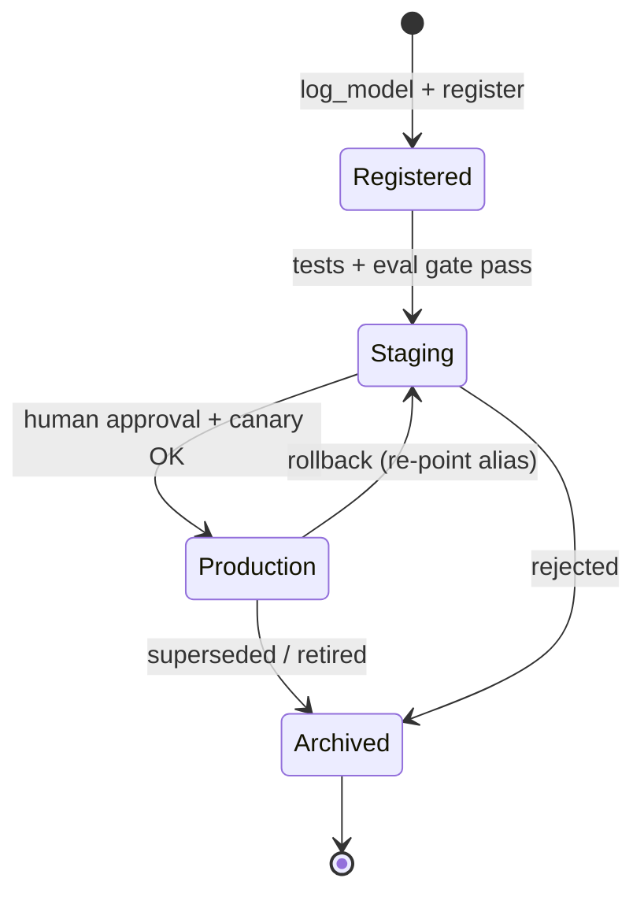

# 04 · Model Registry & Governance

> **Goal:** a single, auditable source of truth for which model version is allowed where, who approved it, and what it was trained on.

### 🌳 Decision Tree: which component, and when?


### 🔗 How this module intersects the others


> Full course map: [assets/tree_00_master_map.svg](assets/tree_00_master_map.svg)


**Contents**
1. [Registry concepts](#1-registry-concepts)
2. [Stages vs aliases (MLflow)](#2-stages-vs-aliases-mlflow)
3. [Promotion workflow with automated gates](#3-promotion-workflow-with-automated-gates)
4. [Model cards](#4-model-cards)
5. [Governance, compliance & audit trails](#5-governance-compliance--audit-trails)
6. [Edge cases & production failures](#6-edge-cases--production-failures)
7. [Senior interview questions & answers](#7-senior-interview-questions--answers)
8. [Tips, Tricks & Field Notes](#8-tips-tricks--field-notes)
9. [Worked Scenario: 3 AM rollback](#9-worked-scenario-3-am-rollback)
10. [More Interview Questions](#10-more-interview-questions)
11. [Where This Module Connects](#11-where-this-module-connects)
12. [Interview Playbook: Tips & Tricks](#12-interview-playbook-tips--tricks)
13. [Scenario-Based Evaluation](#13-scenario-based-evaluation)
14. [Rapid-Fire Round](#14-rapid-fire-round)
- [4.15 Model Risk Tiering and Approval Workflows](#415-model-risk-tiering-and-approval-workflows)
- [4.16 Registry Operations: Packaging, Compatibility and Multi-Environment Promotion](#416-registry-operations-packaging-compatibility-and-multi-environment-promotion)

---

## 1. Registry concepts

| Term | Meaning |
|---|---|
| **Registered model** | A named lineage (e.g. `fraud-detector`) |
| **Model version** | Immutable snapshot: artifact + signature + source run |
| **Stage** (legacy) | `None → Staging → Production → Archived` |
| **Alias** (modern) | Movable pointer: `champion`, `challenger`, `shadow` |
| **Tag** | Free-form key/value: `validation=passed`, `approved_by=alice` |
| **Description / Model card** | Intended use, limits, metrics, ethics |



> **Note:** MLflow (2.9+) deprecates *stages* in favour of **aliases and tags**, because stages are a fixed single-pipeline assumption. Interviewers like to hear that you understand both: stages are a *state machine*; aliases are *named pointers* that allow multiple environments (`prod-eu`, `prod-us`, `shadow`).

## 2. Stages vs aliases (MLflow)

```python
from mlflow import MlflowClient
client = MlflowClient()
NAME = "fraud-detector"

# 1. Register the model produced by a run
mv = client.create_model_version(
    name=NAME,
    source=f"runs:/{run_id}/model",
    run_id=run_id,
    tags={"git.sha": git_sha, "data.version": dvc_rev},
)

# 2. Annotate (lineage + governance)
client.update_model_version(NAME, mv.version,
    description="GBM v7. Trained on 2025-10..2026-01. See model card in artifacts.")
client.set_model_version_tag(NAME, mv.version, "validation", "pending")

# 3. Promote by alias (atomic pointer move; old champion stays intact)
client.set_registered_model_alias(NAME, "challenger", mv.version)
...
client.set_registered_model_alias(NAME, "champion", mv.version)

# 4. Consumers load by alias, never by hard-coded version
import mlflow
model = mlflow.pyfunc.load_model(f"models:/{NAME}@champion")

# 5. Rollback = move alias back (seconds, no rebuild)
client.set_registered_model_alias(NAME, "champion", previous_version)
```

| Approach | Pros | Cons |
|---|---|---|
| Stage transitions | Simple mental model | Single Production slot, deprecated in MLflow |
| Aliases + tags | Multiple environments/regions, flexible | Need conventions; enforce via CI |
| GitOps: version in manifest | Strong audit via Git history; review in PR | Slower; needs PR for each change |

**Best practice:** serving reads the *resolved version number* at deploy time and records it in the deployment manifest (GitOps). Don't let pods silently follow a moving alias at runtime without a change record—otherwise a registry change = unreviewed prod change.

## 3. Promotion workflow with automated gates

Gates convert policy into code. Typical set:

| Gate | Check | Fail action |
|---|---|---|
| **Signature** | Model has input/output signature | Reject |
| **Reproducibility** | `git.dirty=False`, data version tagged | Reject |
| **Offline quality** | Metric ≥ champion − ε on frozen holdout | Reject |
| **Slice fairness/regression** | No protected slice drops > δ | Reject / escalate |
| **Performance** | p95 latency, memory under budget | Reject |
| **Security** | Dependency scan, model file scan (no unsafe pickles) | Reject |
| **Human approval** | Named approver for high-risk models | Wait |

```python
"""promote.py — run in CI after training. Exits non-zero if any gate fails."""
import sys
import mlflow
from mlflow import MlflowClient
from mlflow.exceptions import MlflowException

NAME = "fraud-detector"
MAX_REGRESSION = 0.002          # allowed AUC drop vs champion
MAX_SLICE_DROP = 0.02
MAX_P95_MS = 40

def metric(run_id, key):
    return MlflowClient().get_run(run_id).data.metrics.get(key)

def main(new_version: str):
    c = MlflowClient()
    new = c.get_model_version(NAME, new_version)
    errors = []

    if new.tags.get("git.dirty", "True") != "False":
        errors.append("training tree was dirty")
    if not mlflow.models.get_model_info(f"models:/{NAME}/{new_version}").signature:
        errors.append("missing signature")

    champ = None
    try:
        champ = c.get_model_version_by_alias(NAME, "champion")
    except MlflowException as e:
        if e.error_code != "RESOURCE_DOES_NOT_EXIST":     # only "no champion yet" is benign; anything else fails closed
            raise
        # first model: no champion yet, skip comparison gates

    if champ is not None:
        c_auc, n_auc = metric(champ.run_id, "holdout_auc"), metric(new.run_id, "holdout_auc")
        if c_auc is None or n_auc is None:
            errors.append("missing holdout_auc (cannot compare to champion)")
        elif n_auc < c_auc - MAX_REGRESSION:
            errors.append(f"AUC regression {n_auc:.4f} < {c_auc:.4f}")
        champ_metrics = c.get_run(champ.run_id).data.metrics
        for k, v in c.get_run(new.run_id).data.metrics.items():
            if k.startswith("slice_auc."):
                base = champ_metrics.get(k)
                if base is not None and v < base - MAX_SLICE_DROP:
                    errors.append(f"slice regression {k}: {v:.3f} vs {base:.3f}")

    p95 = metric(new.run_id, "p95_latency_ms")
    if p95 is None or p95 > MAX_P95_MS:                  # a missing metric is a failure, not a pass
        errors.append("latency budget exceeded or p95_latency_ms missing")

    if errors:
        c.set_model_version_tag(NAME, new_version, "validation", "failed")
        c.set_model_version_tag(NAME, new_version, "validation_errors", "; ".join(errors))
        print("\n".join(f"GATE FAIL: {e}" for e in errors)); sys.exit(1)

    c.set_model_version_tag(NAME, new_version, "validation", "passed")
    c.set_registered_model_alias(NAME, "challenger", new_version)
    print(f"v{new_version} passed all gates -> alias 'challenger'")

if __name__ == "__main__":
    main(sys.argv[1])
```

GitHub Actions job gating promotion to `champion` on a protected environment (required reviewers = human approval):
```yaml
jobs:
  promote:
    runs-on: ubuntu-latest
    environment: production        # configure required reviewers in repo settings
    steps:
      - uses: actions/checkout@v4
      - run: pip install mlflow
      - env:
          MLFLOW_TRACKING_URI: ${{ secrets.MLFLOW_URI }}
        run: python scripts/set_champion.py ${{ inputs.version }}
```

## 4. Model cards

A model card documents intended use and limits. Store as `MODEL_CARD.md` artifact attached to the version; render in the registry description.

```markdown
# Model Card — fraud-detector v7
## Overview
Gradient-boosted trees scoring card-not-present transactions. Owner: risk-ml@company
## Intended use / out of scope
Real-time scoring for e-commerce payments < $10k. Not for credit decisions or account closure.
## Training data
2025-10-01..2026-01-31, 41M txns, DVC rev `a1f9c2`, fraud rate 0.31%. Excludes: marketplace B (no labels).
## Evaluation (holdout 2026-02, n=3.2M)
| Metric | Overall | EU | APAC | New users |
|---|---|---|---|---|
| ROC-AUC | 0.962 | 0.964 | 0.955 | 0.921 |
| Recall@1% FPR | 0.71 | 0.72 | 0.68 | 0.52 |
## Limitations & risks
Weaker on new users (<7 days). Drift sensitive to promotions. Labels delayed 30–45 days.
## Fairness analysis
No significant disparity by device type; geographic analysis in appendix A.
## Operational
p95 latency 18 ms; fallback: rule-based v2; retrain monthly or PSI>0.25.
## Approvals
Reviewed: <name>, Risk <date>; Privacy review ticket REF-1234.
```

## 5. Governance, compliance & audit trails

| Concern | Requirement | Implementation |
|---|---|---|
| **Traceability** | Reproduce any model, prove inputs | Run + git SHA + data version + image digest tags |
| **Access control** | Only approvers can promote | Registry RBAC; protected CI environments; separate roles |
| **Segregation of duties** | Builder ≠ approver | CODEOWNERS / environment reviewers |
| **Audit trail** | Who changed what, when | Registry event log → SIEM; Git history of manifests |
| **Explainability** | Reasons for decisions (e.g., adverse action) | SHAP artifacts, reason codes at inference |
| **Regulatory classification** | e.g., EU AI Act risk tiers, SR 11-7 model risk management | Risk tier tag drives required gates/approvals |
| **Retention** | Keep records N years | Immutable bucket (object lock), archived versions are never hard-deleted |
| **Right to erasure** | Remove subject data | Lineage → retrain schedule (see module 02) |

Audit-event emission whenever an alias moves:
```python
import json, logging, getpass, datetime as dt
audit = logging.getLogger("model_audit")

def audited_set_alias(client, name, alias, version, reason: str, ticket: str):
    prev = None
    try: prev = client.get_model_version_by_alias(name, alias).version
    except Exception: pass
    client.set_registered_model_alias(name, alias, version)
    audit.info(json.dumps({
        "ts": dt.datetime.now(dt.timezone.utc).isoformat(), "actor": getpass.getuser(),
        "model": name, "alias": alias, "from": prev, "to": version,
        "reason": reason, "ticket": ticket}))
```

## 6. Edge cases & production failures

| Failure | Root cause | Lesson / fix |
|---|---|---|
| **Wrong model in prod after "rollback"** | Serving pods cached old model; alias moved but pods not restarted | Deploy by pinned version via manifest; rollout restart; expose `model_version` metric and alert on mismatch |
| **Alias race condition** | Two pipelines set `champion` concurrently | Single promotion service, serialized, with optimistic check on expected previous version |
| **Registry down → serving fails to start** | Pod loads model at start from registry | Bake model into image or pull from artifact cache; start from last-known-good local copy |
| **Archived model deleted, audit asks for it** | Cleanup job removed artifacts | Retention policy in code; object lock; delete only after retention |
| **Approval theatre** | Approver clicks yes without evidence | Approval UI shows gate report + diffs; require ticket and metric deltas |
| **Model + preprocessing mismatch** | Registered model excludes the scaler | Package preprocessing in the model (pipeline/pyfunc) so version = full function |
| **Unsafe deserialization** | Pickle from unknown source | Prefer safetensors/ONNX; scan; restrict who can write to registry |

## 7. Senior interview questions & answers

**Q1. Why are MLflow stages being replaced by aliases?**
- ❌ *Trap:* "Aliases are just renamed stages."
- ✅ *Staff:* Stages hard-code a single linear flow with one Production slot per model. Real systems have several environments, regions, shadow/canary variants and A/B arms. Aliases are arbitrary movable names, pairing naturally with tags for state (`validation=passed`), enabling `prod-eu` vs `prod-us` and `challenger`, while leaving the version immutable.

**Q2. How would you implement "four-eyes" approval for production models?**
- ❌ *Trap:* "Send a Slack message asking someone to approve."
- ✅ *Staff:* Make approval a machine-enforced control: promotion only occurs via a CI job in a protected environment with required reviewers different from the author; the job posts the automated gate report; registry write permissions are restricted to the CI service principal; every alias change is logged to an immutable audit stream with ticket reference.

**Q3. A model needs urgent rollback at 3 AM. What should already be in place?**
- ❌ *Trap:* "Redeploy the previous version from the notebook."
- ✅ *Staff:* Previous version retained and still loadable, deployment manifest pinned to version so rollback is a one-line revert (GitOps) or alias re-point, health checks and a `model_version` metric to confirm, a runbook with the decision criteria (error rate, business KPI), and tested rollback drills. Time-to-rollback is a tracked SLO; target < 5 min.

**Q4. Should serving load models from the registry at runtime?**
- ❌ *Trap:* "Yes, always `models:/name@champion` so it's auto-updated."
- ✅ *Staff:* Runtime alias-following couples availability to the registry and makes prod changes without a deploy record. I resolve the alias to a version in CI/CD, bake or fetch immutably (digest-checked) into the image or init-container, and let GitOps be the change record. Auto-follow is acceptable only for non-critical internal models with caching and a last-known-good fallback.

**Q5. What belongs in a model card, and who reads it?**
- ❌ *Trap:* "Accuracy and a description."
- ✅ *Staff:* Intended/out-of-scope uses, training data window and exclusions, slice-level metrics, known failure modes, fairness analysis, operating thresholds, monitoring and fallback plan, approvals. Readers: product owners (can I use it for X?), risk/compliance (audit), on-call engineers (what breaks?), future retrainers (what changed?).

**Q6. How do you handle models that are legally high risk (credit, hiring, health)?**
- ❌ *Trap:* "Same pipeline, just add logging."
- ✅ *Staff:* Risk tier drives controls: mandatory independent validation, explainability artifacts (reason codes), bias testing across protected groups, stricter change management, documented human-in-the-loop, longer retention, periodic revalidation, challenger-only until sign-off. Pipeline enforces by tier tag so developers can't skip steps.

**Q7. Two teams register models under the same name. What breaks, and how do you prevent it?**
- ❌ *Trap:* "Nothing, versions auto-increment."
- ✅ *Staff:* Version history mixes unrelated lineages, consumers could load the wrong thing, and gates compare against the wrong champion. Prevent with naming conventions (`team.domain.model`), registry-level permissions per namespace, and CI checks that the signature/schema is compatible with the previous version of the same name.

**Q8. How do you prove which model scored a particular customer 8 months ago?**
- ❌ *Trap:* "Check what's in production today."
- ✅ *Staff:* The prediction log stores `model_name`, `model_version`, request id and feature snapshot (or reference). The registry retains that version immutably, with its run lineage to data/code. For regulated flows, logs are written to WORM storage with retention matching regulation.


<!-- appendix:start -->

## 8. Tips, Tricks & Field Notes

1. Prefer aliases over stages; multiple environments and shadow variants need named pointers.
2. Resolve the alias to an immutable version in CI and record it in the manifest.
3. Package preprocessing inside the model so version equals full function.
4. Make approval a machine-enforced control (protected environment), not a Slack message.
5. Emit an audit event on every alias move: actor, from, to, reason, ticket.
6. Keep the previous version loadable; rollback time should be a tracked SLO.

## 9. Worked Scenario: 3 AM rollback

**Situation.** A new champion drops approval rate by 12% overnight.

**Steps**

1. Move the traffic weight to 0 or re-point the alias to the previous version.
2. Confirm via the model_version metric that pods run the old version.
3. Open an incident; preserve shadow logs.
4. Backfill a regression test that would have caught it.

**Outcome.** Rollback in under five minutes because the previous version, manifest and runbook already existed.

## 10. More Interview Questions

**Q9. Should serving auto-follow the champion alias?**
- ❌ *Trap:* Yes, simplest.
- ✅ *Staff:* Only with caching and last-known-good; otherwise registry changes become unreviewed prod changes. Pin versions via GitOps.

**Q10. How do you prove which model scored a customer 8 months ago?**
- ❌ *Trap:* Check production.
- ✅ *Staff:* Prediction log holds model name, version, request id and feature snapshot; registry retains the immutable version with lineage.

**Q11. Handle a high-risk (credit) model?**
- ❌ *Trap:* Same pipeline plus logging.
- ✅ *Staff:* Risk tier tag drives mandatory gates: independent validation, bias testing, explainability artifacts, longer retention, periodic revalidation.

## 11. Where This Module Connects

| Direction | Module | What flows |
|---|---|---|
| ⬆ Fed by | [03 Experiments](03_experiment_tracking_model_versioning.md) | runs become versions |
| ⬇ Feeds | [05 CI/CD/CT](05_cicd_ct_automation_pipelines.md) | gates + promotion |
| ⬇ Feeds | [10 Security](10_security_privacy_compliance.md) | RBAC + approvals |


<!-- appendix:end -->

<!-- deep:start -->

## 12. Interview Playbook: Tips & Tricks

1. Say 'aliases and tags' not just 'stages'; it shows you track MLflow's direction.
2. Describe promotion as code (gates) plus a human control for high-risk models.
3. Always connect governance to a concrete artifact: model card, audit log, approval record.
4. Explain rollback time as an SLO you have tested.
5. Mention segregation of duties explicitly; auditors care.
6. When asked about registry downtime, describe last-known-good loading.

## 13. Scenario-Based Evaluation

Each scenario shows what the interviewer is really testing, the answer that loses points, and the answer that earns them.

### Scenario 1: Auditor request

**Situation.** An auditor asks for evidence that a loan model was validated and approved before use.

**What is being evaluated.** Governance and traceability.

- ❌ **Weak answer:** Show the Slack approval.
- ✅ **Strong answer:**
  1. Registry version links to run, git sha, data version and image digest.
  2. Gate report stored as artifact; approver identity from protected environment.
  3. Model card with intended use, slices, limitations.
  4. Immutable audit log of alias changes with ticket references.

**Likely follow-up:** *What gaps would an auditor find in your current setup?*

### Scenario 2: Registry outage

**Situation.** The registry is down while a deploy and autoscale event happen.

**What is being evaluated.** Resilience design.

- ❌ **Weak answer:** Wait for it to recover.
- ✅ **Strong answer:**
  1. Serving should not depend on registry at runtime; artifacts baked or cached with checksum.
  2. Pods start from last-known-good local copy.
  3. Deployments pin versions in manifests.
  4. Registry outage then blocks promotion only, not serving.

**Likely follow-up:** *How do you test this?*

### Scenario 3: Concurrent promotions

**Situation.** Two pipelines set the champion alias within seconds of each other.

**What is being evaluated.** Concurrency control.

- ❌ **Weak answer:** Hope it doesn't happen.
- ✅ **Strong answer:**
  1. Single promotion service serialising changes.
  2. Optimistic check on expected previous version.
  3. Audit event on every move.
  4. Reject stale promotions and notify owners.

**Likely follow-up:** *How do you detect after the fact that it happened?*

### Scenario 4: Model without preprocessing

**Situation.** Registered model expects scaled inputs but the service sends raw ones; accuracy drops.

**What is being evaluated.** Packaging discipline.

- ❌ **Weak answer:** Tell clients to scale.
- ✅ **Strong answer:**
  1. Package preprocessing with the model (pipeline or pyfunc).
  2. Signature enforcement in the gate.
  3. Contract test in CI hitting the packaged model with raw input.
  4. Version equals full function.

**Likely follow-up:** *How do you roll out the fix without breaking clients?*

## 14. Rapid-Fire Round

| Question | One-line answer |
|---|---|
| Stages vs aliases? | Fixed lifecycle slots vs movable named pointers. |
| Why tags? | Free-form state like validation=passed. |
| What is a model card? | Intended use, data, slice metrics, limits, approvals. |
| Rollback by alias? | Re-point to the previous version; no rebuild. |
| Segregation of duties? | Builder is not approver. |
| Audit trail content? | Actor, model, from, to, reason, ticket, time. |
| Why pin versions in manifests? | Registry change should not equal unreviewed prod change. |
| Safe artifact formats? | ONNX or safetensors, signed. |
## 4.15 Model Risk Tiering and Approval Workflows

### Conceptual Deep Dive
A **risk tier** decides how much process a model deserves. Score two axes: **impact** (financial, safety, legal, reputational harm if the model is wrong) and **autonomy** (advisory, where a human decides, versus automated, where the output is the decision). Add modifiers such as use of PII or sensitive attributes. The tier then sets gate strictness, who must review, monitoring depth and review cadence. A low tier might need a model card and an eval report; a high tier adds independent validation, a slice and fairness report, lineage back to data snapshots and a tested rollback plan.

| Tier | Typical example | Reviewers | Revalidation |
|---|---|---|---|
| 1 | internal ranking, advisory | peer | on material change |
| 2 | customer-facing, reversible | peer + owner | time-based, e.g. yearly (rule of thumb) |
| 3 | automated credit or safety decision | independent validator + risk | time, drift and change |

Approval design rests on **separation of duties**: author is not approver, and high tiers need a validator who did not build the model. The evidence package (lineage, eval report, slice report, model card, rollback plan) lives in the registry next to the version, not in chat or email. Banking model-risk supervision (SR 11-7 style) frames this generically as development, independent validation and ongoing monitoring; regulations change, so verify primary sources rather than quoting from memory. Encode the policy as code: required metadata per tier, CI checks that fail closed when anything is missing or unknown (contrast Module 04 section 3 (legacy), whose promote script swallows exceptions), and protected environments with required reviewers. **Exceptions** need a break-glass path: an emergency change is allowed but expires, is logged, and is reviewed retroactively within a fixed window. **Revalidation** is triggered by time, drift alerts or material change (new features, new population, new vendor dependency). Edge cases: a tier assigned once and never revisited as the model's use expands; approvers who rubber-stamp under workload (measure approval time and rejection rate); an emergency fix that quietly becomes permanent.

### Cross-Connection Scenarios
- Tier drives the model card and review board in 17.4 and the evidence pack in 10.16.
- Gates run as automated checks in the promotion flow of Module 04 section 3 (legacy).
- Revalidation triggers consume drift signals from chapter 8.
- Compatibility checks before promotion are in 4.16.

### Production Anti-Patterns
- One process for every model: either a ranking widget waits weeks for review, or a credit model ships with a peer glance.
- Approval by chat message with no record: nobody can prove who approved what when an auditor asks.
- Evidence stored outside the registry: links rot and the approved version cannot be tied to its evidence.

### Minimal Working Code
A fail-closed tier engine: unknown values raise instead of defaulting to the lowest tier.

```python
from dataclasses import dataclass

@dataclass(frozen=True)
class ModelRecord:
    name: str
    impact: str      # low | medium | high
    autonomy: str    # advisory | automated
    uses_pii: bool

BASE = ["model_card", "eval_report"]
GATES = {1: BASE, 2: BASE + ["slice_report", "rollback_plan"],
         3: BASE + ["slice_report", "rollback_plan", "independent_validation", "lineage"]}

def compute_tier(r: ModelRecord) -> int:
    score = {"low": 0, "medium": 1, "high": 2}[r.impact]      # KeyError = fail closed
    score += {"advisory": 0, "automated": 1}[r.autonomy] + int(r.uses_pii)
    return 3 if score >= 3 else 2 if score >= 2 else 1

def missing_gates(r: ModelRecord, version_artifacts: set) -> list:
    return [g for g in GATES[compute_tier(r)] if g not in version_artifacts]

credit = ModelRecord("credit", "high", "automated", True)
rank = ModelRecord("ranker", "low", "advisory", False)
assert compute_tier(credit) == 3 and compute_tier(rank) == 1
print(missing_gates(credit, {"model_card", "eval_report"}))
assert missing_gates(rank, {"model_card", "eval_report"}) == []
```

A hash-chained approval ledger: editing or deleting any past record breaks every later hash.

```python
import hashlib, json

GENESIS = "0" * 64

def _hash(prev: str, rec: dict) -> str:
    return hashlib.sha256((prev + json.dumps(rec, sort_keys=True)).encode()).hexdigest()

class Ledger:
    def __init__(self):
        self.rows = []
    def approve(self, model: str, version: int, author: str, approver: str, decision: str):
        if author == approver:
            raise PermissionError("author cannot approve own model")
        rec = dict(model=model, version=version, author=author, approver=approver, decision=decision)
        prev = self.rows[-1]["hash"] if self.rows else GENESIS
        self.rows.append({"rec": rec, "prev": prev, "hash": _hash(prev, rec)})

def verify(rows: list) -> int:
    """Return index of first corrupt row, or -1 if the chain is intact."""
    prev = GENESIS
    for i, r in enumerate(rows):
        if r["prev"] != prev or r["hash"] != _hash(prev, r["rec"]):
            return i
        prev = r["hash"]
    return -1

led = Ledger()
led.approve("credit", 3, "ana", "raj", "approved")
led.approve("credit", 4, "ana", "raj", "approved")
assert verify(led.rows) == -1
led.rows[0]["rec"]["decision"] = "rejected"   # tamper
print("first corrupt row:", verify(led.rows))
```

### Interview Angle
**Q:** Design an approval process for a credit model versus a product-ranking model. **A:** Tier by impact and autonomy. Ranking is tier 1: peer review, model card, automated eval gate, rollback by alias. Credit is tier 3: independent validation, fairness and slice report, lineage, documented rollback, protected-environment approval, annual revalidation. Trade-off: rigor costs lead time, so keep tier 1 fast. Check: median time-to-approve per tier and zero tier-3 versions in production without a complete evidence package.

**Q:** How do you keep approvals meaningful rather than ceremonial? **A:** Require evidence the reviewer must actively open (diff against champion, slice table), enforce author != approver in the platform, and track rejection and rework rates per approver. A rate near zero signals rubber-stamping. Sample approved versions for later re-review and cap reviewer queue size. Trade-off: more reviewer time. Check: post-launch incidents traced to an approved defect.

## 4.16 Registry Operations: Packaging, Compatibility and Multi-Environment Promotion

### Conceptual Deep Dive
A registered version must be **self-sufficient**: weights, the preprocessing that produced its inputs, a **signature** (column names, dtypes, shapes), an environment spec (lockfile or image digest), the feature-service version it was trained against, decision thresholds, and metadata (data snapshot, metrics, owner). Registering weights alone is the classic trap, because a different preprocessing code path at serving silently changes predictions.

**Packaging** trades portability against fidelity. Native flavors (MLflow pyfunc) preserve behaviour and bundle preprocessing but tie you to Python and a runtime. ONNX and similar exchange formats are portable and fast but can lose custom operators. Containers capture the whole environment at the cost of size and rebuild discipline. Prefer safe serialization (safetensors or ONNX over pickle for untrusted artifacts; see chapter 10).

**Compatibility matrices** span model signature, feature-service schema, serving runtime and client request schema. Check them at promotion time, not at first request: a model needing a deprecated or not-yet-produced feature must be blocked before it reaches production.

**Promotion** across environments should copy the artifact **by digest**, never rebuild: a rebuilt environment differs from the tested one. Registry per environment gives isolation and blast-radius control but needs cross-account access and a promotion tool; one shared registry is simpler but risks accidental production aliasing and permission sprawl. Either way, aliases move only after the digest is verified.

**Retirement**: use telemetry to find consumers, announce, move to archived state, and retain metadata and artifacts for the audit period rather than deleting versions that audits reference. **Operations**: registry high availability, backups, rate limits, and large artifacts in object storage separate from the metadata database. Edge cases: metadata restored from backup while artifacts are missing (verify digests in a periodic restore drill); a model needing a deprecated feature version; an environment rebuilt with a newer library minor version that changes numerical behaviour.

### Cross-Connection Scenarios
- Feature-service versions and schemas come from chapter 2.
- Promotion gates and approvals are in 4.15; evidence retention is 10.16.
- Serving runtimes and formats are in chapter 6.
- Contract tests for the schema checks are in 13.5.

### Production Anti-Patterns
- Registering weights without preprocessing: serving reimplements it and training/serving skew follows.
- Rebuilding artifacts per environment: production runs something nobody tested.
- Deleting versions referenced by audits: you cannot reproduce or explain a past decision.

### Minimal Working Code
A compatibility checker returning human-readable breakages.

```python
def check_compat(model_sig, feature_schema, client_schema, deprecated=frozenset()):
    """Each model input must come from the feature service or the client, with matching dtype."""
    problems = []
    for col, dtype in model_sig.items():
        src = feature_schema if col in feature_schema else client_schema if col in client_schema else None
        if src is None:
            problems.append(f"'{col}' ({dtype}) is produced by neither feature service nor client")
        elif src[col] != dtype:
            problems.append(f"'{col}': model expects {dtype}, source provides {src[col]}")
        elif col in deprecated:
            problems.append(f"'{col}' is a deprecated feature")
    return problems

sig = {"age": "int64", "tenure": "float64", "country": "str", "new_score": "float64"}
features = {"age": "int64", "tenure": "int64", "country": "str"}
client = {"country": "str"}
for p in check_compat(sig, features, client, deprecated={"country"}):
    print("BLOCK:", p)
assert check_compat({"age": "int64"}, features, client) == []
```

A promotion simulation: copy by digest, verify, move the alias last, roll back on failure.

```python
import hashlib

def digest(b: bytes) -> str:
    return hashlib.sha256(b).hexdigest()

def promote(src, dst, key, alias="champion", copy=lambda b: b):
    """src/dst: {'artifacts': {key: bytes}, 'digests': {key: str}, 'aliases': {name: key}}."""
    want = src["digests"][key]
    if digest(src["artifacts"][key]) != want:
        raise ValueError("source artifact does not match its recorded digest")
    prev_alias = dst["aliases"].get(alias)
    existed = key in dst["artifacts"]
    try:
        dst["artifacts"][key] = copy(src["artifacts"][key])
        if digest(dst["artifacts"][key]) != want:
            raise ValueError("copy corrupted in transit")
        dst["digests"][key] = want
        dst["aliases"][alias] = key                 # alias moves only after verification
    except Exception:
        if not existed:
            dst["artifacts"].pop(key, None)
            dst["digests"].pop(key, None)
        if prev_alias is not None:
            dst["aliases"][alias] = prev_alias
        raise

blob = b"weights+preprocess"
stage = {"artifacts": {("m", 2): blob}, "digests": {("m", 2): digest(blob)}, "aliases": {}}
prod = {"artifacts": {}, "digests": {}, "aliases": {"champion": ("m", 1)}}
try:
    promote(stage, prod, ("m", 2), copy=lambda b: b[:-1])   # simulated corruption
except ValueError as e:
    print("rolled back:", e, prod["aliases"])
promote(stage, prod, ("m", 2))
assert prod["aliases"]["champion"] == ("m", 2)
```

### Interview Angle
**Q:** A model needs a new feature that serving doesn't produce yet. What stops it from reaching prod and how do you design that check? **A:** A promotion gate compares the model signature to the feature-service schema and the client schema and fails if any input has no producer or a mismatched dtype. Pair it with an integration test that requests real features for sample entities. Trade-off: strict gates slow experimentation, so run the check early in CI too. Check: zero production incidents from missing features, and gate failures caught before the approval stage.

**Q:** Single registry or one per environment? Argue both. **A:** Per-environment registries isolate blast radius and permissions; production holds only vetted, digest-verified copies, at the cost of a promotion tool and cross-account access. One shared registry gives a single lineage view and simpler tooling, but a mistaken alias or permission affects production directly. I would choose per-environment for high tiers, one registry with strict environment-scoped permissions for small teams. Check: every production artifact's digest matches the tested one.

<!-- deep:end -->

---
**Prev:** [← 03](03_experiment_tracking_model_versioning.md) · **Next:** [05 · CI/CD/CT Automation →](05_cicd_ct_automation_pipelines.md)
