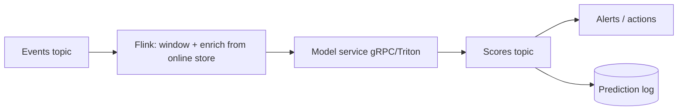

# 06 · Model Serving Architecture

> **Goal:** pick and build the right inference pattern (real-time, batch, streaming) and serve it with predictable latency, throughput and cost.

### 🌳 Decision Tree: which component, and when?


### 🔗 How this module intersects the others


> Full course map: [assets/tree_00_master_map.svg](assets/tree_00_master_map.svg)


**Contents**
1. [Serving patterns compared](#1-serving-patterns-compared)
2. [FastAPI real-time service](#2-fastapi-real-time-service)
3. [Triton Inference Server](#3-triton-inference-server)
4. [TorchServe](#4-torchserve)
5. [Batch inference](#5-batch-inference)
6. [Streaming inference (Kafka)](#6-streaming-inference-kafka)
7. [Edge cases & production failures](#7-edge-cases--production-failures)
8. [Senior interview questions & answers](#8-senior-interview-questions--answers)
9. [Tips, Tricks & Field Notes](#9-tips-tricks--field-notes)
10. [Worked Scenario: p99 is 2s while p50 is 40 ms](#10-worked-scenario-p99-is-2s-while-p50-is-40-ms)
11. [More Interview Questions](#11-more-interview-questions)
12. [Where This Module Connects](#12-where-this-module-connects)
13. [Interview Playbook: Tips & Tricks](#13-interview-playbook-tips--tricks)
14. [Scenario-Based Evaluation](#14-scenario-based-evaluation)
15. [Rapid-Fire Round](#15-rapid-fire-round)
- [6.16 Model Optimization for Serving: Quantization, Distillation, Pruning and Compilation](#616-model-optimization-for-serving-quantization-distillation-pruning-and-compilation)
- [6.17 Latency Budgets, Tail Latency and Load Shedding](#617-latency-budgets-tail-latency-and-load-shedding)
- [6.18 Serving Platforms, Multi-Model Serving and Edge/On-Device Inference](#618-serving-platforms-multi-model-serving-and-edgeon-device-inference)

---

## 1. Serving patterns compared

| Pattern | Latency | Throughput | Freshness of features | Cost profile | Use when |
|---|---|---|---|---|---|
| **Online (REST/gRPC)** | ms–100s ms | Per-request, scale with replicas | Real-time | Always-on capacity | User-facing decisions (fraud, ranking) |
| **Batch** | Minutes–hours | Very high | As of batch time | Cheap, spot/preemptible | Nightly scores, recommendations pre-compute |
| **Streaming** | 10 ms–seconds | High, continuous | Near-real-time | Always-on stream infra | Event-driven (IoT, clickstream, anomaly) |
| **Embedded/edge** | µs–ms | Device-bound | Local | Distribution cost | Offline, privacy, extreme latency |

```
                    ┌────────────────────── Online ──────────────────────┐
 Client ─▶ Gateway ─▶ API (validate, features, predict, log) ─▶ Response
                    └──────────┬──────────────────────────────────────────┘
                               ▼ async: prediction log (Kafka) ─▶ monitoring/labels
 Batch:   Scheduler ─▶ read table ─▶ Spark/Ray map(predict) ─▶ write table
 Stream:  Kafka in ─▶ Flink/consumer (window, enrich) ─▶ model ─▶ Kafka out
```

**Decision shortcut:** Can the prediction be computed before the user asks? → **batch**. Does it depend on events from the last seconds? → **online/stream**. Does the decision need an immediate response? → **online**.

| Protocol | Pros | Cons |
|---|---|---|
| REST/JSON | Ubiquitous, debuggable | Text overhead, no schema enforcement by default |
| gRPC/protobuf | Binary, streaming, strict schema, lower latency | Harder browser use, tooling |
| KServe V2 / OIP | Standard inference protocol (Triton/Seldon/KServe) | Verbose tensor encoding |

## 2. FastAPI real-time service

Production concerns baked in: model loaded once at startup, validated input, health/readiness, Prometheus metrics, async prediction logging with `BackgroundTasks`, timeouts, thread-offloaded CPU work, and graceful fallback.

```python
# app/main.py
import asyncio, json, logging, os, threading, time, uuid
from contextlib import asynccontextmanager

import joblib
import numpy as np
from fastapi import BackgroundTasks, FastAPI, HTTPException, Request
from fastapi.responses import Response
from prometheus_client import CONTENT_TYPE_LATEST, Counter, Histogram, generate_latest
from pydantic import BaseModel, ConfigDict, Field

MODEL_PATH = os.getenv("MODEL_PATH", "/models/model.joblib")
MODEL_VERSION = os.getenv("MODEL_VERSION", "unknown")
PREDICT_TIMEOUT_S = float(os.getenv("PREDICT_TIMEOUT_S", "0.25"))
# Bounded in-flight inference: a timed-out call keeps running in its thread, so slots are
# released only when the thread really finishes (see done-callback below).
INFER_SLOTS = threading.BoundedSemaphore(int(os.getenv("MAX_INFLIGHT", "8")))

log = logging.getLogger("serving")
LAT = Histogram("predict_latency_seconds", "Model inference latency",
                buckets=(.005, .01, .025, .05, .1, .25, .5, 1))
REQ = Counter("predict_requests_total", "Requests", ["status", "model_version"])
FALLBACKS = Counter("predict_fallback_total", "Fallback responses", ["reason"])

class Features(BaseModel):
    model_config = ConfigDict(extra="forbid")
    amount: float = Field(ge=0)
    avg_spend_30d: float = Field(ge=0)
    txn_count_7d: int = Field(ge=0)

class Prediction(BaseModel):
    request_id: str
    score: float
    model_version: str
    fallback: bool = False

state: dict = {}

@asynccontextmanager
async def lifespan(app: FastAPI):
    state["model"] = joblib.load(MODEL_PATH)             # load once
    state["model"].predict_proba(np.zeros((1, 3)))       # warm-up: avoid cold first request
    state["ready"] = True
    yield
    state.clear()

app = FastAPI(title="fraud-api", lifespan=lifespan)

def _predict_sync(x: np.ndarray) -> float:
    return float(state["model"].predict_proba(x)[0, 1])

def _log_prediction(rec: dict) -> None:
    # replace with Kafka/PubSub producer; must never block the request path
    log.info(json.dumps(rec))

@app.get("/healthz")                 # liveness: process is up
def healthz(): return {"ok": True}

@app.get("/readyz")                  # readiness: model loaded
def readyz():
    if not state.get("ready"):
        raise HTTPException(503, "model not loaded")
    return {"ready": True, "model_version": MODEL_VERSION}

@app.get("/metrics")
def metrics():
    if os.getenv("PROMETHEUS_MULTIPROC_DIR"):          # multi-worker: aggregate per-process metric files
        from prometheus_client import CollectorRegistry, multiprocess
        reg = CollectorRegistry()
        multiprocess.MultiProcessCollector(reg)
        return Response(generate_latest(reg), media_type=CONTENT_TYPE_LATEST)
    return Response(generate_latest(), media_type=CONTENT_TYPE_LATEST)

@app.post("/v1/predict", response_model=Prediction)
async def predict(f: Features, bg: BackgroundTasks, request: Request):
    rid = request.headers.get("x-request-id", str(uuid.uuid4()))
    x = np.array([[f.amount, f.avg_spend_30d, f.txn_count_7d]], dtype=np.float32)
    t0 = time.perf_counter()
    fallback, reason = False, ""
    if not INFER_SLOTS.acquire(blocking=False):          # shed load instead of queueing unboundedly
        REQ.labels("shed", MODEL_VERSION).inc()
        raise HTTPException(503, "overloaded", headers={"Retry-After": "1"})
    try:
        # CPU-bound sklearn call is offloaded so the event loop stays responsive.
        # shield(): on timeout we stop waiting, but the thread cannot be cancelled; the slot is
        # freed by the done-callback when it finishes, so timeouts cannot exhaust capacity.
        fut = asyncio.get_running_loop().run_in_executor(None, _predict_sync, x)
        fut.add_done_callback(lambda f: (INFER_SLOTS.release(), f.cancelled() or f.exception()))
        score = await asyncio.wait_for(asyncio.shield(fut), PREDICT_TIMEOUT_S)
    except asyncio.TimeoutError:
        score, fallback, reason = 0.5, True, "timeout"
    except Exception:
        log.exception("inference failed")
        score, fallback, reason = 0.5, True, "error"
    LAT.observe(time.perf_counter() - t0)
    if fallback:
        FALLBACKS.labels(reason).inc()
    REQ.labels("fallback" if fallback else "ok", MODEL_VERSION).inc()
    bg.add_task(_log_prediction, {"request_id": rid, "model_version": MODEL_VERSION,
                                  "features": f.model_dump(), "score": score, "fallback": fallback})
    return Prediction(request_id=rid, score=score, model_version=MODEL_VERSION, fallback=fallback)
```

Run with multiple workers (one model copy each — mind RAM):
```bash
export PROMETHEUS_MULTIPROC_DIR=/tmp/prom   # empty dir, cleaned at start; required for correct /metrics across workers
uvicorn app.main:app --host 0.0.0.0 --port 8080 --workers 4 --timeout-keep-alive 30
```

Notes on this sketch:
- **Multi-worker metrics.** With the default registry each worker process has its own counters, so a scrape of `/metrics` would return only whichever worker answered. `prometheus_client` multiprocess mode (`PROMETHEUS_MULTIPROC_DIR`, as above) aggregates them; gauges need an explicit `multiprocess_mode`. Check the client library's multiprocess documentation for current details.
- **Fail policy.** The `0.5` fallback score is a neutral placeholder, not a safe decision for fraud. The response carries `fallback: true` and the `predict_fallback_total` counter; the *caller* must act on that flag (for example route to rules or manual review, or fail closed), and the fallback rate should alert.

**Dynamic micro-batching** for GPU models (amortise kernel launches):
```python
import asyncio

class MicroBatcher:
    def __init__(self, fn, max_batch=32, max_wait_ms=5):
        self.fn, self.max_batch, self.max_wait = fn, max_batch, max_wait_ms / 1000
        self.q: asyncio.Queue = asyncio.Queue()

    async def start(self):
        asyncio.create_task(self._loop())

    async def submit(self, item):
        fut = asyncio.get_running_loop().create_future()
        await self.q.put((item, fut))
        return await fut

    async def _loop(self):
        while True:
            item, fut = await self.q.get()
            batch, futs = [item], [fut]
            deadline = asyncio.get_running_loop().time() + self.max_wait
            while len(batch) < self.max_batch:
                timeout = deadline - asyncio.get_running_loop().time()
                if timeout <= 0: break
                try:
                    i, f = await asyncio.wait_for(self.q.get(), timeout)
                    batch.append(i); futs.append(f)
                except asyncio.TimeoutError:
                    break
            try:
                for f, out in zip(futs, await asyncio.to_thread(self.fn, batch)):
                    f.set_result(out)
            except Exception as e:
                for f in futs: f.set_exception(e)
```

## 3. Triton Inference Server

Triton serves multiple frameworks (ONNX, TensorRT, PyTorch, TensorFlow, Python), with **dynamic batching**, **concurrent model instances**, **model ensembles** and HTTP/gRPC endpoints.

Model repository:
```
model_repository/
└── fraud_onnx/
    ├── config.pbtxt
    └── 1/model.onnx
```

`config.pbtxt`
```protobuf
name: "fraud_onnx"
platform: "onnxruntime_onnx"
max_batch_size: 64
input  [ { name: "features", data_type: TYPE_FP32, dims: [ 3 ] } ]
output [ { name: "probabilities", data_type: TYPE_FP32, dims: [ 2 ] } ]
instance_group [ { count: 2, kind: KIND_GPU } ]
dynamic_batching {
  preferred_batch_size: [ 8, 16, 32 ]
  max_queue_delay_microseconds: 2000
}
```

Export and call:
```python
# export sklearn -> ONNX
from skl2onnx import to_onnx
import numpy as np
onx = to_onnx(model, np.zeros((1, 3), dtype=np.float32), options={id(model): {"zipmap": False}})
open("model_repository/fraud_onnx/1/model.onnx", "wb").write(onx.SerializeToString())
```
```python
import numpy as np, tritonclient.http as http
c = http.InferenceServerClient("localhost:8000")
inp = http.InferInput("features", [4, 3], "FP32"); inp.set_data_from_numpy(np.random.rand(4, 3).astype(np.float32))
print(c.infer("fraud_onnx", [inp]).as_numpy("probabilities"))
```
> Versions pinned here (Triton 24.08) were current when written; check current documentation and release notes before reuse.

```bash
docker run --gpus all --rm -p 8000:8000 -p 8001:8001 -p 8002:8002 \
  -v $PWD/model_repository:/models nvcr.io/nvidia/tritonserver:24.08-py3 \
  tritonserver --model-repository=/models
# metrics at :8002/metrics (nv_inference_*), readiness at /v2/health/ready
```

| Choose | When |
|---|---|
| **FastAPI** | Custom business logic, feature fetch, small/CPU models, fast iteration |
| **Triton** | GPU, high throughput, many models, dynamic batching, multi-framework |
| **TorchServe** | PyTorch-centric, custom handlers, simple model archive (`.mar`) — note: check project maintenance status before new adoption |
| **KServe/Seldon** | K8s-native serving CRDs, autoscale-to-zero, standard protocol |

Common pattern: **FastAPI gateway** (auth, features, business rules) → **Triton** (pure tensor math).

## 4. TorchServe

```bash
torch-model-archiver --model-name sentiment --version 1.0 \
  --serialized-file model.pt --handler handler.py --export-path model_store
torchserve --start --model-store model_store --models sentiment=sentiment.mar \
  --ts-config config.properties
```
`config.properties`
```properties
inference_address=http://0.0.0.0:8080
management_address=http://127.0.0.1:8081
metrics_address=http://0.0.0.0:8082
number_of_netty_threads=4
default_workers_per_model=2
job_queue_size=200
# per-model batching is set at registration:
# curl -X POST "localhost:8081/models?url=sentiment.mar&batch_size=16&max_batch_delay=10"
```

## 5. Batch inference

Pattern: read partition → score in vectorised chunks → write partition with `model_version` and run id → publish with a commit marker (write to a temp prefix, then publish a manifest or `_SUCCESS` pointer; object stores have no atomic prefix rename).

```python
# batch_score.py — Ray Data (scales horizontally); same shape works in Spark with pandas UDF
import ray, mlflow.pyfunc, pandas as pd
from mlflow import MlflowClient

ray.init(address="auto")

class Scorer:
    def __init__(self):
        self.model = mlflow.pyfunc.load_model("models:/fraud-detector@champion")  # resolve once per actor
        # derive the version from the registry instead of hard-coding it (alias may move between actors:
        # in real use resolve the alias to a version ONCE in the driver and pass it in)
        self.version = MlflowClient().get_model_version_by_alias("fraud-detector", "champion").version
    def __call__(self, batch: pd.DataFrame) -> pd.DataFrame:
        batch["score"] = self.model.predict(batch[["amount", "avg_spend_30d", "txn_count_7d"]])
        batch["model_version"] = self.version
        return batch

(ds := ray.data.read_parquet("s3://lake/features/dt=2026-02-01/"))
out = ds.map_batches(Scorer, batch_format="pandas", batch_size=10_000,
                     concurrency=8, num_cpus=1)
out.write_parquet("s3://lake/scores/dt=2026-02-01/run=<run_id>/")   # write under a unique run prefix, never over live data
# then write a small manifest / _SUCCESS marker (or update a "current" pointer) that readers follow;
# S3 cannot rename a prefix atomically, so readers must only trust prefixes named by the marker
```

Idempotency: key the output by `(partition, model_version)`; a rerun with the same run id rewrites the same prefix, and readers only follow the marker, so a half-written rerun is never visible. Validate output row count equals input before publishing.

## 6. Streaming inference (Kafka)

```python
# consumer-based scoring with at-least-once + idempotent downstream
import json
from confluent_kafka import Consumer, Producer

c = Consumer({"bootstrap.servers": "kafka:9092", "group.id": "fraud-scorer",
              "enable.auto.commit": False, "auto.offset.reset": "latest"})
p = Producer({"bootstrap.servers": "kafka:9092", "enable.idempotence": True, "acks": "all"})
c.subscribe(["transactions"])

while True:
    msg = c.poll(0.1)
    if msg is None or msg.error():
        continue
    evt = json.loads(msg.value())
    score = float(model.predict_proba([[evt["amount"], evt["avg_spend_30d"], evt["txn_count_7d"]]])[0, 1])
    p.produce("fraud-scores", key=evt["txn_id"], value=json.dumps({**evt, "score": score}))
    p.flush(1)          # in production batch flushes; commit AFTER output is durable
    c.commit(msg, asynchronous=False)
```

For windowed features use Flink/Spark Structured Streaming; for exactly-once semantics use transactional producers or sink-side dedup by event id.



## 7. Edge cases & production failures

| Failure | Root cause | Fix |
|---|---|---|
| **Cold start p99 spike** | Lazy model load, JIT, CUDA context init | Load + warm up in startup; readiness only after warm-up; min replicas > 0; pre-pulled images |
| **Event loop blocked** | CPU-bound predict in `async def` | `to_thread`/process pool or sync endpoint; uvicorn workers |
| **Workers × model memory OOM** | 8 workers each loading 3 GB model | Use fewer workers, shared memory/mmap, or Triton single copy |
| **Tail latency from batching** | `max_queue_delay` too large | Tune to SLO; measure p99 not mean |
| **Thundering herd after deploy** | All pods start and fetch model simultaneously | Stagger rollout (maxSurge), local artifact cache |
| **Consumer rebalance duplicates** | At-least-once delivery | Idempotent sinks keyed by event id |
| **Request/response schema break** | Added field, old clients | Versioned endpoints `/v1`, additive changes only, contract tests |
| **Silent NaN outputs** | Unexpected inputs bypass validation | Pydantic + range checks + NaN guard on outputs |
| **Batch job partial write** | Crash mid-write | Write to temp prefix + commit marker or transactional table format (no atomic rename on object stores) |

## 8. Senior interview questions & answers

**Q1. How do you choose between batch, online, and streaming serving?**
- ❌ *Trap:* "Real-time is always better."
- ✅ *Staff:* Derive from decision latency, feature freshness needs and cost. If scores can be pre-computed for a bounded entity set (e.g., daily recommendations), batch is simplest and cheapest. If context only exists at request time, online. If it reacts to event sequences, stream. Many systems are hybrid: batch candidate generation + online re-ranking.

**Q2. Our FastAPI model service has p99 = 2s while p50 = 40 ms. Debug it.**
- ❌ *Trap:* "Add more replicas."
- ✅ *Staff:* Tail problems are usually queuing, GC, blocking calls or cold paths. Check CPU throttling (K8s limits), event-loop blocking by sync inference, worker saturation (queue depth), feature-store/network timeouts without deadlines, large payloads, GC pauses, and noisy neighbours. Use histograms per stage (feature fetch, predict, serialization), tracing, and set per-stage timeouts with fallback. Fix the dominant stage, then re-measure.

**Q3. Why Triton over a Flask/FastAPI wrapper for a GPU model?**
- ❌ *Trap:* "Triton is NVIDIA so it's faster."
- ✅ *Staff:* Triton gives dynamic batching, concurrent instances per GPU, model ensembles, optimised backends (TensorRT/ONNX), and standard metrics—raising GPU utilisation and throughput per dollar. A Python wrapper typically serialises requests and underuses the GPU. Cost: operational complexity and model-repo conventions, so for small CPU models FastAPI is simpler.

**Q4. Explain dynamic batching trade-offs.**
- ❌ *Trap:* "Larger batches are always better."
- ✅ *Staff:* Batching improves throughput by amortising overhead but adds queue delay, hurting latency. Set `max_queue_delay` to a fraction of the latency budget (e.g., 10–20%), pick preferred batch sizes matching GPU efficiency, and measure throughput-vs-p99 curve under realistic load. Under light traffic the delay is pure cost, so cap it.

**Q5. How do you guarantee exactly-once scoring in a stream pipeline?**
- ❌ *Trap:* "Kafka has exactly-once so we're fine."
- ✅ *Staff:* End-to-end exactly-once needs coordinated pieces: transactional producers/consumer offsets within a transaction, or—more practical—at-least-once delivery with idempotent sinks keyed by event id. External side effects (API calls) must be idempotent or deduplicated. Commit offsets only after output is durable.

**Q6. How do you serve a large model that doesn't fit one GPU?**
- ❌ *Trap:* "Buy a bigger GPU."
- ✅ *Staff:* Options: quantisation (INT8/FP8/4-bit), tensor/pipeline parallelism across GPUs (vLLM, TensorRT-LLM, DeepSpeed-Inference), offload, distillation, or model sharding behind a router. Choose by latency budget, accuracy tolerance and cost; benchmark tokens/s and p99 at target concurrency.

**Q7. What should a `/readyz` check do vs `/healthz`?**
- ❌ *Trap:* "They're the same."
- ✅ *Staff:* Liveness says the process isn't deadlocked—restart if it fails. Readiness says it can serve right now: model loaded and warmed, essential dependencies reachable. Don't fail liveness for downstream outages (it triggers pointless restarts); do remove the pod from rotation via readiness.

**Q8. Preprocessing: inside the model graph or in the service?**
- ❌ *Trap:* "Doesn't matter."
- ✅ *Staff:* Anything affecting numerics should travel with the model (sklearn Pipeline, ONNX graph, Triton ensemble) to avoid skew and version mismatch. Business/IO logic (auth, feature fetch, rules) belongs in the service layer. Version them together; log both preprocessed and raw inputs for debugging.


<!-- appendix:start -->

## 9. Tips, Tricks & Field Notes

1. Load and warm up the model at startup; mark ready only after warm-up.
2. Never run CPU-bound inference directly in an async handler.
3. Log predictions asynchronously; the request path must not wait on Kafka.
4. Tune dynamic-batching delay to a fraction of the latency budget, then measure p99.
5. Return buckets or labels externally when extraction is a concern.
6. Write batch outputs to a temp prefix and publish via a commit marker (or a transactional table format).

## 10. Worked Scenario: p99 is 2s while p50 is 40 ms

**Situation.** A FastAPI model service has a heavy tail only at peak.

**Steps**

1. Check CPU throttling and thread oversubscription.
2. Add per-stage histograms (features, predict, serialize).
3. Look for sync work blocking the event loop.
4. Add per-stage timeouts and a fallback; then re-measure.

**Outcome.** Cause was a sync feature-store client without a timeout; fixed with deadlines and a circuit breaker.

## 11. More Interview Questions

**Q9. Batch, online or streaming?**
- ❌ *Trap:* Real-time is better.
- ✅ *Staff:* Derive from decision latency, feature freshness and cost; precompute when the entity set is bounded; hybrids are common.

**Q10. Why Triton?**
- ❌ *Trap:* NVIDIA is faster.
- ✅ *Staff:* Dynamic batching, concurrent instances, ensembles and optimised backends raise GPU utilisation per dollar.

**Q11. Exactly-once scoring?**
- ❌ *Trap:* Kafka gives it.
- ✅ *Staff:* Practically at-least-once with idempotent sinks keyed by event id; commit offsets after output is durable.

## 12. Where This Module Connects

| Direction | Module | What flows |
|---|---|---|
| ⬆ Fed by | [05 CI/CD/CT](05_cicd_ct_automation_pipelines.md) | builds images |
| ⬆ Fed by | [09 Infra & K8s](09_infrastructure_containerization_orchestration.md) | hosts serving |
| ⬆ Fed by | [10 Security](10_security_privacy_compliance.md) | endpoint hardening |
| ⬇ Feeds | [07 Deployment](07_deployment_strategies_traffic_routing.md) | versions to route |
| ⬇ Feeds | [08 Monitoring](08_monitoring_observability_alerting.md) | metrics + logs |


<!-- appendix:end -->

<!-- deep:start -->

## 13. Interview Playbook: Tips & Tricks

1. Start with latency, throughput, freshness and cost numbers before choosing a pattern.
2. Mention warm-up, readiness and graceful shutdown in any serving answer.
3. Describe batching as a throughput-latency trade-off with a number.
4. Explain fallbacks and timeouts per stage.
5. Know when FastAPI is enough; do not over-engineer with Triton.
6. For streaming, say 'at-least-once plus idempotent sink'.

## 14. Scenario-Based Evaluation

Each scenario shows what the interviewer is really testing, the answer that loses points, and the answer that earns them.

### Scenario 1: Peak traffic latency

**Situation.** Black Friday doubles traffic; p99 triples while p50 stays flat.

**What is being evaluated.** Tail-latency reasoning.

- ❌ **Weak answer:** Add replicas.
- ✅ **Strong answer:**
  1. Check CPU throttling, queue depth and per-stage latency.
  2. Look for sync blocking and unbounded queues.
  3. Apply load shedding and per-stage timeouts.
  4. Pre-scale based on traffic forecast and queue-depth metrics.

**Likely follow-up:** *How do you test this before the event?*

### Scenario 2: GPU model underutilised

**Situation.** GPU utilisation is 20% but latency is high.

**What is being evaluated.** Batching and concurrency understanding.

- ❌ **Weak answer:** Buy faster GPUs.
- ✅ **Strong answer:**
  1. Check request concurrency and batch size; single-request serving wastes the GPU.
  2. Enable dynamic batching with tuned queue delay.
  3. Multiple instances per GPU.
  4. Profile preprocessing on CPU as a bottleneck.

**Likely follow-up:** *How do you choose max queue delay?*

### Scenario 3: Stream consumer duplicates

**Situation.** After a rebalance, scores are written twice.

**What is being evaluated.** Delivery semantics.

- ❌ **Weak answer:** Claim exactly-once.
- ✅ **Strong answer:**
  1. At-least-once is expected on rebalance.
  2. Idempotent writes keyed by event id.
  3. Commit offsets after durable output.
  4. Monitor duplicate rate.

**Likely follow-up:** *What if the sink is an external API?*

### Scenario 4: Model too large for one GPU

**Situation.** A 30B parameter model must serve under 1s latency.

**What is being evaluated.** Scaling options.

- ❌ **Weak answer:** Use a bigger GPU.
- ✅ **Strong answer:**
  1. Quantise (INT8/FP8/4-bit); measure quality loss.
  2. Tensor/pipeline parallelism with vLLM/TensorRT-LLM.
  3. Distil or route easy requests to a smaller model.
  4. Benchmark tokens/s and p99 at target concurrency.

**Likely follow-up:** *What accuracy loss is acceptable?*

## 15. Rapid-Fire Round

| Question | One-line answer |
|---|---|
| Batch vs online? | Precompute when entity set is bounded. |
| gRPC vs REST? | Binary, strict schema, streaming vs ubiquitous, debuggable. |
| Dynamic batching? | Group requests to raise throughput at some latency cost. |
| Readiness meaning? | Model loaded, warmed, dependencies ok. |
| Why to_thread? | Keeps event loop free from CPU-bound inference. |
| Triton config key? | max_batch_size, instance_group, dynamic_batching. |
| Atomic batch publish? | Write temp path then rename/commit. |
| Why version endpoints? | Additive changes, safe client evolution. |
## 6.16 Model Optimization for Serving: Quantization, Distillation, Pruning and Compilation

### Conceptual Deep Dive
The levers, roughly from cheapest to most invasive: **precision reduction** (FP32 to FP16/BF16, then INT8), **graph compilers and runtimes** (ONNX Runtime, TensorRT) that fuse operators and pick fast kernels, **pruning** (removing weights or structures; unstructured sparsity rarely speeds up dense hardware, structured pruning does), **distillation**, and **architecture choice** (a smaller or more efficient network). **Cascades** and early exit add a routing layer on top.

**Post-training quantization (PTQ)** needs only a calibration set to choose scales, and is cheap; **quantization-aware training (QAT)** simulates quantization during training and recovers more accuracy at the cost of a training run. Calibration data must resemble production traffic, including rare slices, or ranges will be wrong where it matters. **Distillation** trains a small student on a teacher's soft targets; it works well when a narrow task needs only a fraction of the teacher's capacity and poorly when the student must keep broad generality.

**Cascades** run a cheap model first and escalate on low confidence. The escalation threshold traces a cost-quality frontier, and the escalation rate is a production metric: if it drifts up, cost rises and latency tails fatten.

**Measure first.** Decompose latency into preprocess, transfer, compute and postprocess, and plot throughput against batch size and hardware utilisation. Optimising compute when time is spent in tokenisation, image decoding or serialisation yields nothing.

**Validate** every optimised artifact with numerical parity tests (output deltas on a fixed set, tolerance per output), accuracy per slice, and shadow comparison in production against the original model.

| Lever | Typical gain | Main risk |
|---|---|---|
| FP16/BF16 | memory and speed on supporting GPUs | rare overflow or underflow |
| INT8 PTQ | smaller, faster with INT8 kernels | slice-level accuracy loss |
| Distillation | large size reduction on narrow tasks | teacher-student gap |
| Compile (TensorRT etc.) | kernel fusion | engine tied to GPU architecture |

Edge cases: INT8 can degrade a **minority slice** while aggregate accuracy looks fine; a **compiled engine** is tied to GPU architecture and driver version, so rebuild per target and pin it in the release bundle; when **preprocessing dominates**, a 2x faster model changes end-to-end latency very little.

### Cross-Connection Scenarios
- Serving patterns and the latency breakdown: Module 06 sections 1-2 (legacy).
- Budgeting latency across stages: 6.17.
- Shadow comparison of old and optimised models: Module 07 section 4 (legacy).
- LLM-specific quantization and serving depth: 19.3 and the sibling LLMOps curriculum.

### Production Anti-Patterns
- Optimising before profiling: effort goes into the stage that is not the bottleneck and the SLO is still missed.
- Shipping a quantized model without slice-level parity tests: aggregate accuracy hides a regression for a minority group that surfaces as a complaint.
- Using a cascade without monitoring the escalation rate: a data shift quietly sends most traffic to the expensive model and blows the cost and latency budget.

### Minimal Working Code
Symmetric INT8 quantization of a linear layer, comparing per-tensor and per-channel scales and measuring output error and size.

```python
import numpy as np

rng = np.random.default_rng(0)
W = rng.normal(0, 0.1, (64, 128)).astype(np.float32)
W[0] *= 20                                   # one outlier output channel
x = rng.normal(0, 1, (256, 128)).astype(np.float32)

def quantize(W, axis=None):
    amax = np.abs(W).max(axis=axis, keepdims=axis is not None)
    scale = amax / 127.0
    q = np.clip(np.round(W / scale), -127, 127).astype(np.int8)
    return q, scale

ref = x @ W.T
for name, axis in [("per-tensor", None), ("per-channel", 1)]:
    q, scale = quantize(W, axis)
    deq = q.astype(np.float32) * scale
    err = np.abs(x @ deq.T - ref).mean()
    size = q.nbytes + np.asarray(scale).nbytes
    print(f"{name}: mean abs error {err:.4f}, size ratio {W.nbytes / size:.2f}x")
```

A confidence-based two-stage cascade: sweep the escalation threshold and print accuracy against average cost to expose the frontier.

```python
import numpy as np

rng = np.random.default_rng(1)
n = 20000
difficulty = rng.random(n)
p_small = 1 - 0.5 * difficulty                     # small model: worse on hard items
small_ok = rng.random(n) < p_small
conf = np.clip(p_small + rng.normal(0, 0.05, n), 0, 1)   # imperfect confidence signal
large_ok = rng.random(n) < 0.97
COST_SMALL, COST_LARGE = 1.0, 10.0

for t in [0.0, 0.6, 0.7, 0.8, 0.9, 1.01]:
    esc = conf < t
    acc = np.where(esc, large_ok, small_ok).mean()
    cost = COST_SMALL + esc.mean() * COST_LARGE    # small always runs, large only on escalation
    print(f"threshold {t:4.2f}: escalation {esc.mean():5.1%} accuracy {acc:.3f} avg cost {cost:5.2f}")
```

### Interview Angle
**Q:** Latency SLO is 50 ms and the model takes 80 ms. List options in order of preference and what you measure. **A:** Profile first: if preprocessing or transfer is large, fix that. Then batching and runtime/compile (ONNX Runtime, TensorRT) with parity tests, then FP16/INT8 with slice-level accuracy checks, then distillation or a cascade. Trade-off: each step buys speed at growing accuracy and engineering risk. Measure p50/p99 per stage, accuracy delta per slice, and cost per 1k requests.

**Q:** How do you verify an optimised model is equivalent enough to ship? **A:** Define equivalence up front: output tolerance on a fixed golden set, no metric drop beyond a margin on each slice, and decision-flip rate against the original. Then shadow it on live traffic and compare. Trade-off: strict tolerances block useful optimisations; loose ones hide regressions. Check: flip rate and slice metrics inside agreed bounds with confidence intervals.

## 6.17 Latency Budgets, Tail Latency and Load Shedding

### Conceptual Deep Dive
A **latency budget** decomposes the end-to-end SLO into stages: network, auth, feature fetch, preprocess, inference, postprocess and logging. Assign each stage a budget and a timeout, and check that the sum of stage p99 values (not means) fits the SLO with headroom; otherwise you only discover the overrun in production.

**Tail latency causes**: queueing, garbage-collection pauses, cold caches and lazy loading, noisy neighbours, CPU throttling from tight limits, and **fan-out amplification**, where a request that calls N backends is as slow as the slowest of them, so rare slow events become common.

**Little's law** (L = lambda x W) links concurrency, arrival rate and time in system. Queueing intuition: as utilisation approaches 1, waiting time grows without bound, so p99 degrades sharply long before saturation. A rule of thumb is that tail latency becomes unpredictable above roughly 70-80% utilisation; treat that as a planning heuristic, not a law.

**Techniques**: timeouts at every hop (sized from the budget), **hedged requests** for idempotent calls (send a second copy after a p95-ish delay), **bounded queues with load shedding** (reject fast with 429/503 instead of queuing forever), priority classes so critical callers survive overload, caching, and request coalescing of identical in-flight calls.

**Dynamic batching** trades throughput for queue delay: pick the maximum batching delay from the budget (for a 50 ms SLO with 30 ms compute, the delay must be a few milliseconds), and keep it below the client deadline.

**SLI hygiene**: use histograms not averages, label by model version, include time in queue, and measure client-side too, since server-side numbers omit network and queueing in front of the server.

Edge cases: **retries from several layers** multiply (3 layers x 3 tries is 27 requests) and turn a brownout into an outage; **hedging doubles load** on an already saturated backend, so disable it under shedding; a **batch timeout longer than the client deadline** means the work is done for nobody.

### Cross-Connection Scenarios
- The p99 of 2 s diagnosis walkthrough: Module 06 section 10 (legacy).
- Reducing compute inside the budget: 6.16.
- Autoscaling and its lag: Module 09 section 3 (legacy).
- Consumer lag as the streaming equivalent of queue depth: 14.5.

### Production Anti-Patterns
- Averages for latency SLOs: the mean hides the slowest few percent that users actually complain about.
- Unbounded queues that convert overload into huge latency: every request eventually succeeds, but long after the client gave up, so goodput falls to near zero.
- Retrying without budgets or jitter: synchronized retries create load spikes that keep the backend down.

### Minimal Working Code
An M/M/1 queue simulation (single server, exponential service) showing mean and p99 latency rising sharply with utilisation.

```python
import random

def simulate(rho, n=100_000, mu=1.0, seed=0):
    rng = random.Random(seed)
    lam = rho * mu
    wait, lat = 0.0, []
    for _ in range(n):
        service = rng.expovariate(mu)
        lat.append(wait + service)
        inter = rng.expovariate(lam)
        wait = max(0.0, wait + service - inter)      # Lindley recursion
    lat.sort()
    return sum(lat) / n, lat[int(0.99 * n)]

print("rho   mean   p99   (theory mean 1/(mu-lam))")
for rho in [0.3, 0.5, 0.7, 0.8, 0.9, 0.95]:
    mean, p99 = simulate(rho)
    print(f"{rho:.2f}  {mean:5.2f}  {p99:5.1f}  theory {1 / (1 - rho):5.2f}")
```

A bounded-concurrency handler that sheds load when the queue wait exceeds a deadline and counts what it served and shed.

```python
import asyncio

async def handle(sem, work_s, queue_deadline_s, stats):
    try:
        await asyncio.wait_for(sem.acquire(), timeout=queue_deadline_s)
    except asyncio.TimeoutError:
        stats["shed"] += 1
        return 429                      # fail fast: tell the caller to back off
    try:
        await asyncio.sleep(work_s)     # stand-in for inference
        stats["served"] += 1
        return 200
    finally:
        sem.release()

async def main():
    stats = {"served": 0, "shed": 0}
    sem = asyncio.Semaphore(2)          # concurrency limit
    codes = await asyncio.gather(*(handle(sem, 0.05, 0.02, stats) for _ in range(10)))
    print(sorted(codes), stats)

asyncio.run(main())
```

### Interview Angle
**Q:** p50 is 40 ms but p99 is 2 s. Walk through the diagnosis. **A:** Break the p99 down by stage using traces and compare queue time versus compute time. Check utilisation and queue depth for saturation, then GC/CPU throttling, cold caches, one slow replica or version, and fan-out. Correlate slow requests with payload size or tenant. Trade-off: fixes like hedging or shedding cost capacity. Check: p99 per stage and per replica before and after, plus the share of requests above 1 s.

**Q:** Design load-shedding for a scoring API where some callers are more critical than others. **A:** Tag requests with a priority class, keep separate bounded queues or reserved concurrency per class, and shed lowest priority first when queue wait exceeds a deadline derived from the SLO. Return 429 with Retry-After so callers back off with jitter. Trade-off: some low-priority traffic fails to protect critical traffic. Check: critical-class p99 and success rate hold under a load test at 2x capacity.

## 6.18 Serving Platforms, Multi-Model Serving and Edge/On-Device Inference

### Conceptual Deep Dive
The **platform landscape** includes KServe, Seldon, BentoML, Ray Serve, Triton and managed cloud endpoints. Choose by protocol (REST, gRPC, streaming), scaling model (request-based, GPU-aware, scale-to-zero), framework coverage, and multi-model needs; feature lists change, so check current docs. Whatever you pick, standardise on **one request/response contract** across backends (the idea behind the Open Inference Protocol) so clients and monitoring do not care what runs underneath.

**Multi-model serving** matters when you have many small models, for example one per tenant. A model repository loads models **lazily**, keeps a memory-bounded **LRU** of loaded models and evicts the coldest. Traffic is typically heavy-tailed, so a small cache can serve most requests; the miss path pays a load latency and must be protected from thundering herds.

**Scaling to zero** saves idle cost but the first request pays a cold start (image pull, model load, warmup). It is acceptable for internal or batch-like endpoints and wrong for user-facing paths with tight SLOs; otherwise keep a minimum replica count.

**Inference graphs** chain pre-processing, models (ensembles) and post-processing. Keep feature fetching in an explicit step with its own timeout and fallback rather than hidden inside the model container.

**Edge and on-device** serving uses formats like TFLite, Core ML or ONNX, under size, latency and battery constraints. Benefits: lower latency, offline operation and privacy. Needs: an **OTA update path** with staged rollout, a health gate and rollback; version reporting from devices; and monitoring that sends aggregates or sampled, consented features rather than raw data.

| Choice | Fits | Watch out |
|---|---|---|
| One deployment per model | few large models | idle GPUs for tiny models |
| Multi-model server with LRU | thousands of small models | eviction thrash, load latency |
| Scale to zero | dev, batch, internal | cold start vs SLO |
| On-device | offline, privacy, latency | fleet version sprawl |

Edge cases: thousands of tenant models can exceed memory so **eviction thrashes**; edge fleets end up on **many model versions** at once; **scale-to-zero** violates the SLO on the first request.

### Cross-Connection Scenarios
- Serving patterns and Triton: Module 06 sections 1 and 3 (legacy).
- Latency budget for the cold-load path: 6.17.
- Kubernetes autoscaling and GPU sharing: Module 09 section 3 (legacy).
- Staged rollout logic mirrors canary strategy: Module 07 section 3 (legacy).

### Production Anti-Patterns
- One deployment per tiny model with idle GPUs: cost scales with the number of models instead of the traffic.
- No update path for edge models: a bad or outdated model stays in the field for the lifetime of the devices.
- Different request schemas per backend: every client and monitor needs adapters, and migrating backends becomes a rewrite.

### Minimal Working Code
A memory-bounded LRU model cache with lazy loading, driven by Zipf-distributed tenant traffic to show hit rate against cache size.

```python
import numpy as np
from collections import OrderedDict

class ModelCache:
    def __init__(self, capacity, loader):
        self.capacity, self.loader = capacity, loader
        self.items = OrderedDict()
        self.hits = self.misses = self.evictions = 0

    def get(self, tenant):
        if tenant in self.items:
            self.items.move_to_end(tenant)
            self.hits += 1
        else:
            self.misses += 1
            self.items[tenant] = self.loader(tenant)       # lazy load on first use
            if len(self.items) > self.capacity:
                self.items.popitem(last=False)             # evict least recently used
                self.evictions += 1
        return self.items[tenant]

rng = np.random.default_rng(0)
tenants, a = 1000, 1.1
p = 1 / np.arange(1, tenants + 1) ** a
p /= p.sum()
requests = rng.choice(tenants, size=30000, p=p)
for cap in [10, 50, 100, 300]:
    c = ModelCache(cap, loader=lambda t: f"model-{t}")
    for t in requests:
        c.get(int(t))
    print(f"capacity {cap:3d}: hit rate {c.hits / len(requests):.1%}, evictions {c.evictions}")
```

A staged OTA rollout planner with a health gate and rollback decision over a simulated fleet.

```python
import random

def rollout(devices, stages, crash_prob, max_crash=0.02, min_cohort=20, seed=0):
    rng = random.Random(seed)
    order = devices[:]
    rng.shuffle(order)
    updated = 0
    for pct in stages:
        target = len(order) * pct // 100
        cohort = order[updated:target]
        updated = target
        crashes = sum(rng.random() < crash_prob(d) for d in cohort)
        rate = crashes / max(1, len(cohort))
        if len(cohort) >= min_cohort and rate > max_crash:      # gate needs enough signal
            return {"status": "rolled_back", "stage": pct, "exposed": updated, "crash_rate": round(rate, 3)}
    return {"status": "complete", "stage": 100, "exposed": updated}

fleet = [{"id": i, "os": "old" if i % 5 == 0 else "new"} for i in range(1000)]
healthy = lambda d: 0.002
buggy = lambda d: 0.3 if d["os"] == "old" else 0.002          # bug only on old OS versions
print(rollout(fleet, [5, 25, 100], healthy))
print(rollout(fleet, [5, 25, 100], buggy))
```

### Interview Angle
**Q:** How would you serve 5,000 per-customer models cost-effectively? **A:** Use a multi-model server with lazy loading and a memory-bounded LRU, route requests by tenant for cache affinity, and keep a fallback shared model for cold or rare tenants. Pre-warm the top tenants. Trade-off: cold-load latency on misses versus keeping everything resident. Measure cache hit rate, p99 on misses, load time per model and cost per 1,000 predictions; consider sharing a base model with small per-tenant adapters if models are similar.

**Q:** Design the update and rollback path for a model embedded in a mobile app. **A:** Ship models as versioned assets separate from the app binary, deliver by staged OTA (for example 1%, 10%, 50%, 100%) with a remote kill switch and automatic fallback to the previous model on load or crash failure. Devices report version and aggregate health. Trade-off: device storage and bandwidth. Check: crash and metric deltas per cohort and the share of the fleet on each version.

<!-- deep:end -->

---
**Prev:** [← 05](05_cicd_ct_automation_pipelines.md) · **Next:** [07 · Deployment Strategies →](07_deployment_strategies_traffic_routing.md)
