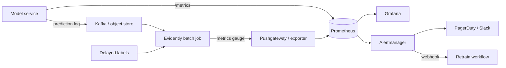

# 08 · Monitoring, Observability & Alerting

> **Goal:** know when the system *and the model* are unhealthy before users or the business tell you.

### 🌳 Decision Tree: which component, and when?


### 🔗 How this module intersects the others


> Full course map: [assets/tree_00_master_map.svg](assets/tree_00_master_map.svg)


**Contents**
1. [Four layers of ML monitoring](#1-four-layers-of-ml-monitoring)
2. [Drift taxonomy](#2-drift-taxonomy)
3. [Evidently AI integration](#3-evidently-ai-integration)
4. [Prometheus instrumentation](#4-prometheus-instrumentation)
5. [Alert rules & thresholds](#5-alert-rules--thresholds)
6. [Grafana dashboards](#6-grafana-dashboards)
7. [Edge cases & production failures](#7-edge-cases--production-failures)
8. [Senior interview questions & answers](#8-senior-interview-questions--answers)
9. [Tips, Tricks & Field Notes](#9-tips-tricks--field-notes)
10. [Worked Scenario: Green dashboards, revenue falling](#10-worked-scenario-green-dashboards-revenue-falling)
11. [More Interview Questions](#11-more-interview-questions)
12. [Where This Module Connects](#12-where-this-module-connects)
13. [Interview Playbook: Tips & Tricks](#13-interview-playbook-tips--tricks)
14. [Scenario-Based Evaluation](#14-scenario-based-evaluation)
15. [Rapid-Fire Round](#15-rapid-fire-round)
- [8.16 Performance Estimation Without Labels](#816-performance-estimation-without-labels)
- [8.17 SLOs, Error Budgets and Burn-Rate Alerting for ML Services](#817-slos-error-budgets-and-burn-rate-alerting-for-ml-services)
- [8.18 Prediction Logging Architecture, Slice and Calibration Monitoring](#818-prediction-logging-architecture-slice-and-calibration-monitoring)

---

## 1. Four layers of ML monitoring

| Layer | Signals | Latency of signal | Tool |
|---|---|---|---|
| **Infrastructure** | CPU/mem/GPU, restarts, saturation | seconds | Prometheus, node/DCGM exporters |
| **Service (RED/USE)** | Rate, Errors, Duration; fallback rate | seconds | Prometheus, OpenTelemetry |
| **Data & prediction** | Feature drift, null rate, score distribution | minutes–hours | Evidently, custom jobs |
| **Outcome / quality** | Accuracy, precision/recall, business KPI | days–weeks (label delay) | Join predictions with labels |



> Principle: **monitor what you can act on.** Each alert needs an owner, a runbook link and a clear action (rollback, retrain, investigate upstream).

## 2. Drift taxonomy

Let *X* = inputs, *Y* = target. A model learns *P(Y|X)*.

| Drift | What changes | Example | Detectable without labels? | Typical action |
|---|---|---|---|---|
| **Data / covariate drift** | P(X) | New user demographic after marketing campaign | ✅ | Investigate; retrain if performance affected |
| **Prior probability shift (label shift)** | P(Y) | Fraud rate rises 0.3% → 1.2% | Partly (prediction distribution) | Recalibrate thresholds/priors, retrain |
| **Concept drift** | P(Y\|X) | Fraudsters change tactics; "same" transactions now fraudulent | ❌ needs labels or proxies | Retrain with recent data; add features |
| **Prediction drift** | P(Ŷ) | Score histogram shifts | ✅ | Leading indicator for any of above |
| **Upstream/data-quality drift** | Pipeline bug | Unit change, null flood | ✅ | Fix pipeline, **don't** retrain |
| **Seasonality** | Periodic P(X) | Holiday traffic | ✅ | Compare to same-period reference |

Concept drift patterns: *sudden* (policy change), *gradual*, *incremental*, *recurring* (seasonal). Detection methods: windowed performance, ADWIN / Page-Hinkley on error stream, DDM.

```
Reference window (training)       Current window (last 24h / 7d)
   ──────────────┐                    ┌──────────────
 feature dist A  │  compare (PSI/KS)  │ feature dist B ─▶ drift score ─▶ alert if sustained
                 └────────────────────┘
```

## 3. Evidently AI integration

Batch job (hourly/daily) comparing current production window with reference; export aggregate numbers to Prometheus and the HTML report to object storage.

```python
# monitoring/drift_job.py  (Evidently 0.4.x Report API)
import json, time
import pandas as pd
from evidently.report import Report
from evidently.metric_preset import DataDriftPreset, TargetDriftPreset, ClassificationPreset
from evidently.metrics import ColumnDriftMetric, DatasetMissingValuesMetric
from evidently import ColumnMapping
from prometheus_client import CollectorRegistry, Gauge, push_to_gateway

FEATURES = ["amount", "avg_spend_30d", "txn_count_7d"]
mapping = ColumnMapping(target="label", prediction="score", numerical_features=FEATURES)

def run(reference: pd.DataFrame, current: pd.DataFrame, labels_available: bool):
    metrics = [DataDriftPreset(drift_share=0.3),            # dataset drift if >=30% cols drift
               ColumnDriftMetric(column_name="score"),      # prediction drift
               DatasetMissingValuesMetric()]
    if labels_available:
        metrics.append(ClassificationPreset(probas_threshold=0.5))
    rep = Report(metrics=metrics)
    rep.run(reference_data=reference, current_data=current, column_mapping=mapping)
    rep.save_html(f"/reports/drift_{int(time.time())}.html")
    return rep.as_dict()

def publish(result: dict, job="fraud_drift"):
    reg = CollectorRegistry()
    # as_dict()["metrics"] is a list of {"metric": <name>, "result": {...}}; the dataset-level
    # numbers and the per-column table are DIFFERENT entries, so look them up by metric name.
    by_name = {m["metric"]: m["result"] for m in result["metrics"]}
    d = by_name["DatasetDriftMetric"]       # share_of_drifted_columns, dataset_drift
    table = by_name["DataDriftTable"]       # drift_by_columns
    Gauge("drift_share_columns", "share of drifted columns", registry=reg).set(d["share_of_drifted_columns"])
    Gauge("drift_dataset", "1 if dataset drift", registry=reg).set(1 if d["dataset_drift"] else 0)
    g = Gauge("drift_feature_score", "per-feature drift score", ["feature"], registry=reg)
    for f, v in table["drift_by_columns"].items():
        g.labels(feature=f).set(v["drift_score"])
    Gauge("drift_job_last_success_timestamp", "unix time of last successful run", registry=reg).set_to_current_time()
    push_to_gateway("pushgateway:9091", job=job, registry=reg)
```

> Evidently's API and result-dict layout have changed between releases (this is the 0.4.x `Report` API; metric names and nesting may differ in newer versions). Pin the version you use and verify against current documentation.

Choose reference carefully:
| Reference | Pros | Cons |
|---|---|---|
| Training data | Exact baseline of model's world | Stale; always drifting eventually |
| Rolling previous N days | Detects sudden change | Slow drift goes unnoticed (boiling frog) |
| Same period last year/week | Handles seasonality | Needs history |
Use training reference for "is the model out of its comfort zone", rolling reference for "something just broke".

**Delayed-label quality monitor**: join predictions to labels by `request_id` once labels arrive, compute metrics per cohort *as of prediction date*:
```python
def quality_by_day(preds: pd.DataFrame, labels: pd.DataFrame) -> pd.DataFrame:
    df = preds.merge(labels, on="request_id", how="inner")
    from sklearn.metrics import roc_auc_score
    df["day"] = pd.to_datetime(df["ts"]).dt.date
    preds_per_day = pd.to_datetime(preds["ts"]).dt.date.value_counts()   # denominator: all predictions that day
    rows = []
    for day, g in df.groupby("day"):
        rows.append({"day": day, "n": len(g),
                     "auc": roc_auc_score(g["label"], g["score"]) if g["label"].nunique() > 1 else None,
                     "label_coverage": len(g) / preds_per_day[day]})
    return pd.DataFrame(rows).set_index("day")
```
Watch **label coverage** and **label delay**: AUC on the 10% of cases labelled quickly is biased.

## 4. Prometheus instrumentation

Metric types: **Counter** (monotonic: requests), **Gauge** (current: queue size), **Histogram** (latency buckets, supports quantiles across instances), **Summary** (client-side quantiles — not aggregable).

```python
from prometheus_client import Counter, Histogram, Gauge

PRED_SCORE = Histogram("model_score", "Distribution of predicted scores",
                       buckets=[0.05*i for i in range(1, 21)], labelnames=["model_version"])
FEATURE_NULL = Counter("feature_null_total", "Null/missing features", ["feature"])
FEATURE_VAL = Histogram("feature_value", "Raw feature values", ["feature"],
                        buckets=(0, 1, 5, 10, 50, 100, 500, 1000, 5000, 1e5))
MODEL_AGE = Gauge("model_age_seconds", "Seconds since model training finished")
FEATURE_FRESHNESS = Gauge("feature_freshness_seconds", "Age of newest feature materialization")
```
**Cardinality warning:** never label by `user_id`/`request_id`. Each unique label set is a time series; high-cardinality labels crash Prometheus.

ServiceMonitor (Prometheus Operator):
```yaml
apiVersion: monitoring.coreos.com/v1
kind: ServiceMonitor
metadata: { name: fraud-api, labels: { release: prometheus } }
spec:
  selector: { matchLabels: { app: fraud-api } }
  endpoints: [{ port: http, path: /metrics, interval: 15s }]
```

Useful PromQL:
```promql
# Request rate, error ratio, p95 latency
sum(rate(predict_requests_total[5m]))
sum(rate(predict_requests_total{status!="ok"}[5m])) / sum(rate(predict_requests_total[5m]))
histogram_quantile(0.95, sum by (le) (rate(predict_latency_seconds_bucket[5m])))

# Score drift proxy: mean score now vs 7 days ago
(sum(rate(model_score_sum[1h])) / sum(rate(model_score_count[1h])))
 - (sum(rate(model_score_sum[1h] offset 7d)) / sum(rate(model_score_count[1h] offset 7d)))

# Null-rate per feature
sum by (feature) (rate(feature_null_total[10m])) / sum(rate(predict_requests_total[10m]))
```

## 5. Alert rules & thresholds

```yaml
groups:
- name: model-alerts
  rules:
  - alert: HighErrorRate
    expr: sum(rate(predict_requests_total{status!="ok"}[5m])) / sum(rate(predict_requests_total[5m])) > 0.02
    for: 5m
    labels: { severity: page }
    annotations: { summary: "Error ratio >2%", runbook: "https://runbooks/model/errors" }

  # Simple threshold alert. A true SLO burn-rate alert uses multi-window error-budget burn (see the table below).
  - alert: LatencyP95High
    expr: histogram_quantile(0.95, sum by (le) (rate(predict_latency_seconds_bucket[5m]))) > 0.05
    for: 10m
    labels: { severity: page }

  - alert: FallbackRateHigh
    expr: sum(rate(predict_fallback_total[5m])) / sum(rate(predict_requests_total[5m])) > 0.05
    for: 5m
    labels: { severity: page }

  - alert: FeatureStale
    expr: feature_freshness_seconds > 2 * 3600
    for: 10m
    labels: { severity: ticket }

  - alert: DatasetDriftSustained
    # the 'and' clause ignores stale pushes: Pushgateway keeps the last value forever if the job stops running
    expr: avg_over_time(drift_dataset[6h]) > 0.8 and on(job) (time() - push_time_seconds) < 2 * 3600   # drift in most windows over 6h
    labels: { severity: ticket }
    annotations: { action: "Investigate upstream; consider retrain workflow" }

  - alert: PredictionDistributionShift
    expr: abs(
        (sum(rate(model_score_sum[1h])) / sum(rate(model_score_count[1h])))
        - (sum(rate(model_score_sum[1h] offset 1d)) / sum(rate(model_score_count[1h] offset 1d)))) > 0.08
    for: 1h
    labels: { severity: ticket }
```

**Threshold design**
| Principle | Detail |
|---|---|
| Page on symptoms, ticket on causes | Users-facing error/latency pages; drift opens a ticket |
| Burn-rate alerts | Multi-window (5m & 1h) for SLO budget burn reduces flapping |
| Hysteresis (`for:`) | Avoid single-window spikes |
| Calibrate on history | Set thresholds from historical p99 of the drift metric, not magic numbers |
| Per-feature weighting | Drift in top-importance feature > drift in minor one |
| Alert budget | Track alert precision; delete alerts nobody acts on |

## 6. Grafana dashboards

Panel plan (one dashboard, four rows, top-to-bottom = outage-triage order):

| Row | Panels |
|---|---|
| **Traffic & SLO** | RPS, error %, p50/p95/p99 latency, SLO burn, availability |
| **Model health** | Score histogram heatmap, mean score vs baseline, fallback rate, model version in use |
| **Data health** | Null rate per feature, feature freshness, drift score top-10, PSI heatmap |
| **Outcome** | Rolling AUC/precision (delayed), label coverage, business KPI, calibration |
| **Infra** | CPU/GPU util & memory, restarts, queue depth, HPA replicas |

Provision as code:
```yaml
# grafana/provisioning/dashboards/mlops.yaml
apiVersion: 1
providers:
  - { name: mlops, folder: MLOps, type: file, options: { path: /var/lib/grafana/dashboards } }
```
```yaml
# datasource
apiVersion: 1
datasources:
  - { name: Prometheus, type: prometheus, url: http://prometheus:9090, isDefault: true }
```
Annotate deployments on graphs (model version changes) so incidents correlate with releases:
```bash
curl -X POST -H "Authorization: Bearer $GRAFANA_TOKEN" -H 'Content-Type: application/json' \
  -d '{"tags":["deploy","fraud-api"],"text":"model v18 canary 5%"}' http://grafana:3000/api/annotations
```

## 7. Edge cases & production failures

| Failure | Root cause | Lesson |
|---|---|---|
| **Drift alert fatigue** | KS test on millions of rows flags everything | Effect-size metrics + sustained windows + importance weighting |
| **"Everything green" yet revenue falls** | Only infra metrics watched; model quality silent | Add prediction-distribution and delayed-quality monitors, business KPI |
| **Monitoring job shows no drift while pipeline broken** | Both reference & current from the same broken source | Validate raw upstream; compare vs. independent baseline |
| **Pushgateway stale metrics** | Job died, last value remains | Add `push_time_seconds` check; alert on staleness |
| **Prometheus OOM** | High-cardinality labels | Label hygiene; relabel drop; use logs for ids |
| **Label leakage into monitoring** | Using post-hoc features in quality calc | Evaluate with data as available at prediction time |
| **Slice blindness** | Aggregate stable, one region collapsed | Slice metrics by key dimensions (region, device, new vs old users) |
| **Seasonal false alarms** | Weekly pattern vs flat reference | Seasonally matched reference or STL-decomposed thresholds |
| **Silent success of fallback** | Fallback masks model outage | Alert on fallback rate and on *time spent in fallback* |

## 8. Senior interview questions & answers

**Q1. Distinguish data drift, concept drift and prior probability shift — and what you can detect without labels.**
- ❌ *Trap:* "Drift is when accuracy drops."
- ✅ *Staff:* Covariate drift: P(X) changes, detectable from inputs. Prior shift: P(Y) changes, partly inferred from prediction distribution. Concept drift: P(Y|X) changes, usually invisible without labels—use delayed-label metrics, proxy signals (complaints, manual review overturn rate), or performance of a small continuously-labelled sample. Accuracy drop is a symptom, not a definition, and can come from a pipeline bug rather than drift.

**Q2. Labels arrive 45 days late. How do you monitor quality?**
- ❌ *Trap:* "Wait for labels."
- ✅ *Staff:* Layered: leading indicators now (feature and prediction drift, null rates, score distribution, decision rates), proxy outcomes with shorter delay (chargebacks reported in 7 days, reviewer overturn rate), a small human-labelled audit sample, then true metrics per prediction-day cohort when labels mature, tracking label coverage. Retrain triggers use the leading indicators with approval; the lagging metrics validate the triggers.

**Q3. Which Prometheus metric type for model latency, and why?**
- ❌ *Trap:* "Gauge of the average latency."
- ✅ *Staff:* Histogram: it is aggregable across replicas and supports `histogram_quantile`. Averages hide tails; summaries' client-side quantiles can't be averaged across pods. Choose buckets around the SLO (e.g., 25, 50, 100 ms) so quantile estimates near the threshold are accurate.

**Q4. Drift detected on 12 of 40 features. What do you do?**
- ❌ *Trap:* "Retrain immediately."
- ✅ *Staff:* Triage: (1) data-quality causes — unit/null/schema changes or upstream outage → fix source; (2) which features—weight by importance (SHAP/permutation); (3) do predictions and proxy/real quality change? (4) is it seasonal/campaign-related and expected? If real and harmful, retrain on a window including the new regime, validate on recent data, canary. Retraining on a corrupted feed bakes in the bug.

**Q5. How do you design alerts so on-call isn't flooded?**
- ❌ *Trap:* "Alert on every metric crossing a threshold."
- ✅ *Staff:* Page only on user-impacting symptoms (SLO burn, error ratio, fallback rate) using multi-window burn rates; route drift and freshness to tickets/dashboards; add `for:` durations; each alert has an owner, runbook and a defined action; review alert precision monthly and delete or retune unactionable ones.

**Q6. Why can't you just monitor accuracy?**
- ❌ *Trap:* "Accuracy is the objective metric."
- ✅ *Staff:* Labels are delayed or missing, accuracy hides class imbalance and slice failures, and by the time it moves, damage is done. Monitor calibrated probabilities, precision/recall at the operating threshold, slices, input/prediction drift, and business KPIs; treat accuracy as one lagging component.

**Q7. How would you detect that the training-serving features have diverged?**
- ❌ *Trap:* "Compare model outputs."
- ✅ *Staff:* Log the exact feature vector at serve time with entity id and timestamp; periodically recompute those features offline using the point-in-time path and compare (exact match for categorical, tolerance for numerics). Track mismatch rate per feature; alert when above tolerance. This isolates skew from true drift.

**Q8. What's your reference dataset strategy for Evidently?**
- ❌ *Trap:* "Use the training set, always."
- ✅ *Staff:* Use two: the training set to know when serving leaves the model's learned domain, and a rolling/seasonal window to detect abrupt breakage. Refresh the training reference at every retrain, and version it with the model so reports are reproducible.


<!-- appendix:start -->

## 9. Tips, Tricks & Field Notes

1. Page on symptoms (errors, latency, fallback); ticket on causes (drift).
2. Use histograms for latency so quantiles aggregate across pods.
3. Never label metrics by user or request id.
4. Use two references in Evidently: training data and a rolling or seasonal window.
5. Track label coverage; AUC on a fast-labelled subset is biased.
6. Add deploy annotations to Grafana so incidents line up with releases.

## 10. Worked Scenario: Green dashboards, revenue falling

**Situation.** Infra metrics are fine but conversion is down 6% for a week.

**Steps**

1. Check prediction distribution and decision rates versus last week.
2. Check feature null rate and freshness.
3. Slice by region, device and new vs returning.
4. Compare to the previous model in shadow.

**Outcome.** A mobile app release stopped sending one feature; slice monitors and a null-rate alert were added.

## 11. More Interview Questions

**Q9. Concept drift without labels?**
- ❌ *Trap:* Not detectable.
- ✅ *Staff:* Use proxies (complaints, review overturn rate), a small continuously-labelled sample, and delayed-label cohort metrics.

**Q10. 12 of 40 features drift. Retrain?**
- ❌ *Trap:* Yes.
- ✅ *Staff:* Triage data-quality causes first, weight by importance, check whether predictions or quality moved; retrain only if harmful.

**Q11. Avoid alert fatigue?**
- ❌ *Trap:* Fewer thresholds.
- ✅ *Staff:* Multi-window burn rates, `for:` durations, owners and runbooks, monthly alert-precision review.

## 12. Where This Module Connects

| Direction | Module | What flows |
|---|---|---|
| ⬆ Fed by | [01 Foundations](01_mlops_foundations_system_design.md) | feedback loops |
| ⬆ Fed by | [02 Data & Features](02_data_engineering_feature_stores.md) | drift baselines |
| ⬆ Fed by | [06 Serving](06_model_serving_architecture.md) | metrics + logs |
| ⬆ Fed by | [07 Deployment](07_deployment_strategies_traffic_routing.md) | canary analysis |
| ⬇ Feeds | [05 CI/CD/CT](05_cicd_ct_automation_pipelines.md) | retrain trigger |


<!-- appendix:end -->

<!-- deep:start -->

## 13. Interview Playbook: Tips & Tricks

1. Say 'symptoms page, causes ticket' early; it shows alert design maturity.
2. Distinguish drift types precisely; many candidates blur them.
3. Always mention label delay when asked about quality monitoring.
4. Mention slices when asked about monitoring depth.
5. Describe thresholds as calibrated from history, not magic numbers.
6. Bring up cardinality when you mention Prometheus labels.

## 14. Scenario-Based Evaluation

Each scenario shows what the interviewer is really testing, the answer that loses points, and the answer that earns them.

### Scenario 1: Quality fell, no drift

**Situation.** AUC dropped 5 points but PSI is quiet.

**What is being evaluated.** Concept drift versus pipeline issues.

- ❌ **Weak answer:** Retrain.
- ✅ **Strong answer:**
  1. Check label definition/pipeline changes.
  2. Check slice-level performance and calibration.
  3. Check P(Y|X) shift with recent labels.
  4. Check upstream semantic changes not visible in marginals.

**Likely follow-up:** *How do you detect concept drift earlier?*

### Scenario 2: Pushgateway stale

**Situation.** Drift dashboard shows constant values for 3 days.

**What is being evaluated.** Monitoring the monitors.

- ❌ **Weak answer:** Ignore.
- ✅ **Strong answer:**
  1. Job died; last pushed values persist.
  2. Alert on push_time_seconds staleness.
  3. Use heartbeat metric.
  4. Prefer pull-based exporter for continuous jobs.

**Likely follow-up:** *What else needs a heartbeat?*

### Scenario 3: Seasonal false alarms

**Situation.** Drift alerts fire every Monday.

**What is being evaluated.** Reference selection.

- ❌ **Weak answer:** Disable alerts.
- ✅ **Strong answer:**
  1. Use same-weekday reference or STL-decomposed thresholds.
  2. Two references: training and rolling seasonal.
  3. Sustained-window requirement.
  4. Annotate known events.

**Likely follow-up:** *How do you handle one-off promotions?*

### Scenario 4: On-call overload

**Situation.** 30 pages per week; 25 are not actionable.

**What is being evaluated.** Alert hygiene.

- ❌ **Weak answer:** Hire more on-call.
- ✅ **Strong answer:**
  1. Classify alerts by actionability.
  2. Delete or convert to tickets.
  3. Multi-window burn rates.
  4. Monthly precision review.

**Likely follow-up:** *What target alert precision?*

## 15. Rapid-Fire Round

| Question | One-line answer |
|---|---|
| RED metrics? | Rate, errors, duration. |
| USE metrics? | Utilisation, saturation, errors. |
| Histogram vs summary? | Histogram aggregates across pods. |
| Prior shift? | P(Y) changes. |
| Label coverage? | Fraction of predictions with labels yet. |
| Burn rate? | Speed of consuming error budget. |
| Why reference windows? | Define baseline for drift. |
| Alert needs? | Owner, runbook, action. |
## 8.16 Performance Estimation Without Labels

### Conceptual Deep Dive
Ground truth is often late (loan defaults after 60 days, churn after a quarter) or absent (fraud nobody investigates), yet the question "is the model degrading today?" cannot wait. The first step is to separate what can and cannot be estimated. **Covariate shift** (P(X) changes, P(Y|X) stable) and **label shift** (P(Y) changes, P(X|Y) stable) are estimable from unlabelled data under stated assumptions. **Concept shift** (P(Y|X) changes) is not: if inputs look the same but the world's rule changed, no label-free method can see it. Module 08 section 2 (legacy) gives the taxonomy.

**Confidence-based estimation** is the cheapest tool. If the model's probabilities are calibrated, the expected accuracy of a batch is the mean of the probability assigned to the predicted class, and expected precision, recall and confusion-matrix cells follow the same way (the idea behind CBPE in NannyML; name only, check its docs). This works under covariate shift because calibration, a property of P(Y|X), survives it, so the estimate moves when the score distribution moves.

**Importance weighting** handles covariate shift when you still hold old labelled data. Train a domain classifier to separate old from new inputs; the weight for an old example is the density ratio c(x)/(1-c(x)) times the old-to-new sample-size ratio. Reweighting old labelled errors then estimates error on the new distribution. **Label-shift estimation** (BBSE, Lipton, Wang and Smola, 2018) solves a small linear system: predicted-label rates on the new data equal the confusion matrix times the new class priors, so the priors are recovered by inverting the confusion matrix measured on labelled validation data.

**Proxies and audits** complement the maths: reviewer overturn rate, complaint volume, or a downstream outcome with a shorter delay (a 7-day repayment signal rather than a 60-day default). A small continuous labelled audit sample, stratified by score band and key slices, is the only way to validate any estimate and should be sized for the interval width you need.

Failure modes. Calibration itself drifts, so confidence-based estimates lie exactly when the world changes; re-check calibration on every matured cohort (8.18). If the domain classifier separates old from new perfectly, overlap is zero, weights explode and the effective sample size collapses; clip weights and report effective sample size. Concept drift with stable P(X) is invisible to every method here. Always publish an interval, state the assumption next to the number, and treat the estimate as an alert that triggers an audit, never as ground truth.

| Shift | Estimable without labels? | Method |
|---|---|---|
| Covariate | Yes, if overlap and calibration hold | Confidence-based, importance weights |
| Label (prior) | Yes, if confusion matrix invertible | BBSE |
| Concept | No | Audit sample, proxies |

### Cross-Connection Scenarios
- Matured-cohort calibration checks that guard these estimates: 8.18.
- Drift scores are inputs to triage, not performance numbers; see Module 08 section 2 (legacy).
- Alert routing for an estimated-quality drop uses the SLO machinery in 8.17.
- A retraining trigger based on estimated quality needs the gates in Module 05 (legacy).

### Production Anti-Patterns
- Reporting estimated accuracy without stating the calibration and shift assumptions, so a calibration drift silently turns the dashboard into fiction.
- Using a drift score (PSI, KS) as a performance proxy: drift can be large and harmless, or absent while the concept changes, producing both false alarms and misses.
- Running no audit sample, so estimates are never validated and nobody learns how wrong they are until labels finally arrive.

### Minimal Working Code
The first block estimates accuracy from calibrated scores and compares it with truth under covariate shift and under calibration drift, with a bootstrap interval.

```python
import numpy as np
rng = np.random.default_rng(0)

def estimated_accuracy(p, thr=0.5):
    """Expected accuracy if p is calibrated: mean prob of the predicted class."""
    return float(np.where(p >= thr, p, 1 - p).mean())

def boot_interval(p, n_boot=300, thr=0.5):
    est = [estimated_accuracy(rng.choice(p, len(p)), thr) for _ in range(n_boot)]
    return tuple(round(float(v), 3) for v in np.percentile(est, [2.5, 97.5]))

def batch(n, a, b, calib=lambda p: p):
    p = rng.beta(a, b, n)
    y = rng.random(n) < calib(p)          # outcome drawn from the TRUE probability
    return p, y

if __name__ == "__main__":
    cases = {
        "reference": ((0.5, 0.5), lambda p: p),
        "covariate shift": ((2, 2), lambda p: p),
        "calibration drift": ((2, 2), lambda p: 0.5 + 0.4 * (p - 0.5)),
    }
    for name, ((a, b), cal) in cases.items():
        p, y = batch(20000, a, b, cal)
        true = float(((p >= 0.5) == y).mean())
        print(f"{name:18s} est={estimated_accuracy(p):.3f} "
              f"ci={boot_interval(p)} true={true:.3f}")
```

The second block recovers new class priors with black-box shift estimation and refuses to run when the confusion matrix is near-singular.

```python
import numpy as np
rng = np.random.default_rng(1)
K = np.array([[.8, .1, .1], [.1, .8, .1], [.1, .1, .8]])   # P(pred=i | y=j)

def sample(priors, n):
    y = rng.choice(3, n, p=priors)
    cum = K.cumsum(axis=0)[:, y]                            # (3, n)
    pred = (rng.random(n)[None, :] > cum).sum(axis=0).clip(0, 2)
    return y, pred

def bbse(y_src, pred_src, pred_tgt, max_cond=1e3):
    k = 3
    C = np.zeros((k, k))                                     # joint P(pred=i, y=j) on source
    for i in range(k):
        for j in range(k):
            C[i, j] = np.mean((pred_src == i) & (y_src == j))
    if np.linalg.cond(C) > max_cond:
        raise ValueError("confusion matrix nearly singular; BBSE unreliable")
    mu = np.bincount(pred_tgt, minlength=k) / len(pred_tgt)  # predicted rates on target
    w = np.clip(np.linalg.solve(C, mu), 0, None)             # q(y)/p(y)
    q = w * np.bincount(y_src, minlength=k) / len(y_src)
    return q / q.sum()

if __name__ == "__main__":
    ys, ps = sample([.5, .3, .2], 20000)
    _, pt = sample([.2, .3, .5], 20000)                      # target labels never used
    print("estimated target priors:", bbse(ys, ps, pt).round(3), "true: [0.2 0.3 0.5]")
```

### Interview Angle
**Q:** Labels arrive after 60 days. How do you know today whether the model is degrading? **A:** Layer it: confidence-based performance estimates (valid only if calibration holds), drift on inputs and scores for triage, shorter-delay proxies such as reviewer overturn rate, and a stratified labelled audit sample to validate it all. Trade-off: audits cost reviewer time but are the only ground truth. Measurable check: backtest the estimator on past matured cohorts and require the estimate to fall inside its interval, for example 90% of the time, before alerting on it.

**Q:** When can you not detect degradation without labels? Give an example. **A:** Under concept shift with stable inputs: a fraud ring changes tactics so transactions look statistically identical but are now fraudulent more often. P(X) and calibrated scores look unchanged, so every label-free estimate stays flat. Mitigation: a small randomly sampled audit stream, outcome proxies like chargebacks as they mature, and canary comparison against a challenger. Measurable check: audit-sample accuracy with a confidence interval, tracked weekly.

## 8.17 SLOs, Error Budgets and Burn-Rate Alerting for ML Services

### Conceptual Deep Dive
An SLI is a measurable ratio of good events to valid events; an SLO is the target for it over a window. For ML services choose SLIs users feel: availability (non-error responses), latency (requests under a threshold, as a good-events ratio rather than a percentile), freshness (features younger than a bound), fallback rate (share served by a rule-based fallback), and quality measured on matured cohorts (8.18). Quality SLIs are slow and sparse, so they carry ticket-level, not page-level, urgency.

The **error budget** is 1 - SLO over the window: a 99.9% SLO over 28 days allows 0.1% bad events. A budget **policy** makes it operational: when the budget is exhausted, risky deploys freeze and reliability work takes priority; when plenty remains, ship faster. Without enforcement the budget is decoration.

**Burn rate** is the observed bad-event ratio divided by the allowed ratio (1 - SLO). A burn rate of 1 spends the budget exactly over the window; 14.4 spends 2% of a 30-day budget in one hour. The Google SRE Workbook pattern uses **multi-window, multi-burn-rate** alerts: a fast rule (for example burn above 14.4 over both 1 hour and 5 minutes) pages; a slower rule (for example above 6 over 6 hours and 30 minutes) pages or tickets for sustained leaks; a very slow rule (burn 1 over days) opens a ticket. The long window proves significance; the short window makes the alert reset quickly after recovery. Exact tiers vary by organisation; verify against the book.

A common mistake, visible in Module 08 section 5 (legacy), is an alert named a "burn" that is really `p95 > threshold for 10m`. That is a threshold, not a burn rate: it ignores how much budget is spent, flaps around the threshold, and cannot tell a 1-minute blip from a slow leak. Build the alert from a good-events ratio (requests under the latency bound over all requests) divided by (1 - SLO), over two windows.

Operations around the maths: route by urgency (page for fast burn, ticket for slow), attach an owner and runbook link to every alert, and track alert precision (the share that led to action) and delete the noisy ones. Test rules by replaying historical or synthetic metric series through them (promtool-style rule unit tests; check docs).

Edge cases. Low traffic makes ratios noisy: one error in ten requests is 10%; require minimum event counts or lengthen windows. An SLO window mismatched to release cadence (a 30-day window with weekly releases) hides regressions. Dependencies compose: serial availabilities multiply, so a 99.9% service on three 99.9% dependencies cannot honestly promise 99.9%.

### Cross-Connection Scenarios
- Estimated-quality drops from 8.16 become ticket-severity SLO violations rather than pages.
- Fallback-rate and feature freshness SLIs depend on the feature store in Module 02 (legacy).
- Budget-gated deploy freezes connect to rollout strategy in Module 07 (legacy).
- Platform-level SLOs for the pipelines themselves are in 16.5.

### Production Anti-Patterns
- Paging on every metric, so on-call fatigue teaches engineers to ignore the pager and real incidents wait.
- SLOs nobody agreed to: targets set by engineers without product input are either unattainable or meaningless, and are never defended in prioritisation.
- An error budget policy that is never enforced, so the budget burns to zero with no change in behaviour and the whole exercise loses credibility.

### Minimal Working Code
The first block evaluates a naive error-rate rule and a multi-window burn-rate rule over a simulated minute-by-minute stream containing a sharp incident and a slow leak.

```python
import random
SLO = 0.999
BUDGET = 1 - SLO

def stream(minutes=2000, rpm=200, seed=0):
    rng = random.Random(seed)
    out = []
    for m in range(minutes):
        p = 0.0005
        if 600 <= m < 660: p = 0.03        # sharp incident, burn 30x
        if 1000 <= m < 1600: p = 0.008     # slow leak, burn 8x
        out.append((rpm, sum(rng.random() < p for _ in range(rpm))))
    return out

def burn(prefix_t, prefix_e, m, w):
    lo = max(0, m + 1 - w)
    t, e = prefix_t[m + 1] - prefix_t[lo], prefix_e[m + 1] - prefix_e[lo]
    return (e / t) / BUDGET if t else 0.0

def evaluate(data):
    pt, pe = [0], [0]
    for t, e in data:
        pt.append(pt[-1] + t); pe.append(pe[-1] + e)
    naive, fast, slow = [], [], []
    for m, (t, e) in enumerate(data):
        naive.append(e / t > 0.02)
        fast.append(burn(pt, pe, m, 60) > 14.4 and burn(pt, pe, m, 5) > 14.4)
        slow.append(burn(pt, pe, m, 360) > 6 and burn(pt, pe, m, 30) > 6)
    return naive, fast, slow

if __name__ == "__main__":
    for name, s in zip(("naive", "fast", "slow"), evaluate(stream())):
        starts = sum(1 for i in range(len(s)) if s[i] and (i == 0 or not s[i - 1]))
        first = s.index(True) if True in s else None
        print(f"{name:6s} fires={sum(s):4d} min  transitions={starts:3d}  first_minute={first}")
```

The second block computes allowed downtime, composite availability of a serial dependency chain, and remaining budget with a policy decision.

```python
def allowed_downtime_min(slo, days=28):
    return (1 - slo) * days * 24 * 60

def composite(*availabilities):
    p = 1.0
    for a in availabilities:
        p *= a                              # serial dependencies multiply
    return p

def budget_remaining(slo, good, total):
    """Fraction of request-based error budget left (negative = overspent)."""
    allowed_bad = (1 - slo) * total
    return 1 - (total - good) / allowed_bad

def policy(remaining):
    if remaining < 0: return "FREEZE risky deploys"
    if remaining < 0.25: return "CAUTION: slow rollouts only"
    return "NORMAL"

if __name__ == "__main__":
    print("SLO      allowed downtime (28d)")
    for slo in (0.995, 0.999, 0.9995, 0.9999):
        print(f"{slo:<8} {allowed_downtime_min(slo):7.1f} min")
    chain = composite(0.999, 0.9995, 0.999)          # service, feature store, registry
    print(f"best achievable chain availability: {chain:.4f}")
    total = 5_000_000
    for bad in (2000, 4000, 6000):
        r = budget_remaining(0.999, total - bad, total)
        print(f"bad={bad}: remaining={r:+.0%} -> {policy(r)}")
```

### Interview Angle
**Q:** Explain burn-rate alerting to a teammate who currently pages on "error rate > 2%". **A:** A threshold ignores how much budget is spent. Burn rate is observed error ratio divided by the allowed ratio (1 - SLO); alert when it is high over a long window and a short window together. Trade-off: fast rules catch outages in minutes, slow rules catch leaks a 2% threshold never sees, at the cost of more rules to maintain. Measurable check: replay past incidents and compare detection delay and false-page count against the old rule.

**Q:** What SLOs would you define for a nightly batch scoring service? **A:** Request latency is irrelevant; use job-level SLIs: on-time completion (finished before downstream consumers read, for example 99% of nights), freshness of the output table, fraction of entities scored successfully, and quality on matured cohorts. Budget in nights per quarter. Trade-off: a strict completion SLO forces spare capacity. Measurable check: error budget burn per quarter and the share of runs breaching the deadline.

## 8.18 Prediction Logging Architecture, Slice and Calibration Monitoring

### Conceptual Deep Dive
Every monitor in this chapter is only as good as the prediction log feeding it. A useful record contains a request id, hashed entity ids, model version and feature-service version, the raw inputs or the exact feature vector, the score, the decision (score after threshold and business rules), latency, the serving tier or fallback path, a timestamp, and the join keys needed to attach a label later. The schema is versioned, validated at write time, and uses typed fields: free-form strings cannot be aggregated, and a missing model-version field makes every rollback investigation guesswork.

The pipeline emits asynchronously (never on the request path's critical latency), streams to an object store or warehouse, partitions by date and model version, and sets retention by risk tier: high-risk models keep records for the audit horizon, low-risk ones for the debugging horizon. Minimise PII: hash or tokenise identifiers with a keyed hash, log feature vectors rather than raw payloads where possible, and restrict access by role. Logging a full payload leaks PII into a store with broader access than the source.

**Sampling** controls cost. Log everything at low volume; at high volume use stratified sampling (rare classes and high-risk segments at higher rates), always log errors and fallbacks, and use reservoir sampling for unbounded streams. Sampling must be recorded: each retained record carries a weight (inverse inclusion probability), and aggregates use weighted estimators, otherwise rates are biased. Logging only successes, a classic bias, hides exactly the failures you need.

**Slice monitoring** answers "is it worse for someone?" Choose slice dimensions in advance with domain input (region, channel, device, customer segment, protected attributes where permitted), enforce a minimum support per slice, and compare against that slice's own baseline with relative change. Hundreds of slices create hundreds of chances for a false alarm, so correct for multiple comparisons (a Bonferroni-style threshold or false discovery control) and rank by impact (relative change times volume).

**Calibration monitoring** uses matured cohorts: plot reliability curves per cohort, track expected calibration error (ECE) as a trend, and before labels fully mature compare the mean predicted score with the outcome rate of the part of the cohort already matured. It also validates the label-free estimators in 8.16.

Control monitoring cost: aggregate near the source, cap metric label cardinality (never a user id as a metric label), and use cheap sketches (fixed-bin histograms, the t-digest idea for quantiles) rather than storing raw values.

Edge cases. A log schema change (renamed field, changed unit) breaks the monitor silently, so add schema-version checks and a canary alert on the null-rate of required fields. Sampling bias from success-only logging, and PII leakage from full payloads, are the two most common audit findings.

### Cross-Connection Scenarios
- Matured-cohort calibration backs the label-free estimators in 8.16.
- Slice false-alarm control and ownership tie into alert precision in 8.17.
- Retention and access controls link to privacy requirements in Module 10 (legacy).
- Join keys and label latency tie to training-serving consistency in Module 02 (legacy).

### Production Anti-Patterns
- Logging free-form strings and unversioned dicts, so schema drift silently breaks every downstream aggregate.
- Omitting the model-version field, which makes it impossible to attribute a regression to a deploy or compare canary against stable.
- Alerting on hundreds of slices without multiple-comparison correction or minimum support, which trains the team to ignore the slice report.

### Minimal Working Code
The first block defines a schema-validated log record with keyed identifier hashing and a reservoir sampler whose weight gives unbiased aggregates.

```python
import hashlib, hmac, random
from dataclasses import dataclass, asdict

SALT = b"demo-secret-rotate-me"            # in production: a managed secret

def hash_id(raw: str) -> str:
    return hmac.new(SALT, raw.encode(), hashlib.sha256).hexdigest()[:16]

@dataclass(frozen=True)
class PredictionLog:
    request_id: str
    entity_hash: str
    model_version: str
    score: float
    decision: str
    latency_ms: float
    schema_version: int = 1
    def __post_init__(self):
        if not self.model_version: raise ValueError("model_version required")
        if not 0.0 <= self.score <= 1.0: raise ValueError("score out of range")
        if self.latency_ms < 0: raise ValueError("latency must be >= 0")

class Reservoir:
    """Algorithm R: uniform sample of k from a stream; weight = seen / k."""
    def __init__(self, k, seed=0):
        self.k, self.items, self.seen, self.rng = k, [], 0, random.Random(seed)
    def add(self, x):
        self.seen += 1
        if len(self.items) < self.k: self.items.append(x)
        else:
            j = self.rng.randrange(self.seen)
            if j < self.k: self.items[j] = x
    @property
    def weight(self): return self.seen / max(1, len(self.items))

if __name__ == "__main__":
    res, rng, total = Reservoir(5000), random.Random(1), 0
    for i in range(100_000):
        rec = PredictionLog(f"r{i}", hash_id(f"user{i}"), "m-v3", rng.random(), "approve", 20 + 30 * rng.random())
        total += rec.score > 0.9
        res.add(rec)
    est = sum(r.score > 0.9 for r in res.items) * res.weight
    print("true count", total, "weighted estimate", round(est), asdict(res.items[0])["entity_hash"])
```

The second block computes ECE on a matured cohort and a slice report with minimum support, a multiple-comparison-corrected threshold and relative-change flags.

```python
import numpy as np
from statistics import NormalDist
rng = np.random.default_rng(0)

def ece(p, y, bins=10):
    idx = np.minimum((p * bins).astype(int), bins - 1)
    return sum((idx == b).mean() * abs(p[idx == b].mean() - y[idx == b].mean())
               for b in range(bins) if (idx == b).any())

def slice_report(slices, base_rate, min_n=200, alpha=0.05):
    z_crit = NormalDist().inv_cdf(1 - alpha / (2 * len(slices)))   # Bonferroni
    out = []
    for name, y in slices.items():
        n, rate = len(y), y.mean()
        if n < min_n:
            out.append((name, n, "skip: low support")); continue
        z = (rate - base_rate) / np.sqrt(base_rate * (1 - base_rate) / n)
        rel = (rate - base_rate) / base_rate
        flag = "ALERT" if abs(z) > z_crit and abs(rel) > 0.2 else "ok"
        out.append((name, n, f"rel={rel:+.0%} z={z:+.1f} {flag}"))
    return out

if __name__ == "__main__":
    p = rng.random(30000)
    y = rng.random(30000) < p                                   # well calibrated
    print("ECE calibrated:", round(ece(p, y), 4))
    y_bad = rng.random(30000) < 0.5 + 0.5 * (p - 0.5)           # calibration drifted
    print("ECE drifted:   ", round(ece(p, y_bad), 4))
    slices = {"web": rng.random(5000) < 0.10, "mobile": rng.random(4000) < 0.16,
              "kiosk": rng.random(80) < 0.30, "api": rng.random(3000) < 0.10}
    for row in slice_report(slices, base_rate=0.10): print(row)
```

### Interview Angle
**Q:** Design the prediction log for a lending model that must be auditable and privacy-safe. **A:** Versioned typed schema: request id, keyed-hash applicant id, model and feature-service versions, feature vector (not free text), score, decision, reason codes, latency, timestamp, label join key. Append-only storage partitioned by date and version, role-based access, retention matched to the audit horizon, and no always-on raw payload. Trade-off: richer logs raise audit value and privacy risk. Measurable check: replay any logged decision from its record and reproduce the score exactly.

**Q:** How do you choose slices to monitor and avoid alert spam? **A:** Pick a short list in advance from product and fairness requirements, enforce a minimum sample size, compare each slice with its own baseline, and apply a multiple-comparison correction. Rank alerts by relative change times volume and ticket rather than page. Trade-off: fewer slices miss niche failures; add an offline exploratory scan. Measurable check: alert precision (fraction acted on) above a target such as half, reviewed monthly.

<!-- deep:end -->

---
**Prev:** [← 07](07_deployment_strategies_traffic_routing.md) · **Next:** [09 · Infrastructure & Orchestration →](09_infrastructure_containerization_orchestration.md)
