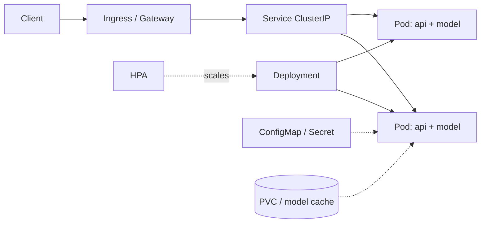

# 09 · Infrastructure: Containerization & Orchestration

> **Goal:** package models into small, reproducible, secure images and run them on Kubernetes with correct resource, scaling and networking behaviour; scale compute with Ray and Spark.

### 🌳 Decision Tree: which component, and when?


### 🔗 How this module intersects the others


> Full course map: [assets/tree_00_master_map.svg](assets/tree_00_master_map.svg)


**Contents**
1. [Containerizing ML models](#1-containerizing-ml-models)
2. [Kubernetes core objects for ML serving](#2-kubernetes-core-objects-for-ml-serving)
3. [Autoscaling](#3-autoscaling)
4. [Ingress & networking](#4-ingress--networking)
5. [Distributed compute: Ray & Spark](#5-distributed-compute-ray--spark)
6. [Local environment](#6-local-environment)
7. [Edge cases & production failures](#7-edge-cases--production-failures)
8. [Senior interview questions & answers](#8-senior-interview-questions--answers)
9. [Tips, Tricks & Field Notes](#9-tips-tricks--field-notes)
10. [Worked Scenario: OOMKilled only under load](#10-worked-scenario-oomkilled-only-under-load)
11. [More Interview Questions](#11-more-interview-questions)
12. [Where This Module Connects](#12-where-this-module-connects)
13. [Interview Playbook: Tips & Tricks](#13-interview-playbook-tips--tricks)
14. [Scenario-Based Evaluation](#14-scenario-based-evaluation)
15. [Rapid-Fire Round](#15-rapid-fire-round)
- [9.16 GPU Sharing and Scheduling on Kubernetes](#916-gpu-sharing-and-scheduling-on-kubernetes)
- [9.17 Storage, Data Movement and Artifact Distribution](#917-storage-data-movement-and-artifact-distribution)
- [9.18 Infrastructure as Code, Environment Parity and Cluster Operations](#918-infrastructure-as-code-environment-parity-and-cluster-operations)

---

## 1. Containerizing ML models

Principles: **small**, **deterministic**, **non-root**, **no secrets**, **model separate from code when large**, **cache-friendly layers**.

```dockerfile
# syntax=docker/dockerfile:1.7
# ---------- builder: compile wheels once ----------
FROM python:3.11-slim AS builder
ENV PIP_NO_CACHE_DIR=1 PIP_DISABLE_PIP_VERSION_CHECK=1
RUN apt-get update && apt-get install -y --no-install-recommends build-essential && rm -rf /var/lib/apt/lists/*
WORKDIR /w
COPY requirements.lock .
RUN pip wheel --wheel-dir /wheels -r requirements.lock

# ---------- runtime ----------
FROM python:3.11-slim AS runtime
ENV PYTHONUNBUFFERED=1 PYTHONDONTWRITEBYTECODE=1 \
    OMP_NUM_THREADS=1 MKL_NUM_THREADS=1 \
    MODEL_PATH=/models/model.joblib
RUN useradd -r -u 10001 -m app
WORKDIR /srv
COPY --from=builder /wheels /wheels
RUN pip install --no-index --find-links=/wheels /wheels/* && rm -rf /wheels
COPY app/ ./app/
# Small models can be baked in; large ones come from an init container / volume.
COPY --chown=app:app artifacts/model.joblib /models/model.joblib
USER 10001
EXPOSE 8080
HEALTHCHECK --interval=15s --timeout=3s --start-period=20s CMD python -c "import urllib.request,sys; sys.exit(0 if urllib.request.urlopen('http://127.0.0.1:8080/healthz').status==200 else 1)"
CMD ["uvicorn", "app.main:app", "--host", "0.0.0.0", "--port", "8080", "--workers", "2"]
```

GPU variant: base on `nvidia/cuda:12.4.1-cudnn-runtime-ubuntu22.04` (runtime, not `devel`) or the framework's official runtime image; pin CUDA to a version supported by the node's driver.

`.dockerignore`
```
.git
data/
notebooks/
mlruns/
__pycache__/
*.ipynb
.env
```

| Practice | Why |
|---|---|
| Multi-stage build | Smaller image, no compilers in runtime |
| Pin by digest (`@sha256:`) | Immutable deploys |
| `OMP_NUM_THREADS=1` per worker | Prevents CPU oversubscription and throttling |
| Non-root, read-only rootfs | Reduces blast radius |
| Scan (Trivy/Grype) + SBOM + sign (cosign) | Supply-chain security |
| Separate model artifact from image for large models | Avoid 10 GB images, faster rollouts, model swap w/o rebuild |

## 2. Kubernetes core objects for ML serving



Deployment with probes, resources, topology spread, graceful shutdown, and an init container fetching the model:

> Versions pinned in this chapter (aws-cli 2.17.0, Ray/KubeRay 2.35.0) were current when written. Ray's Serve and Tune APIs in particular have changed across releases; check current documentation before reuse.

```yaml
apiVersion: apps/v1
kind: Deployment
metadata: { name: fraud-api, namespace: mlops, labels: { app: fraud-api } }
spec:
  replicas: 3
  strategy: { type: RollingUpdate, rollingUpdate: { maxSurge: 1, maxUnavailable: 0 } }
  selector: { matchLabels: { app: fraud-api } }
  template:
    metadata:
      labels: { app: fraud-api, version: v17 }
      annotations: { checksum/config: "REPLACE_ON_CONFIG_CHANGE" }
    spec:
      serviceAccountName: fraud-api
      securityContext: { runAsNonRoot: true, runAsUser: 10001, fsGroup: 10001, seccompProfile: { type: RuntimeDefault } }
      terminationGracePeriodSeconds: 45
      topologySpreadConstraints:
        - { maxSkew: 1, topologyKey: topology.kubernetes.io/zone, whenUnsatisfiable: ScheduleAnyway,
            labelSelector: { matchLabels: { app: fraud-api } } }
      initContainers:
        - name: fetch-model
          image: amazon/aws-cli:2.17.0
          command: [sh, -c, "aws s3 cp s3://models/fraud/17/model.joblib /models/model.joblib && sha256sum -c /models-meta/checksum"]
          volumeMounts: [{ name: models, mountPath: /models }, { name: meta, mountPath: /models-meta }]
      containers:
        - name: api
          image: ghcr.io/acme/fraud-api@sha256:REPLACE_WITH_DIGEST
          ports: [{ name: http, containerPort: 8080 }]
          env:
            - { name: MODEL_VERSION, value: "17" }
            - { name: MODEL_PATH, value: /models/model.joblib }
          envFrom: [{ configMapRef: { name: fraud-api-config } }]
          resources:
            requests: { cpu: "1", memory: 1Gi }
            limits:   { memory: 2Gi }          # memory limit yes; CPU limit often omitted to avoid throttling
          startupProbe:   { httpGet: { path: /readyz, port: http }, failureThreshold: 30, periodSeconds: 2 }
          readinessProbe: { httpGet: { path: /readyz, port: http }, periodSeconds: 5 }
          livenessProbe:  { httpGet: { path: /healthz, port: http }, periodSeconds: 10, failureThreshold: 3 }
          lifecycle: { preStop: { exec: { command: [sh, -c, "sleep 10"] } } }   # let LB drain
          securityContext: { allowPrivilegeEscalation: false, readOnlyRootFilesystem: true, capabilities: { drop: [ALL] } }
          volumeMounts: [{ name: models, mountPath: /models, readOnly: true }, { name: tmp, mountPath: /tmp }]
      volumes:
        - { name: models, emptyDir: {} }
        - { name: meta, configMap: { name: fraud-model-meta } }
        - { name: tmp, emptyDir: {} }
---
apiVersion: v1
kind: Service
metadata: { name: fraud-api, namespace: mlops }
spec:
  selector: { app: fraud-api }
  ports: [{ name: http, port: 80, targetPort: http }]
---
apiVersion: policy/v1
kind: PodDisruptionBudget
metadata: { name: fraud-api, namespace: mlops }
spec: { minAvailable: 2, selector: { matchLabels: { app: fraud-api } } }
```

| Object | Role in ML serving |
|---|---|
| **Pod** | Smallest unit; one model-server container (+ sidecars: mesh, log shipper) |
| **Deployment** | Replicas + rolling update for stateless inference |
| **Service** | Stable virtual IP/DNS, load-balances to ready pods |
| **ConfigMap/Secret** | Thresholds, feature-store endpoints, credentials (prefer External Secrets/Workload Identity) |
| **HPA** | Scales replicas from metrics |
| **PDB** | Keeps capacity during node drains |
| **Job/CronJob** | Batch inference, training, drift jobs |
| **StatefulSet** | Stateful components (Redis, Kafka) – prefer managed |
| **PVC** | Model/cache volumes (ReadOnlyMany for shared models) |
| **NodePool + taints** | Isolate GPU nodes: `tolerations` + `nodeSelector` |

Requests vs limits: **requests** drive scheduling and QoS; **memory limit** kills (OOMKilled) on breach; **CPU limit** throttles (CFS), causing latency spikes—many teams set CPU requests, no CPU limits for latency-sensitive inference.

## 3. Autoscaling

```yaml
apiVersion: autoscaling/v2
kind: HorizontalPodAutoscaler
metadata: { name: fraud-api, namespace: mlops }
spec:
  scaleTargetRef: { apiVersion: apps/v1, kind: Deployment, name: fraud-api }
  minReplicas: 3
  maxReplicas: 30
  metrics:
    - type: Resource
      resource: { name: cpu, target: { type: Utilization, averageUtilization: 60 } }
    - type: Pods                                    # custom metric via Prometheus Adapter
      pods: { metric: { name: http_inflight_requests }, target: { type: AverageValue, averageValue: "20" } }
  behavior:
    scaleUp:   { stabilizationWindowSeconds: 0,   policies: [{ type: Percent, value: 100, periodSeconds: 30 }] }
    scaleDown: { stabilizationWindowSeconds: 300, policies: [{ type: Pods, value: 2, periodSeconds: 60 }] }
```

| Scaler | Signal | Use for |
|---|---|---|
| HPA (CPU/mem) | Utilisation | CPU-bound inference |
| HPA (custom/external) | In-flight requests, queue depth, GPU util | GPU / latency-driven |
| **KEDA** | Kafka lag, SQS depth, cron, Prometheus | Event-driven/stream consumers, scale-to-zero |
| VPA | Right-size requests | Recommendation mode for tuning |
| Cluster Autoscaler / Karpenter | Pending pods | Node provisioning (GPU nodes take minutes!) |

**GPU notes:** pods request `nvidia.com/gpu`; GPUs are whole units unless using MIG/time-slicing/MPS. GPU node cold start (node + driver + image pull + model load) can be 5–10 min → keep warm capacity, pre-pull images, and scale on leading indicators (queue depth).

KEDA Kafka scaler:
```yaml
apiVersion: keda.sh/v1alpha1
kind: ScaledObject
metadata: { name: scorer, namespace: mlops }
spec:
  scaleTargetRef: { name: fraud-scorer }
  minReplicaCount: 1
  maxReplicaCount: 20
  triggers:
    - type: kafka
      metadata: { bootstrapServers: kafka:9092, consumerGroup: fraud-scorer, topic: transactions, lagThreshold: "500" }
```

## 4. Ingress & networking

> The Ingress example uses the `ingress-nginx` controller. The Kubernetes project announced that ingress-nginx is being retired (best-effort maintenance only, with a date in 2026). Verify its current status against current documentation, and consider the Gateway API or another maintained controller for new clusters. The `Ingress` resource itself is still a standard API.

```yaml
apiVersion: networking.k8s.io/v1
kind: Ingress
metadata:
  name: fraud-api
  namespace: mlops
  annotations:
    nginx.ingress.kubernetes.io/proxy-read-timeout: "5"
    nginx.ingress.kubernetes.io/limit-rps: "100"
    nginx.ingress.kubernetes.io/proxy-body-size: "1m"
spec:
  ingressClassName: nginx
  tls: [{ hosts: [api.example.com], secretName: api-tls }]
  rules:
    - host: api.example.com
      http:
        paths:
          - { path: /v1/predict, pathType: Prefix, backend: { service: { name: fraud-api, port: { number: 80 } } } }
```
`NetworkPolicy`: default-deny, then allow only ingress-controller → api, Prometheus → api (scrape), and api → feature-store/Redis, DNS and the model store. Policies apply to the whole pod, **including init containers**, so an init container that downloads the model from S3 needs the egress rule too; without it the pod never becomes ready.
```yaml
apiVersion: networking.k8s.io/v1
kind: NetworkPolicy
metadata: { name: fraud-api-default, namespace: mlops }
spec:
  podSelector: { matchLabels: { app: fraud-api } }
  policyTypes: [Ingress, Egress]
  ingress:
    - { from: [{ namespaceSelector: { matchLabels: { kubernetes.io/metadata.name: ingress-nginx } } }], ports: [{ port: 8080 }] }
    - { from: [{ namespaceSelector: { matchLabels: { kubernetes.io/metadata.name: monitoring } } }], ports: [{ port: 8080 }] }   # Prometheus scrape (/metrics)
  egress:
    - { to: [{ podSelector: { matchLabels: { app: redis } } }], ports: [{ port: 6379 }] }
    - { to: [{ namespaceSelector: {} }], ports: [{ port: 53, protocol: UDP }, { port: 53, protocol: TCP }] }   # DNS
    - { to: [{ ipBlock: { cidr: 10.0.0.0/8 } }], ports: [{ port: 443 }] }   # placeholder: model store / feature store endpoint (S3 gateway or VPC endpoint CIDR)
```
Also remember service-mesh control-plane traffic if you run a mesh; the standard `kubernetes.io/metadata.name` label (set automatically on namespaces) is used above instead of a hand-made `name:` label.
gRPC needs HTTP/2-aware L7 load-balancing (a ClusterIP Service balances per *connection*, so long-lived gRPC channels pin to one pod) → use a mesh, headless Service + client-side LB, or an L7 proxy.

## 5. Distributed compute: Ray & Spark

| | **Ray** | **Spark** |
|---|---|---|
| Model | Tasks + actors (stateful), Python-native | Dataflow, DataFrames/SQL, JVM |
| Strengths | Distributed training (Ray Train), tuning (Tune), serving (Serve), GPU actors, heterogeneous workloads | Large ETL, SQL, feature engineering, mature ecosystem |
| Weak spot | Not a SQL engine | GPU/Python ML less natural |
| K8s | KubeRay operator | Spark-on-K8s / Operator |
| Pick | Training/HPO/online model composition | Petabyte ETL and batch features |

KubeRay cluster:
```yaml
apiVersion: ray.io/v1
kind: RayCluster
metadata: { name: ml-cluster, namespace: mlops }
spec:
  rayVersion: "2.35.0"
  headGroupSpec:
    rayStartParams: { dashboard-host: "0.0.0.0" }
    template:
      spec:
        containers:
          - { name: ray-head, image: rayproject/ray:2.35.0-py311, resources: { requests: { cpu: "2", memory: 8Gi } } }
  workerGroupSpecs:
    - groupName: gpu
      replicas: 2
      minReplicas: 0
      maxReplicas: 8
      rayStartParams: {}
      template:
        spec:
          containers:
            - { name: ray-worker, image: rayproject/ray:2.35.0-py311-gpu,
                resources: { limits: { nvidia.com/gpu: 1, memory: 32Gi }, requests: { cpu: "4", memory: 24Gi } } }
          tolerations: [{ key: nvidia.com/gpu, operator: Exists, effect: NoSchedule }]
```

Ray Tune HPO + Ray Serve:
```python
from ray import tune, serve
from ray.tune.schedulers import ASHAScheduler

def objective(cfg):
    auc = train_and_eval(lr=cfg["lr"], depth=cfg["depth"])      # your code
    tune.report({"auc": auc})

tuner = tune.Tuner(
    tune.with_resources(objective, {"cpu": 2}),
    param_space={"lr": tune.loguniform(1e-4, 1e-1), "depth": tune.choice([4, 6, 8, 10])},
    tune_config=tune.TuneConfig(metric="auc", mode="max", num_samples=40,
                                scheduler=ASHAScheduler(grace_period=2, reduction_factor=3)),
)
best = tuner.fit().get_best_result()

@serve.deployment(num_replicas=2, ray_actor_options={"num_cpus": 1}, max_ongoing_requests=32)
class Scorer:
    def __init__(self): self.model = load_model()
    async def __call__(self, request):
        return {"score": float(self.model.predict_proba([(await request.json())["x"]])[0, 1])}

serve.run(Scorer.bind(), route_prefix="/score")
```

Spark batch feature + scoring with pandas UDF:
```python
from pyspark.sql import SparkSession, functions as F
import pandas as pd

spark = SparkSession.builder.appName("batch-score").getOrCreate()
model_bc = spark.sparkContext.broadcast(load_model())          # broadcast once per executor

@F.pandas_udf("double")
def score(amount: pd.Series, avg: pd.Series, cnt: pd.Series) -> pd.Series:
    X = pd.concat([amount, avg, cnt], axis=1).to_numpy()
    return pd.Series(model_bc.value.predict_proba(X)[:, 1])

df = spark.read.parquet("s3://lake/features/dt=2026-02-01")
(df.withColumn("score", score("amount", "avg_spend_30d", "txn_count_7d"))
   .write.mode("overwrite").parquet("s3://lake/scores/dt=2026-02-01"))
```
`mode("overwrite")` on plain Parquet is not atomic: a failure mid-write can leave a partial or empty partition, and concurrent readers can see it. For production, write to a run-specific path and flip a pointer/manifest, or use a transactional table format (Delta, Iceberg, Hudi) so the swap is a single commit.

## 6. Local environment

See the [README setup guide](../README.md#-local-setup--hands-on-environment) for Docker Compose and Minikube. Quick build/run/verify loop:
```bash
docker build -t fraud-api:dev .
docker run --rm -p 8080:8080 fraud-api:dev &
curl -s localhost:8080/readyz
minikube image load fraud-api:dev && kubectl apply -f deploy/k8s/ && kubectl -n mlops rollout status deploy/fraud-api
```

## 7. Edge cases & production failures

| Failure | Root cause | Fix |
|---|---|---|
| **OOMKilled loops** | Memory limit < model + framework overhead + per-worker copies | Measure RSS under load; `limit = 1.3 × peak`; fewer workers; mmap |
| **CPU throttling tail latency** | CPU limit with bursty inference; thread oversubscription | Remove CPU limit or raise; set `OMP_NUM_THREADS`; check `container_cpu_cfs_throttled_seconds_total` |
| **ImagePullBackOff on deploy wave** | Registry rate limit / 8 GB image | Mirror/pull-through cache, pre-pull DaemonSet, slim images |
| **GPU pods Pending** | Quota, taints, fragmentation | Node pool sizing, priority classes, MIG, bin-packing |
| **Rolling update drops requests** | No readiness/preStop; LB still routes to terminating pod | `preStop sleep`, `terminationGracePeriodSeconds`, graceful shutdown handler |
| **HPA flapping** | Scale on spiky CPU, short windows | Stabilization windows, scale on smoothed in-flight metric |
| **gRPC imbalance** | Single long-lived connection pinned | L7 balancing, headless svc + client LB, max connection age |
| **Ray head OOM / lost object store** | Large objects through head, spilling | Keep data in object store/parquet, scale head, set spill dir |
| **Spark data skew** | One hot key partition | Salting, AQE skew join, repartition |
| **Node drain kills all replicas** | No PDB, same node/zone | PDB + topology spread |

## 8. Senior interview questions & answers

**Q1. Should the model be baked into the image?**
- ❌ *Trap:* "Always bake it for immutability" or "Never, always download."
- ✅ *Staff:* Depends on size and rollout cadence. Small models (<~500 MB) baked in give immutable, fast, registry-independent starts. Large models make huge images and slow pulls; use an init container/CSI/model cache keyed by checksum with versions pinned in the manifest. In both cases the deployed unit is pinned (digest/version) and verified.

**Q2. Pod keeps getting OOMKilled only under load. Walk through it.**
- ❌ *Trap:* "Double the memory limit."
- ✅ *Staff:* Determine whether it's a leak (RSS monotonically rising) or burst (batch size × activations, per-worker copies, request payload buffering). Profile with `memray`/`tracemalloc`, compare worker count × model size, check pandas copies and unbounded queues/caches. Fixes: bound batch/queue sizes, cap payload, fewer workers, mmap, restart-on-RSS policy as a stopgap. Then set limit from measured peak with headroom and alert on memory working set.

**Q3. Why might CPU limits hurt an inference service?**
- ❌ *Trap:* "Limits make it safer; always set them."
- ✅ *Staff:* CPU limits enforce CFS quotas per 100 ms period; a multi-threaded burst exhausts the quota early, and the container is throttled for the rest of the period, inflating p99. Use requests for scheduling fairness, keep memory limits, tune thread counts, and use throttling metrics to decide. Exception: multi-tenant clusters with strict isolation needs.

**Q4. HPA on CPU is not scaling our GPU service. Why?**
- ❌ *Trap:* "Lower the CPU target."
- ✅ *Staff:* GPU inference is bottlenecked by GPU/queue, not pod CPU. Scale on a saturation signal: in-flight requests per pod, queue latency, or DCGM GPU utilisation exposed via Prometheus Adapter/KEDA. Account for slow scale-up (node + model load) with higher min replicas or predictive scaling.

**Q5. Ray or Spark for our nightly feature + batch scoring?**
- ❌ *Trap:* "Ray is newer, so Ray."
- ✅ *Staff:* The heavy part is relational ETL over TBs → Spark (or warehouse SQL). The scoring step with GPU or custom Python models benefits from Ray Data's actor pools. Many teams do Spark for features, then Ray for training/HPO/scoring. Decide by workload shape, team skill and existing infra.

**Q6. Liveness vs readiness vs startup probes for a model service?**
- ❌ *Trap:* "Point all three at `/health`."
- ✅ *Staff:* Startup protects slow model loads from liveness kills; readiness gates traffic until model loaded/warmed and drops pod on dependency loss; liveness only detects unrecoverable states (deadlock). Failing liveness for downstream issues causes restart storms.

**Q7. How do you secure the container supply chain?**
- ❌ *Trap:* "Use a private registry."
- ✅ *Staff:* Minimal base images, pinned dependencies with hashes, SBOM generation, vulnerability scan gating in CI, image signing (cosign) and admission control verifying signatures (Kyverno/Gatekeeper), non-root/read-only rootfs, no secrets in layers, and digest-pinned deploys through GitOps.

**Q8. A rolling update causes a burst of 502s. Why?**
- ❌ *Trap:* "The new version has bugs."
- ✅ *Staff:* Typically lifecycle: old pods removed from endpoints while still receiving traffic (no preStop delay), new pods marked ready before warm-up, or `maxUnavailable>0` with insufficient capacity. Fix with preStop sleep + graceful shutdown, accurate readiness, `maxUnavailable: 0`, PDB, and connection draining on the ingress.


<!-- appendix:start -->

## 9. Tips, Tricks & Field Notes

1. Use multi-stage builds, non-root users, digest pins and a .dockerignore.
2. Set OMP_NUM_THREADS per worker to avoid CPU oversubscription.
3. Set memory limits from measured peak; be careful with CPU limits on latency paths.
4. Use startup probes for slow model loads and keep liveness cheap.
5. Scale GPU services on queue depth, not CPU.
6. Add a preStop sleep and PDB so rollouts do not drop requests.

## 10. Worked Scenario: OOMKilled only under load

**Situation.** Pods restart every few hours at peak.

**Steps**

1. Plot working set versus RPS to separate leak from burst.
2. Count workers times model size.
3. Bound batch and queue sizes.
4. Set limit to 1.3x measured peak and alert at 80%.

**Outcome.** Eight workers each held a model copy; dropped to three workers plus mmap.

## 11. More Interview Questions

**Q9. Bake the model into the image?**
- ❌ *Trap:* Always.
- ✅ *Staff:* Small models yes; large ones via init container or cache keyed by checksum; both pinned.

**Q10. Why avoid CPU limits?**
- ❌ *Trap:* Limits are safer.
- ✅ *Staff:* CFS throttling inflates p99 for bursty multithreaded inference; use requests, keep memory limits, watch throttling metrics.

**Q11. Ray or Spark?**
- ❌ *Trap:* Ray is newer.
- ✅ *Staff:* Spark for TB-scale relational ETL; Ray for GPU actors, HPO and model composition.

## 12. Where This Module Connects

| Direction | Module | What flows |
|---|---|---|
| ⬆ Fed by | [10 Security](10_security_privacy_compliance.md) | pod + supply-chain security |
| ⬇ Feeds | [06 Serving](06_model_serving_architecture.md) | hosts serving |
| ⬇ Feeds | [11 Failures](11_production_failures_troubleshooting.md) | OOM, cold start |


<!-- appendix:end -->

<!-- deep:start -->

## 13. Interview Playbook: Tips & Tricks

1. State resource requests/limits with reasons, not defaults.
2. Mention probes and graceful shutdown for any Kubernetes answer.
3. Explain GPU node cold start when discussing autoscaling.
4. Contrast Ray and Spark by workload shape.
5. Mention supply-chain controls for images.
6. Mention PDB and topology spread for availability.

## 14. Scenario-Based Evaluation

Each scenario shows what the interviewer is really testing, the answer that loses points, and the answer that earns them.

### Scenario 1: Node drain outage

**Situation.** A node upgrade took all three replicas offline.

**What is being evaluated.** Availability design.

- ❌ **Weak answer:** Add replicas.
- ✅ **Strong answer:**
  1. PDB with minAvailable.
  2. Topology spread across nodes/zones.
  3. Graceful termination and preStop.
  4. Rolling node upgrades with surge.

**Likely follow-up:** *How do you test this?*

### Scenario 2: GPU pods pending

**Situation.** New GPU replicas stay Pending for 10 minutes.

**What is being evaluated.** Capacity planning.

- ❌ **Weak answer:** Request more quota.
- ✅ **Strong answer:**
  1. Check taints, quota, fragmentation.
  2. Warm node pool or overprovisioning pods.
  3. Smaller GPU slices with MIG.
  4. Scale on leading indicator (queue depth).

**Likely follow-up:** *What cost trade-off?*

### Scenario 3: Huge image pull

**Situation.** 8 GB image causes 5-minute rollouts.

**What is being evaluated.** Build optimisation.

- ❌ **Weak answer:** Accept it.
- ✅ **Strong answer:**
  1. Multi-stage, slim runtime base.
  2. Separate model from image; cache by checksum.
  3. Pre-pull DaemonSet; registry mirror.
  4. Lazy-pull snapshotter.

**Likely follow-up:** *How do you measure improvement?*

### Scenario 4: Spark skew

**Situation.** One executor runs 40 minutes while others finish in 3.

**What is being evaluated.** Distributed data debugging.

- ❌ **Weak answer:** More executors.
- ✅ **Strong answer:**
  1. Identify hot key.
  2. Salting or AQE skew join.
  3. Repartition by better key.
  4. Broadcast small side.

**Likely follow-up:** *How to find the hot key?*

## 15. Rapid-Fire Round

| Question | One-line answer |
|---|---|
| Request vs limit? | Scheduling vs enforcement. |
| OOMKilled meaning? | Memory limit exceeded. |
| HPA custom metric? | Scale on in-flight, queue depth. |
| KEDA use? | Event-driven scaling, scale to zero. |
| Startup probe? | Protects slow-start from liveness. |
| PDB? | Minimum available during disruptions. |
| Ingress vs Service? | L7 routing vs stable internal VIP. |
| Ray Serve? | Python model serving and composition. |
## 9.16 GPU Sharing and Scheduling on Kubernetes

### Conceptual Deep Dive
Kubernetes natively schedules GPUs as indivisible extended resources, so the default model is **whole GPU per container**: perfect isolation, poor utilisation for small workloads. Three sharing models exist, each trading isolation for utilisation. **MIG** (Multi-Instance GPU, available only on supported NVIDIA data-centre GPUs) partitions one GPU into hardware-isolated slices with dedicated memory and compute; isolation is strong but slice shapes are fixed and repartitioning disrupts workloads. **Time-slicing** lets several pods share a GPU by turns through the device plugin configuration; it multiplies "visible" GPUs but gives no memory isolation or performance guarantee, so one pod's OOM or hot loop hurts neighbours. **MPS** shares a GPU concurrently with some resource limits, in between. Verify support and configuration against current NVIDIA and Kubernetes docs.

Plain kube-scheduler places pods one at a time, which breaks distributed jobs. ML needs **gang scheduling** (all workers start together or none do), **queues with quotas and fair-share**, and **preemption with priorities**; Kueue and Volcano are the usual open-source answers (concept level; check current docs). Without gang scheduling, two 8-worker jobs can each grab four GPUs and deadlock forever, a partially scheduled gang that holds resources it cannot use.

**Fragmentation** explains the classic complaint "my 4-GPU job is pending while the dashboard shows 6 free GPUs": the free GPUs are scattered one or two per node and the job needs four on one node (or on an NVLink-connected set, because topology matters for tensor-parallel communication). Bin-packing policies matter: best-fit and "most allocated" scoring keep large contiguous holes open; spreading policies, good for availability, shred them. Defragmentation means preempting or migrating small jobs, which costs work.

Pool design uses **taints and tolerations** so only GPU workloads land on GPU nodes, separate node pools for on-demand and **spot** GPUs, and priority classes so interactive and serving jobs preempt batch work, not the reverse. Spot reclaim needs graceful handling: a termination signal, a checkpoint (15.2), and a controller that requeues the job.

Utilisation has three levels: **allocated** (reserved by a pod), **busy** (kernel activity reported by DCGM-style exporters), and **useful** (work that advances the objective; see MFU in 15.3). A notebook holding a GPU for days is allocated at 100% and useful at 0%. Reclaim idle GPUs with idle detection and automatic shutdown, and watch queue wait against idle cost: both sides of the trade must be priced (16.3).

Edge cases. Time-sliced GPUs share memory without isolation, so one OOM can kill co-resident pods. A gang partially scheduled deadlocks unless the scheduler treats the gang atomically with a timeout. Spot reclaim mid-training wastes everything since the last checkpoint.

### Cross-Connection Scenarios
- Fault-tolerant training that survives spot reclaim: 15.2.
- Queue policies, backfill and capacity planning at cluster level: 15.3.
- Per-team quotas and admission policy as code: 16.2; allocation of the bill: 16.3.
- Pod-level resource requests and autoscaling basics are in Module 09 sections 2-3 (legacy).

### Production Anti-Patterns
- One GPU per notebook left idle for days: allocation looks full while real utilisation is near zero and the queue grows for no reason.
- No quotas or priorities, so one team's sweep monopolises the pool and everyone else's jobs, including serving, starve.
- Treating GPU allocation as utilisation in dashboards, which hides idle reservations and drives needless capacity purchases.

### Minimal Working Code
The first block simulates first-fit versus best-fit placement of GPU jobs onto three 8-GPU nodes and reports pending jobs and fragmentation.

```python
def place(jobs, nodes=3, per_node=8, policy="first"):
    free = [per_node] * nodes
    pending = []
    for g in jobs:
        fits = [i for i in range(nodes) if free[i] >= g]
        if not fits:
            pending.append(g); continue
        i = fits[0] if policy == "first" else min(fits, key=lambda k: free[k] - g)
        free[i] -= g
    return free, pending

def report(name, free, pending):
    total, largest = sum(free), max(free)
    frag = 1 - largest / total if total else 0.0
    print(f"{name:9s} free={total:2d} largest_hole={largest} pending={pending} "
          f"fragmentation={frag:.2f}")

if __name__ == "__main__":
    jobs = [3, 1, 5, 1, 1, 6, 4]                     # hand-built trace, 3 nodes x 8 GPUs
    print("trace:", jobs)
    for policy in ("first", "best"):
        report(policy + "-fit", *place(jobs, policy=policy))
```

The second block is a fair-share scheduler: teams may borrow idle GPUs, and a team under its quota reclaims capacity by preempting borrowers.

```python
CAP, QUOTA = 16, {"a": 8, "b": 4, "c": 4}

def simulate(jobs, hours=14):
    running, queue, gh, preempts = [], [], {t: 0 for t in QUOTA}, 0
    for t in range(hours):
        queue += [dict(j, left=j["dur"]) for j in jobs if j["submit"] == t]
        for j in sorted(queue, key=lambda x: (-x["prio"], x["submit"])):
            used = lambda team: sum(r["gpus"] for r in running if r["team"] == team)
            free = CAP - sum(r["gpus"] for r in running)
            victims = []
            if j["gpus"] > free and used(j["team"]) + j["gpus"] <= QUOTA[j["team"]]:
                over = [r for r in running if used(r["team"]) > QUOTA[r["team"]]]
                for v in sorted(over, key=lambda r: r["prio"]):
                    if free + sum(x["gpus"] for x in victims) >= j["gpus"]: break
                    victims.append(v)
            if j["gpus"] <= free + sum(v["gpus"] for v in victims):
                for v in victims:
                    running.remove(v); queue.append(v); preempts += 1
                queue.remove(j); running.append(j)
        for r in list(running):
            r["left"] -= 1; gh[r["team"]] += r["gpus"]
            if r["left"] == 0: running.remove(r)
    return gh, preempts

if __name__ == "__main__":
    jobs = [dict(id=i, team="a", gpus=4, prio=1, dur=10, submit=0) for i in range(4)]
    jobs += [dict(id=9, team="b", gpus=4, prio=1, dur=6, submit=3)]
    gh, n = simulate(jobs)
    print("GPU-hours:", gh, "preemptions:", n, "quota GPU-hours over 14h:",
          {t: q * 14 for t, q in QUOTA.items()})
```

### Interview Angle
**Q:** Why can jobs pend when the cluster shows free GPUs? **A:** Free GPUs are fragmented across nodes, while the job needs a contiguous or topology-aligned set, or a whole gang at once. Other causes: taints, quota exhaustion, MIG profile mismatch. Fix with best-fit scoring, gang scheduling, defragmenting through preemption, and showing largest-free-block next to total free. Trade-off: packing hurts availability spread. Measurable check: queue wait by job size and the largest free hole over time.

**Q:** Design GPU sharing for notebooks, training and online inference on one cluster. **A:** Separate node pools: MIG or time-sliced GPUs for notebooks with idle shutdown, a quota-managed queue with gang scheduling and preemption for training (spot where checkpointed), and dedicated on-demand capacity with high priority for inference. Trade-off: dedicated serving capacity idles at night, so allow preemptible batch backfill there. Measurable check: serving p99 under burst, notebook idle hours, and training queue wait per team.

## 9.17 Storage, Data Movement and Artifact Distribution

### Conceptual Deep Dive
ML systems move far more bytes than most services, and storage choices set throughput, latency and cost. The tiers: **object storage** (cheap, durable, high aggregate throughput, high per-request latency, poor random access), **network block or file storage** (POSIX semantics, moderate cost, shared-bandwidth limits), **local NVMe** (fastest, ephemeral, lost with the node), and **in-memory or node-local caches**. Design so cold data lives in object storage and hot working sets are staged to local disk.

For training, the format decides input throughput. **Parquet** and other columnar formats suit tabular and feature data (column pruning, predicate pushdown). Large sequential **sharded record formats** (WebDataset or TFRecord style, concept level) suit images, audio and token streams: each shard is a few hundred megabytes (rule of thumb) read sequentially. The anti-pattern is the **small-file problem**: millions of tiny objects make listing and per-request overhead dominate and throttle the store. Pack small files into shards.

Data loading bottlenecks come from remote reads, random access on object stores, and cold caches. Remedies: parallel readers, prefetching, a local or shared caching layer, shard-level shuffling with a buffer, and placing compute near the data (15.5 covers diagnosing GPU idle gaps). **Data gravity** frames the decision: move compute to data when datasets are huge, data to compute when compute is scarce and datasets small; cross-region reads quietly dominate bills because egress is billed per byte.

Model artifacts need their own distribution plan. Options: an **init container** that downloads from the registry or object store (simple, but N pods download N copies); **baking the model into the image** (immutable and versioned together, but every rollout pulls gigabytes through the image registry and image layers are slow to build); a **shared ReadOnlyMany volume** or node-local cache populated once; **lazy image pulling** that starts containers before full download; and peer-to-peer or regional registry caches that fan out inside the cluster. Always verify a checksum recorded in the registry (Module 04 section 1 (legacy)) so a truncated or substituted file fails fast.

Retention and lifecycle rules save money but are dangerous: a bucket rule that expires objects after N days will happily delete an artifact that a registry version still references, producing a model that cannot be reloaded or rolled back. Lifecycle policy must be derived from the registry's reference set, with a grace period, not from object age alone. Replicate production-tier artifacts across regions for failover (9.18), not scratch outputs.

Edge cases. Thousands of pods downloading a 5 GB model at once saturate the object store's per-prefix or per-account bandwidth, so rollouts crawl or fail with throttling; stagger, cache or fan out. A lifecycle rule deleting a referenced artifact, and cross-region reads dominating the bill, are the other two classic failures.

### Cross-Connection Scenarios
- Rollout timing under a bandwidth cap interacts with deployment strategy in Module 07 (legacy).
- Referential safety between registry and bucket is part of DR in 9.18 and governance in Module 04 (legacy).
- Dataset sharding and loader bottlenecks are diagnosed in 15.5.
- Egress and storage lines in the bill are attributed in 16.3 and cut in 16.4.

### Production Anti-Patterns
- Millions of tiny files per dataset, so listing and request overhead throttle the store and starve the GPUs.
- Baking multi-gigabyte models into images so every rollout and node scale-up pulls gigabytes through the registry.
- No integrity check on downloaded artifacts, so a truncated or corrupted file is loaded and fails only under traffic.

### Minimal Working Code
The first block estimates rollout transfer time and abstract cost for three distribution strategies, with every rate and price a parameter.

```python
import math

def rollout(replicas, size_gb, pod_bw=0.2, src_bw=0.5, node_bw=1.0,
            reg_bw=1.0, cache_bw=5.0, pods_per_node=4, price_per_gb=1.0):
    """GB and GB/s. price_per_gb is an abstract unit, not a real price."""
    nodes = math.ceil(replicas / pods_per_node)
    out = {}
    t = max(size_gb / pod_bw, replicas * size_gb / src_bw)
    out["init-download"] = (t, replicas * size_gb)
    t = max(size_gb / node_bw, nodes * size_gb / reg_bw)
    out["baked-image"] = (t, nodes * size_gb)
    t = size_gb / src_bw + max(size_gb / pod_bw, replicas * size_gb / cache_bw)
    out["shared-cache"] = (t, size_gb)               # only one external transfer
    return {k: (round(t / 60, 1), gb, gb * price_per_gb) for k, (t, gb) in out.items()}

if __name__ == "__main__":
    for name, (minutes, gb, cost) in rollout(200, 5).items():
        print(f"{name:14s} {minutes:6.1f} min  {gb:7.0f} GB external  cost={cost:7.0f} units")
```

The second block checks referential integrity between a registry listing and a bucket listing and simulates a lifecycle rule.

```python
def integrity(registry, bucket, now, grace_days=7, lifecycle_days=90):
    """registry: {version: (uri, sha)}, bucket: {uri: (sha, created_day)}."""
    ref = {uri for uri, _ in registry.values()}
    report = {"dangling": [], "corrupt": [], "orphaned": [], "lifecycle_risk": []}
    for ver, (uri, sha) in registry.items():
        if uri not in bucket: report["dangling"].append(ver)
        elif bucket[uri][0] != sha: report["corrupt"].append(ver)
        elif now - bucket[uri][1] >= lifecycle_days: report["lifecycle_risk"].append(ver)
    for uri, (_, created) in bucket.items():
        if uri not in ref and now - created > grace_days: report["orphaned"].append(uri)
    return report

if __name__ == "__main__":
    registry = {
        "fraud-v1": ("s3://m/fraud/v1", "aaa"), "fraud-v2": ("s3://m/fraud/v2", "bbb"),
        "rank-v7": ("s3://m/rank/v7", "ccc"), "rank-v8": ("s3://m/rank/v8", "ddd"),
    }
    bucket = {
        "s3://m/fraud/v1": ("aaa", 10),             # old but still the production alias
        "s3://m/fraud/v2": ("bbb", 95),
        "s3://m/rank/v7": ("XXX", 80),              # checksum mismatch
        "s3://m/scratch/tmp1": ("zzz", 20),         # nobody references it
    }
    for k, v in integrity(registry, bucket, now=100).items():
        print(f"{k:15s} {v}")
```

### Interview Angle
**Q:** A rollout of 200 pods takes 40 minutes because of model downloads. Fix it. **A:** First compute whether the object store's bandwidth cap or per-pod bandwidth is the limit: 200 copies of the model multiply traffic. Then download once per node or zone into a shared cache or node-local volume, or use image lazy pulling, and stagger the rollout. Trade-off: a cache adds a component and a stale-file risk, mitigated by checksum-keyed paths. Measurable check: rollout time, bytes from the origin per rollout, and pod ready latency.

**Q:** How do you make sure retention rules never delete a model still in production? **A:** Derive deletion from the registry, not object age: the registry's reference set (all versions with aliases, plus rollback window) is the allow-list, and anything else is deletable after a grace period. Enable bucket versioning and run the integrity check in CI and nightly. Trade-off: storage cost for the protected set. Measurable check: zero dangling references, plus a periodic rollback drill that loads the previous version from storage.

## 9.18 Infrastructure as Code, Environment Parity and Cluster Operations

### Conceptual Deep Dive
An ML platform contains cloud networking, clusters, node pools, buckets, databases and registries, then applications on top. **Infrastructure as code** (Terraform-style provisioning for cloud resources, Helm or Kustomize for Kubernetes applications) makes changes reviewable, repeatable and revertible. **GitOps** reconciliation (an agent such as Argo CD or Flux continuously applies the repository state, concept level) converts the repo into the single source of truth and surfaces drift. Keep infrastructure and application repositories separate so a model release never needs infra permissions and an infra change never ships unreviewed model code.

**Environment parity** means staging differs from production only through an explicit overlay: the same images by digest, the same manifests, differing replicas, quotas and endpoints. Differences in instance type, driver version or GPU model are the usual source of "worked in staging". Lower environments use sampled or synthetic data under a documented policy (Module 10 (legacy) on data handling).

**Cluster lifecycle** is a continuous job: Kubernetes upgrades, node image rotation, and above all **driver and CUDA compatibility**. A node image carrying a newer driver can break an image built against a runtime that the driver no longer supports; maintain a compatibility matrix (driver, CUDA runtime in the image, framework) and test it in a canary node pool first. **PodDisruptionBudgets** keep a minimum of serving replicas alive during node drains; the safe sequence for upgrading a GPU pool is a surge pool, cordon, drain with PDBs respected, verify, then retire the old pool.

**Quotas, limit ranges and namespaces per team** bound the blast radius, and **policy-as-code** (OPA or Kyverno, concept level; details in 16.2) enforces guardrails at admission: approved registries, resource limits, no mutable tags.

**Multi-cluster and multi-region** basics: serving can fail over across regions if models and features are replicated and DNS or a global load balancer shifts traffic; training prefers data locality, since moving data is slower and pricier than moving a job (9.17).

**Disaster recovery** for ML assets goes beyond databases. Back up the registry database, the artifact bucket (versioning plus cross-region copy), the feature store's offline data and online store definitions, and pipeline metadata. Define RPO and RTO per asset, then restore-test on a schedule: an untested backup is a hypothesis. The consistency trap is restoring the registry database to one point in time and the artifact bucket to another, which yields registry versions pointing at missing or different files.

Edge cases. A driver or CUDA upgrade breaks pinned images and fails only at GPU initialisation. Console edits cause state drift between Terraform and reality, which the next apply may destructively "fix". The registry DB and the artifact bucket restored out of sync produce dangling versions (check with the integrity scan in 9.17).

### Cross-Connection Scenarios
- Dangling-artifact detection after a restore reuses the check in 9.17.
- Policy guardrails and namespaces per team are expanded in 16.2.
- Node pool upgrades of GPU pools interact with the scheduler behaviour in 9.16.
- Deployment objects, HPAs and probes referenced here are covered in Module 09 sections 2-3 (legacy).

### Production Anti-Patterns
- Click-ops cluster changes that never reach code, so nobody can recreate the environment and drift causes a surprise on the next apply.
- Staging on different instance types, drivers or images from production, which makes staging results meaningless for GPU and performance behaviour.
- Backups that are never restore-tested, discovered to be incomplete or inconsistent only during the incident they were meant to cover.

### Minimal Working Code
The first block diffs two environment configs and flags differences outside an allow-list of keys that may legitimately differ.

```python
from fnmatch import fnmatch

def flatten(d, prefix=""):
    out = {}
    for k, v in d.items():
        key = f"{prefix}{k}"
        if isinstance(v, dict): out.update(flatten(v, key + "."))
        else: out[key] = v
    return out

def env_diff(staging, prod, allow=("replicas", "ingress.host", "resources.requests.*")):
    a, b = flatten(staging), flatten(prod)
    rows = []
    for k in sorted(set(a) | set(b)):
        if a.get(k, "<missing>") != b.get(k, "<missing>"):
            ok = any(fnmatch(k, pat) for pat in allow)
            rows.append((k, a.get(k, "<missing>"), b.get(k, "<missing>"), "allowed" if ok else "VIOLATION"))
    return rows

if __name__ == "__main__":
    staging = {"image": "reg/app@sha256:aaa", "replicas": 1, "gpu": {"type": "T4"},
               "ingress": {"host": "stg.example.test"}, "resources": {"requests": {"cpu": "1"}}}
    prod = {"image": "reg/app@sha256:aaa", "replicas": 6, "gpu": {"type": "A10"},
            "ingress": {"host": "api.example.test"}, "resources": {"requests": {"cpu": "4"}}}
    for row in env_diff(staging, prod): print(row)
```

The second block scores ML assets against RPO, RTO and restore-test freshness, and checks that interdependent backups are consistent.

```python
def assess(assets, max_test_age_days=90, max_skew_h=1.0):
    results = []
    for a in assets:
        issues = []
        if a["backup_age_h"] > a["rpo_h"]: issues.append("backup older than RPO")
        if a["restore_test_age_d"] > max_test_age_days: issues.append("restore test stale")
        if a["measured_restore_h"] > a["rto_h"]: issues.append("measured restore exceeds RTO")
        results.append((a["name"], "FAIL" if issues else "ok", issues))
    return results

def consistency(assets, group=("registry-db", "artifact-bucket"), max_skew_h=1.0):
    ages = [a["backup_age_h"] for a in assets if a["name"] in group]
    return max(ages) - min(ages) <= max_skew_h

if __name__ == "__main__":
    assets = [
        dict(name="registry-db", rpo_h=1, rto_h=2, backup_age_h=0.5, restore_test_age_d=30, measured_restore_h=1.0),
        dict(name="artifact-bucket", rpo_h=24, rto_h=4, backup_age_h=20, restore_test_age_d=200, measured_restore_h=3.0),
        dict(name="feature-store", rpo_h=6, rto_h=4, backup_age_h=3, restore_test_age_d=60, measured_restore_h=6.5),
        dict(name="pipeline-metadata", rpo_h=24, rto_h=8, backup_age_h=12, restore_test_age_d=45, measured_restore_h=2.0),
    ]
    for row in assess(assets): print(row)
    print("registry/bucket backups consistent:", consistency(assets))
```

### Interview Angle
**Q:** How do you upgrade a GPU node pool with serving workloads without downtime? **A:** Create a new pool with the target image and driver beside the old one, validate the driver and CUDA compatibility matrix with a canary workload, then cordon and drain the old nodes one batch at a time with PodDisruptionBudgets guaranteeing minimum replicas and readiness gates holding the drain. Trade-off: temporary surge capacity costs money, and GPUs may be scarce. Measurable check: serving error rate and p99 during the drain, and zero pods unschedulable.

**Q:** What must be in a disaster-recovery plan for an ML platform? **A:** An asset inventory (registry DB, artifact bucket, feature store, pipeline metadata, secrets, IaC state), RPO and RTO per asset, consistent backup points across the registry and artifact store, cross-region copies for production-tier assets, a runbook, and scheduled restore drills. Trade-off: tighter RPO and RTO raise storage and replication cost. Measurable check: drill-measured restore time against RTO and a post-restore integrity scan showing zero dangling model versions.

<!-- deep:end -->

---
**Prev:** [← 08](08_monitoring_observability_alerting.md) · **Next:** [10 · Security, Privacy & Compliance →](10_security_privacy_compliance.md)
